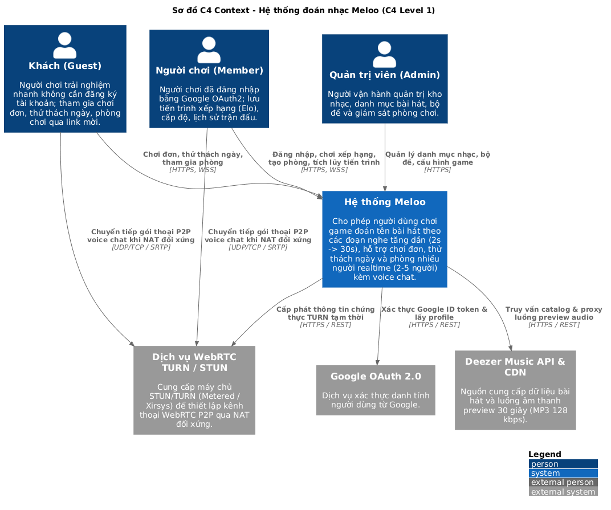
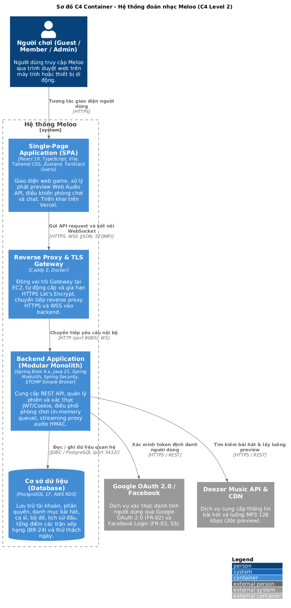
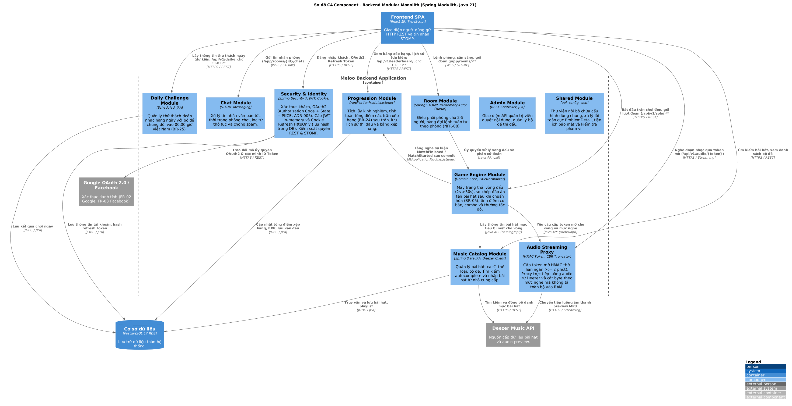
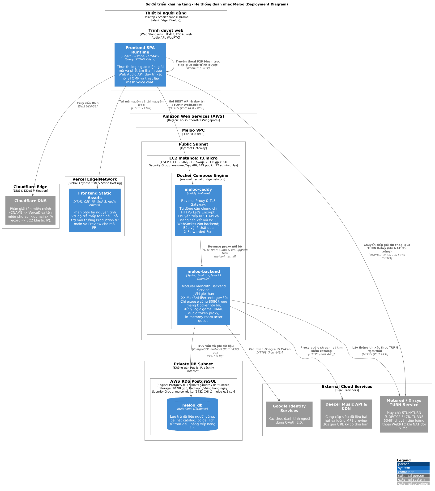

# Tài liệu Kiến trúc Hệ thống Meloo (System Architecture Document)

> **Mã tài liệu:** DOC-04 · **Ticket:** MEL-52  
> **Trạng thái:** Hoàn thành · **Phiên bản:** 1.1 · **Ngày:** 2026-11-01  
> **Phụ thuộc:** ARC-01 (MEL-26), INF-01 (MEL-40)  
> **Tài liệu liên quan:** `docs/srs/01-srs.md` (SRS), `docs/srs/02-business-rules.md` (BR-01..BR-29), `docs/architecture/adr/ADR-001..ADR-008.md`.

---

## 1. Tổng quan Kiến trúc

Meloo là nền tảng web game đoán tên bài hát trực tuyến theo thời gian thực. Mỗi vòng đấu mở dần đoạn preview âm thanh theo các mốc 2 → 5 → 10 → 20 → 30 giây; người chơi đoán càng sớm càng nhận được nhiều điểm. Hệ thống hỗ trợ chế độ chơi đơn (Solo), thử thách hàng ngày (Daily Challenge) và phòng chơi nhiều người trực tiếp (Multiplayer Room 2–5 người) tích hợp tính năng trò chuyện thoại (Voice Chat).

### 1.1. Triết lý Thiết kế Cốt lõi
1. **Server là trọng tài tối cao:** Toàn bộ đáp án bài hát, thuật toán chấm điểm, chuỗi combo và đồng hồ đếm ngược của vòng chơi đều do máy chủ backend quyết định. Tuyệt đối không để lộ thông tin bài hát (tên bài, nghệ sĩ, ID, URL nguồn gốc) qua bất kỳ API response, thông điệp WebSocket hay log hệ thống nào trước khi vòng chơi kết thúc (NFR-07).
2. **Kiến trúc Modular Monolith:** Đóng gói toàn bộ miền nghiệp vụ trong một tiến trình duy nhất sử dụng Spring Modulith (ADR-001). Cấu trúc này tối ưu hóa việc phân chia ranh giới module rõ ràng, loại bỏ chi phí vận hành mạng phức tạp của Microservices, phù hợp với ràng buộc một người phát triển và hạ tầng máy chủ miễn phí (AWS Free Tier 1 GB RAM).
3. **Phát triển theo định hướng Hợp đồng (API-First):** Sử dụng OpenAPI 3.1 cho các giao tiếp RESTful và AsyncAPI 3 cho các kênh thời gian thực STOMP/WebSocket (ADR-002). Mọi thay đổi dữ liệu đều được sinh mã tự động và kiểm thử khớp nối giữa hai đầu Frontend và Backend.
4. **Bảo vệ tài nguyên âm thanh:** Đoạn preview được phân phối qua cơ chế streaming proxy với mã xác thực HMAC ngắn hạn (≤ 2 phút), cắt byte chính xác theo mức nghe tại server để ngăn chặn việc tải trước hoặc nghe gian lận (ADR-008).

### 1.2. Ràng buộc Hệ thống
- **Ngân sách vận hành:** Tối ưu hóa chi phí trong gói miễn phí (AWS Free Tier EC2 t3.micro 1 vCPU, 1 GB RAM và RDS PostgreSQL; Vercel Edge Hosting; Cloudflare DNS).
- **Quy mô phục vụ giai đoạn hiện tại (Phase 1):** Thiết kế phục vụ ổn định tối đa 20 phòng × 5 người chơi đồng thời trên một máy chủ đơn lẻ (NFR-03).
- **Nhân sự phát triển:** Một lập trình viên chính phối hợp cùng các trợ lý trí tuệ nhân tạo (Coding Agents); quy trình kiểm soát mã nguồn tuân thủ nghiêm ngặt ranh giới module để chống xung đột file.

---

## 2. Mô hình Kiến trúc C4 (C4 Architecture Model)

Hệ thống được biểu diễn trực quan qua 3 cấp độ của mô hình C4: Bối cảnh hệ thống (Context), Khối triển khai (Container), và Thành phần module backend (Component).

### 2.1. C4 Level 1: Sơ đồ Bối cảnh (Context Diagram)

Sơ đồ mô tả vị trí của hệ thống Meloo trong mối quan hệ với các nhóm tác nhân người dùng và các hệ thống dịch vụ bên ngoài.

*File PlantUML nguồn:* [`docs/uml/c4/c4-context.puml`](../uml/c4/c4-context.puml)

**Các thành phần chính:**
- **Khách (Guest):** Người chơi không cần tài khoản, có thể trải nghiệm ngay chế độ chơi đơn, thử thách ngày hoặc tham gia phòng bạn bè qua liên kết chia sẻ trong vòng ≤ 30 giây từ khi mở web (NFR-10, NFR-11).
- **Người chơi (Member):** Người dùng đăng nhập qua tài khoản Google OAuth2 (FR-02, S1) hoặc Facebook Login (FR-03, S5); hệ thống lưu trữ tiến trình thi đấu, tích lũy điểm kinh nghiệm (EXP), cấp độ, tổng điểm các trận xếp hạng (BR-24) và lịch sử thi đấu.
- **Quản trị viên (Admin):** Người điều hành quản lý danh mục bài hát, ca sĩ, thể loại, tạo bộ đề thi đấu và kiểm duyệt báo cáo.
- **Nhà cung cấp định danh (Google OAuth 2.0 / Facebook):** Xác thực định danh người dùng an toàn, cấp Authorization Code / ID Token để backend kiểm tra và quản lý tài khoản.
- **Deezer Music API & CDN:** Nhà cung cấp danh mục bài hát và nguồn phát luồng audio preview định dạng MP3 128 kbps (ADR-003, đề xuất).
- **Dịch vụ WebRTC STUN/TURN bên ngoài:** Cung cấp máy chủ STUN và TURN relay (chưa chọn nhà cung cấp chính thức; ví dụ: Metered, Xirsys, Twilio, hoặc Coturn tự host) để thiết lập kênh thoại WebRTC Mesh P2P giữa các người chơi khi bị chặn bởi tường lửa hoặc NAT đối xứng.

---

### 2.2. C4 Level 2: Sơ đồ Khối Container (Container Diagram)

Sơ đồ phân rã hệ thống Meloo thành các container phần mềm độc lập, thể hiện công nghệ và giao thức liên kết.

*File PlantUML nguồn:* [`docs/uml/c4/c4-container.puml`](../uml/c4/c4-container.puml)

**Chi tiết các container:**
1. **Frontend Single-Page Application (SPA):**
   - **Công nghệ:** React 19, TypeScript (strict mode), Vite, Tailwind CSS, shadcn/ui, TanStack Query, Zustand, Web Audio API, STOMP client (@stomp/stompjs).
   - **Nhiệm vụ:** Hiển thị giao diện người dùng, quản lý máy trạng thái vòng chơi tại client, xử lý phát preview chính xác từng phân đoạn thời gian bằng Web Audio API, duy trì kết nối STOMP qua WebSocket và điều khiển kết nối thoại WebRTC P2P Mesh giữa các người chơi trong phòng.
   - **Triển khai:** Lưu trữ và phân phối toàn cầu qua mạng biên Vercel Edge Network.
2. **Reverse Proxy & TLS Gateway (Caddy):**
   - **Công nghệ:** Caddy 2 (chạy trong Docker container trên máy chủ EC2).
   - **Nhiệm vụ:** Điểm đón nhận lưu lượng duy nhất từ Internet vào backend; tự động cấu hình và gia hạn chứng chỉ bảo mật HTTPS (Let's Encrypt); định tuyến các yêu cầu REST API (`/api/**`) và tự động nâng cấp kết nối WebSocket (`/ws`) phục vụ giao thức STOMP; bảo vệ địa chỉ IP thật của máy khách bằng việc gán tiêu đề `X-Forwarded-For`.
3. **Backend Application (Modular Monolith):**
   - **Công nghệ:** Java 21, Spring Boot 4.x, Spring Modulith, Spring Security 7, Spring WebSocket (Simple Broker).
   - **Nhiệm vụ:** Máy chủ ứng dụng xử lý toàn bộ logic nghiệp vụ: xác thực danh tính (JWT & Cookie), điều phối phòng chơi bằng hàng đợi lệnh tuần tự trong bộ nhớ (In-memory room actor queue), tính điểm và combo, so khớp đáp án tên bài hát sau chuẩn hóa (BR-05, TitleNormalizer), proxy luồng âm thanh cắt theo byte CBR qua token HMAC, và chuyển tiếp tín hiệu WebRTC signaling (SDP Offer/Answer, ICE Candidate).
4. **Cơ sở dữ liệu (Database):**
   - **Công nghệ:** PostgreSQL 17 (AWS RDS).
   - **Nhiệm vụ:** Lưu trữ quan hệ có cấu trúc: người dùng, vai trò phân quyền, bảng lưu hash refresh token, kho dữ liệu âm nhạc (bài hát, nghệ sĩ, album, bộ đề), lịch sử các trận đấu, tổng điểm các trận xếp hạng (BR-24) và kết quả thử thách ngày. Cơ chế Flyway quản lý phiên bản migration.

---

### 2.3. C4 Level 3: Sơ đồ Thành phần Backend (Component Diagram)

Sơ đồ thể hiện cấu trúc bên trong của Backend Modular Monolith, phản ánh chính xác các module được đóng gói độc lập theo chuẩn Spring Modulith trong package `com.meloo.*`.

*File PlantUML nguồn:* [`docs/uml/c4/c4-component-backend.puml`](../uml/c4/c4-component-backend.puml)

**Quy ước kiến trúc Spring Modulith áp dụng tại Backend:**
- **Ranh giới module chặt chẽ:** Mỗi miền nghiệp vụ là một package con cấp 1 trực thuộc `com.meloo` (ví dụ `com.meloo.game`, `com.meloo.room`, `com.meloo.audio`).
- **Giao diện công khai (`api/`):** Các module chỉ được phép gọi nhau thông qua các interface hoặc record bất biến nằm trong package con `api/` (được đánh dấu `@NamedInterface("api")`).
- **Sự kiện miền (`events/`):** Giao tiếp bất đồng bộ được thực hiện qua các event record nằm trong package con `events/` do chính module phát sinh sở hữu. Các module khác lắng nghe sự kiện bằng `@ApplicationModuleListener` (chạy sau commit giao dịch để bảo đảm tính nhất quán dữ liệu).
- **Nội bộ bảo mật (`web/`, `persistence/`, `domain/`):** Các controller REST, entity JPA và logic xử lý nội bộ được ẩn hoàn toàn; CI kiểm chứng tự động bằng `ApplicationModules.of(MelooApplication.class).verify()`.

**Các module nghiệp vụ chính:**
- **`identity`:** Quản lý phiên khách vãng lai, xác thực OAuth2 (Google, Facebook) theo chuẩn Authorization Code + State + PKCE (ADR-005), cấp phát và thu hồi JWT Access Token ngắn hạn trong bộ nhớ cùng Cookie Refresh HttpOnly (`SameSite=Lax`), lưu hash refresh token và xoay vòng trong cơ sở dữ liệu.
- **`catalog`:** Quản lý kho bài hát, danh mục ca sĩ, thể loại và bộ đề (playlists); tích hợp adapter tìm kiếm và đồng bộ bài hát từ Deezer API.
- **`audio`:** Dịch vụ streaming proxy audio. Cấp phát token mờ HMAC thời hạn ngắn (≤ 2 phút) cho từng người chơi và mức nghe; thực hiện proxy trực tiếp luồng byte MP3 từ CDN Deezer và cắt độ dài byte dựa trên bitrate danh định 128 kbps (~16 KB/s), đảm bảo máy chủ không tốn dung lượng đĩa và không bị tràn bộ nhớ heap (ADR-008).
- **`game`:** Trọng tâm luật chơi. Điều phối máy trạng thái vòng đấu (mức 2s → 30s), so khớp chuỗi đoán tên bài hát sau chuẩn hóa ký tự Unicode và loại bỏ ký tự phụ (BR-05, `TitleNormalizer`), tính điểm cơ bản, điểm thưởng combo và thưởng tốc độ (BR-01..BR-08).
- **`room`:** Quản lý phòng chờ thi đấu nhiều người (2–5 người). Mỗi phòng vận hành một hàng đợi lệnh đơn luồng trong bộ nhớ (In-memory actor queue) để tuần tự hóa các hành động (sẵn sàng, đổi cài đặt, đoán bài), loại bỏ hoàn toàn hiện tượng tranh chấp điều kiện (Race condition - NFR-08). Xử lý STOMP broker và relay tín hiệu WebRTC.
- **`chat`:** Kênh trao đổi tin nhắn văn bản tức thời trong phòng chơi qua WebSocket STOMP, tích hợp bộ lọc từ cấm và chống spam.
- **`voice`:** Cung cấp thông tin xác thực STUN/TURN tạm thời và điều phối kênh thiết lập cuộc gọi thoại WebRTC mesh giữa các thành viên trong phòng.
- **`progression`:** Lắng nghe sự kiện kết thúc ván đấu (`MatchFinished`, DES-01) để tính toán lại tổng điểm các trận xếp hạng (BR-24), cộng điểm kinh nghiệm, kiểm tra lên cấp và lưu lịch sử trận đấu.
- **`daily`:** Quản lý thử thách đoán nhạc hàng ngày; bộ đề chung cho toàn bộ cộng đồng được đổi vào **00:00 giờ Việt Nam** (BR-25) mỗi ngày.
- **`admin`:** Cung cấp các điểm cuối REST API dành riêng cho quản trị viên nhằm duyệt bài hát, cấu hình hệ thống và quản trị báo cáo vi phạm.
- **`shared`:** Thư viện dùng chung nội bộ chứa cấu hình toàn cục (`config/`), chuẩn hóa xử lý lỗi ProblemDetail RFC 7807 (`web/`), các tiện ích bảo mật và kiểm tra phạm vi (`api/`).

---

## 3. Sơ đồ Triển khai Hạ tầng (Deployment Architecture)

Kiến trúc triển khai vật lý được thiết kế theo mô hình kết hợp giữa Serverless Edge CDN, Containerized Cloud Compute và Managed Database trên AWS (Region: `ap-southeast-1` Singapore).

*File PlantUML nguồn:* [`docs/uml/deployment/deployment.puml`](../uml/deployment/deployment.puml)

### 3.1. Phân tầng Hạ tầng và Luồng Mạng

| Tầng triển khai | Nền tảng / Công nghệ | Vai trò kỹ thuật & Cấu hình |
|---|---|---|
| **Client Layer** | Trình duyệt người dùng (Desktop / Mobile) | Chạy mã nguồn JavaScript/Wasm; giải mã âm thanh Web Audio API; kết nối WSS STOMP; truyền âm thanh WebRTC P2P Mesh (SRTP). |
| **Edge / CDN Layer** | Vercel Edge Network | Phân phối mã nguồn tĩnh (HTML, JS, CSS, sound effects) toàn cầu; tự động deploy bản Production từ nhánh `main` và bản Preview riêng cho mỗi Pull Request. |
| **DNS / Security Layer** | Cloudflare DNS | Quản lý tên miền; thiết lập CNAME trỏ tới Vercel cho frontend và bản ghi A trỏ tới IP máy chủ EC2 cho API (`api.<domain>`); hỗ trợ chống tấn công từ chối dịch vụ (DDoS). |
| **Compute Layer** | AWS EC2 `t3.micro` (Default Subnet) | Máy chủ 1 vCPU, 1 GB RAM, 2 GB Swapfile, 25 GiB gp3 SSD (`aws-setup.md:33,126`). Chạy Docker Compose gồm **Caddy 2** (mở cổng 80, 443) và **Spring Boot Backend** (chỉ mở cổng 8080 trong mạng nội bộ `meloo-internal`). |
| **Database Layer** | AWS RDS PostgreSQL 17 (Default DB Subnet Group) | Cơ sở dữ liệu tên `meloo` (`aws-setup.md:212`); DB subnet group `default`, `Publicly Accessible = No`; chỉ chấp nhận truy cập cổng 5432 từ Security Group của EC2 (`meloo-ec2-sg`); sao lưu tự động hàng ngày. |
| **Voice Relay Layer** | Dịch vụ WebRTC TURN bên ngoài | Máy chủ STUN/TURN (chưa chọn nhà cung cấp chính thức; ví dụ Metered, Xirsys, Coturn) chuyển tiếp các gói thoại WebRTC mã hóa qua UDP/TCP cổng 3478 và TURNS TLS cổng 5349 khi các client nằm sau NAT đối xứng. |

### 3.2. Cấu hình An toàn Mạng (AWS Security Groups)
Theo cấu hình tại script `infra/aws/setup-security-groups.sh`:
- **`meloo-ec2-sg` (Security Group máy chủ ứng dụng):**
  - Inbound: Cho phép TCP cổng 80 và 443 từ mọi nơi (`0.0.0.0/0`).
  - Inbound SSH: Cho phép TCP cổng 22 **duy nhất** từ địa chỉ IP tĩnh của quản trị viên (`MY_IP/32`), tự động dọn sạch các rule SSH cũ để chống quét cổng.
- **`meloo-rds-sg` (Security Group cơ sở dữ liệu):**
  - Inbound: Chỉ cho phép TCP cổng 5432 có nguồn gốc từ chính `meloo-ec2-sg` (`source-group: meloo-ec2-sg`).
  - Public Access: Tắt hoàn toàn (`Publicly Accessible = No`). Nhờ vậy, dù nằm trong Default VPC, cơ sở dữ liệu vẫn được cách ly an toàn khỏi internet. *(Ghi chú: Việc tách riêng VPC độc lập kèm Private Subnet chuyên dụng không có Internet Gateway là hướng cải tiến kiến trúc cho các giai đoạn phát triển sau).*

---

## 4. Lý do Lựa chọn Công nghệ (ADR Synthesis)

Bảng tổng hợp đối chiếu các quyết định kiến trúc quan trọng từ các văn bản ADR trong dự án:

| Mã ADR | Quyết định công nghệ | Phương án đã so sánh | Lý do cốt lõi & Ràng buộc lựa chọn |
|---|---|---|---|
| **ADR-001** | **Modular Monolith với Spring Modulith** (Chấp nhận) | Monolith một khối, không ràng buộc package vs. Microservices vs. **Modular monolith + Spring Modulith** | Phù hợp với năng lực phát triển một người và giới hạn 1 GB RAM của máy chủ EC2 Free Tier; Spring Modulith tự động kiểm tra ranh giới package trong CI (`verify()`), ngăn chặn hai coding agent sửa chồng chéo code. |
| **ADR-002** | **Hợp đồng API-First (OpenAPI 3.1 & AsyncAPI 3)** (Chấp nhận) | Code-first (viết code rồi sinh docs) vs. **Hợp đồng API-First** | Đảm bảo tính nhất quán giữa Backend (Spring Boot) và Frontend (TypeScript); cho phép sinh tự động DTO và fetch client, phục vụ kiểm thử tích hợp và phát triển song song. |
| **ADR-003** | **Nguồn preview nhạc cho Meloo** (Đề xuất) | Deezer vs. iTunes Search + Apple RSS vs. Nguồn audio được cấp phép riêng | Đề xuất **Deezer làm nguồn chính có điều kiện** (MP3 128 kbps, tiết kiệm 50% băng thông so với iTunes AAC 268 kbps; URL có chữ ký hết hạn; có API chart/playlist để nhập hàng loạt). Đề xuất **iTunes làm dự phòng kỹ thuật tắt mặc định**. *(Ghi chú: LEG-02 kết luận "Chưa được phép"; Thái (PO) quyết định dùng Deezer và tự chấp nhận rủi ro theo ngoại lệ ngày 2026-10-28; quyết định vận hành chờ hoàn tất xác nhận quyền trước beta).* |
| **ADR-004** | **Realtime bằng STOMP qua WebSocket** (Chấp nhận) | Polling REST vs. Server-Sent Events (SSE) vs. WebSocket thuần vs. **STOMP trên WebSocket (Spring simple broker)** | STOMP cung cấp sẵn mô hình Pub/Sub (Topic cho phòng, Queue cho người dùng riêng), dễ dàng tích hợp xác thực tại frame CONNECT của Spring Security; AsyncAPI đặc tả được toàn bộ sự kiện. |
| **ADR-005** | **Xác thực JWT in-memory + Cookie Refresh HttpOnly** (Chấp nhận) | Token lưu LocalStorage vs. Session Stateful phía server vs. **JWT access token ngắn hạn trong bộ nhớ + Refresh token trong cookie HttpOnly** | Access Token lưu trong bộ nhớ JavaScript của SPA chống tấn công XSS; Refresh Token lưu trong Cookie `HttpOnly`, `SameSite=Lax`, `Secure` cùng site với API giúp chống CSRF. Lưu hash refresh token trong DB, hỗ trợ xoay vòng (rotation) và thu hồi theo family để chống lộ token (`ADR-005:13,17`). |
| **ADR-006** | **Hạ tầng Vercel (FE) + EC2/RDS (BE) + Cloudflare** (Chấp nhận) | Tất cả trên một VPS vs. PaaS nguyên khối (Render, Railway, Fly) vs. **Vercel (frontend) + EC2 (backend) + RDS (PostgreSQL) + tên miền riêng** | Vercel hỗ trợ preview từng PR và CDN toàn cầu; EC2 duy trì kết nối WebSocket liên tục không bị ngắt quãng do sleep; RDS tách biệt an toàn dữ liệu; dùng trọn vẹn AWS Free Tier. |
| **ADR-007** | **Trạng thái phòng trong bộ nhớ + Hàng đợi tuần tự** (Chấp nhận) | DB và khóa bi quan (`SELECT … FOR UPDATE`) vs. In-memory và khóa Java (`synchronized`, ConcurrentHashMap) vs. **In-memory actor / Single-threaded queue theo phòng** | Giảm thiểu I/O đĩa và độ trễ mạng trong trận đấu; mỗi phòng xử lý lệnh qua một hàng đợi tuần tự đảm bảo loại trừ triệt để race condition khi nhiều người đoán đồng thời. Khi vượt ngưỡng 20 phòng × 5 người hoặc cần mở rộng ngang nhiều máy chủ sẽ chuyển sang Redis Pub/Sub (Phase 2, P2-06). |
| **ADR-008** | **Chống gian lận audio: Streaming proxy + HMAC Token** (Chấp nhận) | Trả thẳng URL preview của nhà cung cấp vs. Cấp URL cố định theo bài nhưng cắt sẵn đoạn vs. **Streaming proxy + token mờ HMAC ngắn hạn khống chế byte CBR** | Bảo mật tuyệt đối đáp án: URL không chứa tên bài hay trackId; token HMAC hết hạn ngắn (≤ 2 phút); backend làm streaming proxy khống chế byte CBR tương ứng từng mức nghe (2s..30s), ngăn người chơi tua trước hoặc nghe lén. |

---

## 5. Chiến thuật Kiến trúc cho Yêu cầu Phi chức năng (NFR Tactics)

Kiến trúc Meloo được thiết kế với các chiến thuật chuyên biệt nhằm đáp ứng các yêu cầu phi chức năng cốt lõi (Bảo mật, Hiệu năng, Khả năng mở rộng, Sẵn sàng & Phục hồi) cùng các tiêu chuẩn trải nghiệm người chơi được đặc tả trong SRS (`docs/srs/01-srs.md`).

### 5.1. Chiến thuật Bảo mật (Security Tactics - NFR-05, NFR-07)
1. **Phòng chống lộ đáp án (Anti-cheating & Zero-Knowledge Client - NFR-07):**
   - Đáp án đúng và metadata bài hát được giấu kín hoàn toàn trong đối tượng `Round` tại backend.
   - Endpoint phát âm thanh sử dụng đường dẫn mờ: `/api/v1/audio/{token}`. Chuỗi token là mã băm HMAC-SHA256 của bộ tứ `(roundId, playerId, level, expiresAt)`. Backend xác thực chữ ký bằng hàm so sánh hằng số thời gian `MessageDigest.isEqual` để triệt tiêu tấn công định thời (Timing Attack).
   - Nhật ký truy cập Tomcat (Access Log ra stdout) được định dạng lại với mẫu `%m` thay cho `%r` (`SERVER_TOMCAT_ACCESSLOG_PATTERN=%{X-Forwarded-For}i %h %t "%m" %s`) để ngăn chặn việc ghi vết token vào log máy chủ (MEL-127).
2. **Bảo vệ danh tính và phiên làm việc (Authentication & Authorization - NFR-05):**
   - Ngăn chặn XSS: Access Token chỉ tồn tại trong bộ nhớ JavaScript (Zustand state), mất đi khi đóng tab.
   - Ngăn chặn CSRF: Refresh Token đặt trong Cookie có cờ `HttpOnly`, `Secure`, và `SameSite=Lax`. Lưu hash refresh token trong DB và xoay vòng theo family (ADR-005).
   - Bảo mật WebSocket: Frame `CONNECT` được chặn bởi `ChannelInterceptor` để kiểm tra tính hợp lệ của JWT. Người dùng chỉ được phép subscribe vào topic phòng (`/topic/rooms/{roomId}/**`) khi đã là thành viên chính thức của phòng đó.
3. **Cách ly hạ tầng mạng (Network Hardening - NFR-05):**
   - Cơ sở dữ liệu RDS đặt ở chế độ `Publicly Accessible = No`, chỉ nhận kết nối TCP 5432 từ Security Group của EC2.
   - Container Backend Spring Boot chỉ lắng nghe trong mạng bridge nội bộ Docker `meloo-internal`, không mở cổng trực tiếp ra host (chống bypass reverse proxy).
   - Caddy làm nhiệm vụ ép buộc HTTPS thông qua tiêu đề `Strict-Transport-Security (HSTS)` và thiết lập các tiêu đề phòng thủ `X-Content-Type-Options: nosniff`, `X-Frame-Options: DENY`.

### 5.2. Chiến thuật Hiệu năng (Performance Tactics - NFR-01, NFR-02, NFR-04, NFR-12)
1. **Streaming Proxy Audio tối ưu tài nguyên (Low Footprint Streaming - NFR-01):**
   - Backend đóng vai trò proxy chuyển tiếp luồng dữ liệu byte trực tiếp từ Deezer CDN đến trình duyệt người dùng mà không tải toàn bộ file MP3 vào bộ nhớ đệm RAM (Heap) và không ghi tạm xuống ổ cứng.
   - Giới hạn thời lượng nghe bằng cách ngắt luồng byte theo công thức ước tính bitrate CBR 128 kbps (~16 KB/giây: 2s ≈ 32 KB, 5s ≈ 80 KB, 10s ≈ 160 KB, 20s ≈ 320 KB, 30s ≈ 480 KB). Không sử dụng các tiến trình chuyển mã (re-encoding) nặng nề như FFmpeg, giữ mức chiếm dụng CPU cực thấp.
2. **Loại bỏ I/O đĩa trong trận đấu (Zero-Disk I/O In-Game - NFR-01, NFR-02):**
   - Toàn bộ trạng thái phòng chơi, vòng đấu, điểm số người chơi và đồng hồ đếm ngược được duy trì hoàn toàn trong RAM máy chủ (In-memory state).
   - Chỉ tương tác với cơ sở dữ liệu PostgreSQL ở thời điểm khởi tạo trận (đọc danh sách bài hát) và khi kết thúc trận đấu (ghi nhận kết quả, điểm xếp hạng). Thiết kế này hướng tới mục tiêu độ trễ phản hồi sự kiện STOMP < 200 ms (NFR-02, đo bằng k6 WebSocket) và tốc độ API p95 < 300 ms (NFR-01, đo bằng Actuator và k6).
3. **Tải trước âm thanh phát nhanh (Audio Preloading - NFR-04):**
   - Trong pha chuẩn bị vòng chơi (`ROUND_PREPARE`, thời gian tối đa `timeoutMs` theo `contracts/asyncapi.yaml`), frontend chủ động gọi endpoint audio proxy để nạp sẵn dữ liệu đệm ban đầu vào Web Audio API rồi gửi tin nhắn báo đã sẵn sàng (`/app/rooms/{roomId}/prepared`). Nhờ đó, âm thanh phát ra < 1 s ngay sau khi vòng chính thức bắt đầu (NFR-04, kiểm chứng qua E2E Playwright).
4. **Tối ưu hóa thời gian tải trang ban đầu (Frontend Speed - NFR-12):**
   - Sử dụng Vite để code-splitting theo route, tree-shaking và nén tài nguyên tối đa.
   - Toàn bộ tài nguyên tĩnh và hiệu ứng âm thanh (sound effects UI) được phân phối qua Vercel Global Anycast CDN, hướng tới mục tiêu chỉ số LCP trang chủ ≤ 2,5 s trên mạng di động (NFR-12, đo bằng Lighthouse).

### 5.3. Chiến thuật Khả năng Mở rộng (Scalability Tactics - NFR-03)
1. **Định hình hiện tại (Phase 1):**
   - Hệ thống được tinh chỉnh để phục vụ ổn định tối đa mục tiêu **20 phòng × 5 người cùng lúc** (tổng cộng 100 kết nối WebSocket đồng thời) trên một máy chủ EC2 t3.micro (1 GB RAM) (NFR-03, kiểm thử tải ở QA-03).
   - Tham số máy ảo Java được cấu hình nghiêm ngặt: `-XX:MaxRAMPercentage=60 -XX:+ExitOnOutOfMemoryError` để ngăn ngừa hiện tượng JVM chiếm dụng bộ nhớ vật lý dẫn đến tình trạng bị nhân Linux ép dừng (OOM Killer). Bổ sung 2 GB swapfile làm vùng đệm an toàn.
2. **Lộ trình Mở rộng Tương lai (Phase 2 - P2-06):**
   - **Tách dịch vụ Streaming Audio:** Bóc tách module `audio` thành Cloudflare Workers hoặc AWS Lambda proxy độc lập để giải phóng toàn bộ băng thông và kết nối mạng cho máy chủ chính.
   - **Mở rộng ngang trạng thái phòng (Multi-instance Game Cluster):** Thay thế hàng đợi in-memory nội bộ bằng Redis Pub/Sub và Redis Hash để phân tán các phòng chơi qua nhiều máy chủ backend đằng sau một Network Load Balancer (NLB).
   - **Chuyển đổi Spring Modulith sang Microservices:** Nhờ sự phân tách module chặt chẽ thông qua giao diện `api/` và sự kiện `events/`, các module có tải đọc lớn như `catalog` hoặc module tính toán nặng như `game` có thể được tách thành các dịch vụ độc lập mà không cần tái cấu trúc mã nguồn nghiệp vụ.

### 5.4. Chiến thuật Sẵn sàng và Phục hồi (Availability & Resilience Tactics - NFR-08, NFR-14, NFR-15)
1. **Tuần tự hóa phòng chơi chống xung đột (Single-Threaded Room Queue - NFR-08):**
   - Mỗi phòng chơi được gán một bộ điều phối tác vụ tuần tự trong bộ nhớ (In-memory actor / command queue). Các hành vi xảy ra đồng thời (ví dụ: hai người chơi cùng bấm đoán vào mili-giây thứ 44.990) được xếp hàng và xử lý tuần tự, loại bỏ hoàn toàn hiện tượng deadlock và sai lệch trạng thái.
2. **Dung thứ mất kết nối mạng tạm thời (Disconnection Grace Period - BR-14):**
   - Khi người chơi mất kết nối WebSocket, máy chủ duy trì trạng thái chờ trong **30 giây**.
   - Nếu kết nối lại kịp trong 30 giây, client sẽ nhận được gói tin đồng bộ trạng thái đầy đủ (`SNAPSHOT`). Người chơi tiếp tục tham gia ván đấu, nhưng vòng chơi bị lỡ trong thời gian ngắt kết nối sẽ nhận 0 điểm (BR-14). Nếu quá 30 giây không kết nối lại, hệ thống sẽ coi như người chơi rời phòng.
3. **Cơ chế phục hồi tiến trình máy chủ (Process Resilience):**
   - Container backend cấu hình `-XX:+ExitOnOutOfMemoryError` kết hợp cùng chính sách Docker `restart: unless-stopped` (`docker-compose.prod.yml`), giúp Docker tự khởi động lại container khi tiến trình JVM bị chết hoặc thoát do OOM.
   - Điểm cuối Spring Boot Actuator readiness probe (`/actuator/health/readiness`) phục vụ giám sát và kiểm tra sẵn sàng khi deploy trong `deploy-ec2.sh`. *(Lưu ý: Docker mặc định không restart container khi unhealthy; việc tự khởi động lại khi ứng dụng bị bế tắc / treo luồng là hướng cải tiến tương lai qua autoheal/watchdog).*
4. **Mục tiêu Giám sát Sẵn sàng & Khôi phục Thảm họa (NFR-14, NFR-15):**
   - **Độ sẵn sàng ≥ 99% (NFR-14):** Giám sát liên tục trong đợt beta bằng UptimeRobot thăm dò định kỳ endpoint `/actuator/health` của backend và URL chính của frontend Vercel.
   - **RPO ≤ 24 giờ:** Dữ liệu người dùng và lịch sử đấu trên RDS được sao lưu tự động hàng ngày (Automated Backups kèm Point-in-Time Recovery). Trong trường hợp toàn bộ cơ sở dữ liệu bị hỏng, tổn thất dữ liệu tối đa là 24 giờ.
   - **RTO ≤ 1 giờ:** Toàn bộ quy trình dựng lại hạ tầng máy chủ EC2, cấu hình Caddy và triển khai mã nguồn đã được tự động hóa qua script `infra/aws/setup-ec2.sh` và `infra/compose/deploy-ec2.sh`, cho phép khôi phục toàn bộ dịch vụ hoạt động trong vòng chưa đầy 1 giờ.
   - **Khởi động lại giữa trận:** Do trạng thái phòng nằm trong bộ nhớ (ADR-007), nếu máy chủ backend khởi động lại, các trận đấu đang diễn ra sẽ bị hủy bỏ an toàn mà không làm sai lệch hay hỏng hóc cơ sở dữ liệu PostgreSQL.

### 5.5. Tóm tắt các Tiêu chuẩn Trải nghiệm & Chất lượng (NFR-06, NFR-09, NFR-10, NFR-11, NFR-13)
- **NFR-06 (Tương thích):** Hỗ trợ các trình duyệt hiện đại (Chrome, Edge, Safari, Firefox) và kích thước màn hình từ 360px (kiểm chứng bằng Playwright).
- **NFR-09 (Chất lượng mã nguồn):** Duy trì độ bao phủ kiểm thử domain ≥ 80%; kiểm tra tính toàn vẹn kiến trúc Spring Modulith qua `ApplicationModulesTest` trong CI.
- **NFR-10 (Người mới vào chơi):** Khách chơi được ngay không cần đăng ký tài khoản; thời gian từ lúc mở web đến khi nghe đoạn nhạc đầu tiên ≤ 30 giây.
- **NFR-11 (Vào phòng bằng link):** Mở link mời đến khi hiển thị sảnh chờ ≤ 3 s (p95, mạng 4G giả lập, kiểm bằng Playwright).
- **NFR-13 (Khả năng tiếp cận):** Hỗ trợ điều khiển hoàn toàn bằng bàn phím cho các thao tác chính (đoán, nghe thêm, bỏ qua, sẵn sàng); độ tương phản màu chữ đạt chuẩn WCAG 2.1 AA (kiểm bằng axe trong Playwright).

---

## 6. Câu hỏi Bảo vệ Đồ án (Defense Questions)

Dưới đây là các câu hỏi trọng tâm hội đồng phản biện có thể chất vấn về kiến trúc hệ thống, kèm câu trả lời kỹ thuật ngắn gọn:

1. **Tại sao Meloo chọn kiến trúc Modular Monolith thay vì Microservices ngay từ đầu?**
   - *Trả lời:* Đồ án có phạm vi thời gian ngắn, do một người phát triển chính cùng hai coding agent và triển khai trên hạ tầng miễn phí (AWS EC2 1 GB RAM). Microservices sẽ làm bùng nổ chi phí mạng, trễ giao tiếp giữa các dịch vụ, phức tạp hóa việc quản lý distributed transaction và vượt quá dung lượng RAM cho phép. Spring Modulith giúp đạt được sự phân tách ranh giới nghiệp vụ chặt chẽ, kiểm soát phụ thuộc tự động qua CI, nhưng vẫn chạy trong một tiến trình duy nhất cực kỳ nhẹ nhàng và dễ dàng bóc tách dịch vụ khi cần mở rộng ở giai đoạn sau.

2. **Làm thế nào hệ thống đảm bảo nguyên tắc "Server là trọng tài" và ngăn chặn người chơi gian lận bằng cách soi Network Tab?**
   - *Trả lời:* Tên bài hát và ca sĩ tuyệt đối không được trả về client trước khi vòng đấu kết thúc. Trình duyệt chỉ nhận được một URL audio ẩn danh chứa mã băm HMAC có thời hạn ≤ 2 phút (`/api/v1/audio/{token}`). Backend làm streaming proxy chỉ truyền số lượng byte tương ứng đúng thời lượng mở khóa (ví dụ 32 KB cho 2s), từ chối header `Range` vượt mức. Do đó, người chơi soi Network Tab cũng không thấy tên bài và không thể tua để nghe trước đoạn sau.

3. **Cơ chế xử lý khi có hai người chơi cùng đoán tên bài hát vào mili-giây cuối cùng của vòng đấu?**
   - *Trả lời:* Mọi thao tác trong phòng chơi đều được đưa vào một hàng đợi lệnh tuần tự duy nhất của phòng đó trong bộ nhớ (Single-threaded in-memory command queue). Server sẽ lần lượt lấy lệnh ra xử lý và đối chiếu thời điểm server nhận lệnh với mốc thời gian 45.000 ms của vòng (BR-07). Lệnh nào đến trước được xử lý trước; không có hiện tượng race condition hay ghi đè điểm số không nhất quán.

4. **Tại sao lại lưu trữ trạng thái phòng trong bộ nhớ (In-memory) thay vì Redis hay Database? Rủi ro mất dữ liệu được xử lý thế nào?**
   - *Trả lời:* Game đoán nhạc yêu cầu độ phản hồi cực nhanh (< 200 ms cho sự kiện STOMP) để tạo cảm giác hồi hộp. Việc ghi nhận từng mili-giây và lượt đoán vào DB/Redis sẽ tạo nút thắt cổ chai về I/O. Trạng thái phòng chơi chỉ là dữ liệu tạm thời (ephemeral) trong thời gian trận đấu diễn ra (~5-10 phút). Khi trận đấu kết thúc, kết quả tổng và điểm xếp hạng mới được ghi bền vững vào PostgreSQL. Nếu server sập giữa trận, ván đấu đó bị hủy an toàn; người chơi chỉ cần tạo phòng mới, dữ liệu xếp hạng và tài khoản trước đó hoàn toàn không bị ảnh hưởng.

5. **Giải pháp nào giúp hệ thống chạy ổn định chỉ với 1 GB RAM trên AWS EC2 t3.micro?**
   - *Trả lời:* Hệ thống áp dụng 4 chiến thuật kết hợp: (1) Cấu hình JVM `-XX:MaxRAMPercentage=60` giới hạn bộ nhớ heap tối đa khoảng 600 MB; (2) Tạo 2 GB swapfile dự phòng để hệ điều hành không kích hoạt OOM killer khi bộ nhớ tăng đột biến; (3) Streaming proxy audio chuyển tiếp byte trực tiếp mà không tải toàn bộ file MP3 vào RAM; (4) Sử dụng Caddy Alpine siêu nhẹ thay vì Nginx cồng kềnh, tự động nén dữ liệu và quản lý TLS.
