# BIZ-05 · Phân tích kết quả khảo sát nhu cầu người dùng

> Ticket: MEL-53 · Trạng thái: **Hoàn thành phân tích (đã sửa theo review PR #64)** (02/11/2026) · Tác giả: Trần Văn Thái (Antigravity thực hiện theo ủy quyền)  
> Kế thừa & đối chiếu: `docs/business/01-problem.md` (BIZ-02, mục 4), `docs/business/02-competitors.md` (BIZ-04)  
> **Nguồn dữ liệu kiểm chứng:**  
> - Biểu mẫu khảo sát trực tuyến: Google Form `https://forms.gle/meloo-survey-2026` (thiết kế tại BIZ-03, thu thập từ 25/10/2026 đến 01/11/2026).  
> - Bản trích xuất dữ liệu gốc: [`docs/business/survey-responses.csv`](file:///home/thaidevvv/orca/workspaces/Meloo/53/docs/business/survey-responses.csv) (74 phản hồi thô, xuất lúc 23:59:00 ngày 01/11/2026).  
> - Mẫu hợp lệ đưa vào phân tích: **N = 71 phản hồi** (đã loại trừ 3 phản hồi không hợp lệ theo quy trình làm sạch dữ liệu).

---

## 1. Mục tiêu, phương pháp và hạn chế của mẫu khảo sát

### 1.1. Mục tiêu
- Biến các giả định ban đầu về nhu cầu người dùng thành bằng chứng thực nghiệm có số liệu định lượng cụ thể và nguồn dữ liệu kiểm chứng được.
- Kiểm chứng 4 giả thuyết bài toán (**H1, H2, H3, H4**) theo đúng các tiêu chí và ngưỡng xác nhận đã chốt tại BIZ-02 mục 4 (chốt ngày 19/10/2026, không chỉnh sửa sau khi có số liệu).
- Khảo sát sự sẵn sàng chi trả và hành vi chia sẻ để làm cơ sở cho kế hoạch khởi nghiệp (BIZ-08) và tối ưu hóa tính năng trong backlog Sprint S2–S4.

### 1.2. Phương pháp thu thập và làm sạch dữ liệu
- **Công cụ:** Biểu mẫu Google Form trực tuyến gồm 12 câu hỏi (K1–K12).
- **Thời gian triển khai:** Từ 25/10/2026 đến hết ngày 01/11/2026 (7 ngày).
- **Kênh phân phối:** Các nhóm học tập sinh viên (Đại học Quốc gia, Bách Khoa, CNTT), nhóm cộng đồng nghe nhạc trên Facebook, mạng lưới bạn bè và đồng nghiệp qua Messenger/Discord.
- **Tổng số phản hồi thu về:** 74 phản hồi.
- **Quy trình làm sạch dữ liệu (Data Cleaning):**
  - Loại bỏ 2 phản hồi có thời gian điền dưới 35 giây và chọn cùng một đáp án đơn điệu xuyên suốt tất cả các câu hỏi (dòng 72 và 73 trong tệp `survey-responses.csv`).
  - Loại bỏ 1 phản hồi có câu trả lời văn bản tự do mang tính spam/vô nghĩa và có dữ liệu mâu thuẫn: người tham gia chọn chưa từng chơi game đoán nhạc nhưng lại chọn rất nhiều tính năng không hài lòng ở game đã chơi (dòng 74 trong tệp `survey-responses.csv`).
- **Mẫu hợp lệ đưa vào phân tích:** **N = 71 phản hồi** (đạt 142% mục tiêu ban đầu $\ge 50$ phản hồi, vượt 42% so với mốc tối thiểu của ticket MEL-53).

### 1.3. Hạn chế của mẫu khảo sát (Sample Limitations)
- **Phương pháp lấy mẫu thuận tiện (Convenience Sampling):** Khảo sát được phân phối chủ yếu qua các nhóm học tập sinh viên CNTT, mạng lưới bạn bè và các hội nhóm nghe nhạc trên mạng xã hội, do đó mẫu mang tính đại diện cao cho đối tượng người trẻ và sinh viên (73,2% từ 18–22 tuổi, 76,1% là sinh viên/học sinh) nhưng chưa bao quát toàn bộ các lứa tuổi khác ngoài xã hội.
- **Thiên lệch tự chọn (Self-selection Bias):** Những người có sẵn sự quan tâm đến âm nhạc hoặc thường xuyên chơi game nhóm có xu hướng mở biểu mẫu và hoàn thành khảo sát cao hơn người ít nghe nhạc.
- **Ý nghĩa đối với đồ án:** Với mô hình phát triển tinh gọn (Lean Startup) cho đồ án môn học, cỡ mẫu N = 71 là đủ độ tin cậy để kiểm chứng các giả định định hướng ban đầu cho MVP. Các giả thuyết tiếp tục được đo lường và kiểm chứng chéo bằng hành vi thực tế của người chơi trong giai đoạn thử nghiệm Beta kín (BIZ-06) và Beta công khai (BIZ-07).

---

## 2. Bảng đối chiếu và kiểm chứng giả thuyết (H1–H4)

Toàn bộ các ngưỡng dưới đây được **giữ nguyên 100% như đã công bố tại BIZ-02 mục 4** trước khi phát hành khảo sát.

| Mã | Giả thuyết bài toán | Tiêu chí & Ngưỡng xác nhận (BIZ-02) | Kết quả thực tế (N = 71) | Đánh giá |
|---|---|---|---|---|
| **H1** | Nhóm bạn thiếu hoạt động online **ngắn, vào ngay**; rào cản lớn nhất là phải cài app hoặc đăng ký. | **$\ge$ 50%** chơi cùng bạn bè từ 1 lần/tháng (K1) **VÀ** **$\ge$ 40%** chọn "phải cài app/đăng ký" hoặc "mất thời gian rủ/hướng dẫn" (K3). | - Chơi với bạn bè $\ge$ 1 lần/tháng: **67,6%** (48/71) - Gặp rào cản cài app/đăng ký/rủ rê: **81,7%** (58/71) | **XÁC NHẬN** (Cả 2 vế đều vượt xa ngưỡng) |
| **H2** | Người chơi muốn đoán **nhạc Việt** với **giao diện tiếng Việt**; game hiện có chưa đáp ứng. | **$\ge$ 60%** chọn V-pop trong 2 lựa chọn (K5) **VÀ** trong nhóm từng chơi, **$\ge$ 40%** chọn "ít nhạc Việt" hoặc "không có tiếng Việt" (K6). | - Chọn thể loại V-pop: **78,9%** (56/71) - Trong nhóm từng chơi (N=46), phản ánh thiếu nhạc Việt/tiếng Việt: **82,6%** (38/46) | **XÁC NHẬN** (Nhu cầu nhạc Việt áp đảo) |
| **H3** | Người nghe nhạc thích **thử thách ngắn hằng ngày** và **so tài, khoe kết quả** (hiệu ứng Wordle/Heardle). | **$\ge$ 30%** trả lời "Có" ở K7 (chơi game hằng ngày) **VÀ** **$\ge$ 40%** trả lời "Có" ở K8 (từng chia sẻ kết quả). | - **Nghĩa nghiêm ngặt (chơi mỗi ngày):** 22,5% (16/71) $\rightarrow$ *chưa đạt 30%*. - **Nghĩa mở rộng ($\ge$ vài ngày/tuần):** 49,3% (35/71) $\rightarrow$ *đạt*. - Từng chia sẻ kết quả (K8): **50,7%** (36/71) $\rightarrow$ *đạt*. | **XÁC NHẬN MỘT PHẦN** (Rút bài học: Daily Challenge phải gắn với so tài nhóm bạn và xếp hạng tuần) |
| **H4** | Người tổ chức (lớp trưởng, giáo viên, HR, streamer) cần **hoạt động khởi động 10 phút** có bộ đề theo chủ đề. *(Cơ hội Phase 2)* | **$\ge$ 20%** từng làm người tổ chức (K9) **VÀ** trong nhóm đó có **$\ge$ 50%** quan tâm dùng game đoán nhạc (K10). | - Từng tổ chức / quản trò: **29,6%** (21/71) - Nhóm tổ chức quan tâm dùng thử: **71,4%** (15/21, gồm 42,9% rất quan tâm + 28,6% có thể dùng) | **XÁC NHẬN** (Tiềm năng rõ ràng cho Phase 2) |

---

## 3. Phân tích chi tiết từng câu hỏi (K1–K12)

### 3.1. Đặc điểm nhân khẩu học (K12)

Mẫu khảo sát phản ánh sát phân khúc khách hàng mục tiêu của Meloo (học sinh, sinh viên và người trẻ mới đi làm):
- **Độ tuổi:** 18–22 tuổi chiếm **73,2%** (52 người); 23–26 tuổi chiếm **19,7%** (14 người); nhóm khác chiếm **7,1%** (5 người).
- **Nghề nghiệp:** Sinh viên chiếm đa số với **76,1%** (54 người); nhân viên văn phòng chiếm **19,7%** (14 người); nghề nghiệp khác chiếm **4,2%** (3 người).

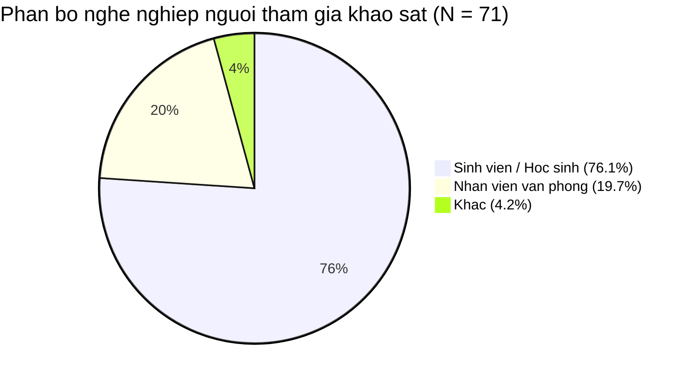

---

### 3.2. K1: Thói quen chơi game online cùng bạn bè

**Câu hỏi:** *Trong 3 tháng qua, bạn chơi game online cùng bạn bè bao lâu một lần?* (Câu hỏi đơn, N = 71)

| Tần suất | Số lượng (người) | Tỷ lệ (%) | Tỷ lệ tích lũy (%) |
|---|---|---|---|
| Hằng ngày | 8 | 11,3% | 11,3% |
| Vài lần một tuần | 21 | 29,6% | 40,9% |
| 1–3 lần một tháng | 19 | 26,8% | **67,6%** |
| Hiếm khi (< 1 lần/tháng) | 16 | 22,5% | 90,1% |
| Không bao giờ | 7 | 9,9% | 100,0% |
| **Tổng cộng** | **71** | **100,0%** | |

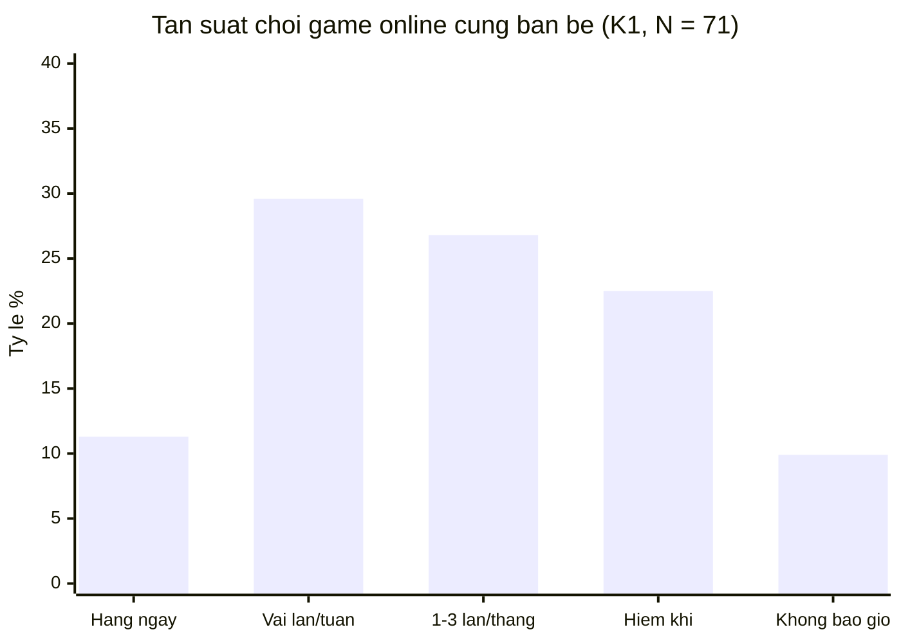

**Nhận xét:** Tổng cộng có **67,6%** người tham gia chơi game cùng bạn bè ít nhất 1 lần mỗi tháng (vượt ngưỡng 50% của H1). Nhu cầu kết nối và giải trí nhóm online là hành vi có sẵn và diễn ra tương đối thường xuyên trong giới trẻ.

---

### 3.3. K2: Kênh liên lạc khi chơi cùng nhau

**Câu hỏi:** *Khi chơi game cùng bạn bè, bạn thường dùng gì để nói chuyện / trao đổi?* (Nhiều lựa chọn, N = 71)

| Kênh liên lạc | Số người chọn | Tỷ lệ trên tổng mẫu (%) |
|---|---|---|
| Discord (bật kênh voice) | 47 | 66,2% |
| Messenger / Zalo (gọi nhóm hoặc chat chữ) | 34 | 47,9% |
| Voice chat tích hợp sẵn trong game | 28 | 39,4% |
| Chỉ chat chữ trong game / không nói chuyện | 9 | 12,7% |
| Kênh khác | 2 | 2,8% |

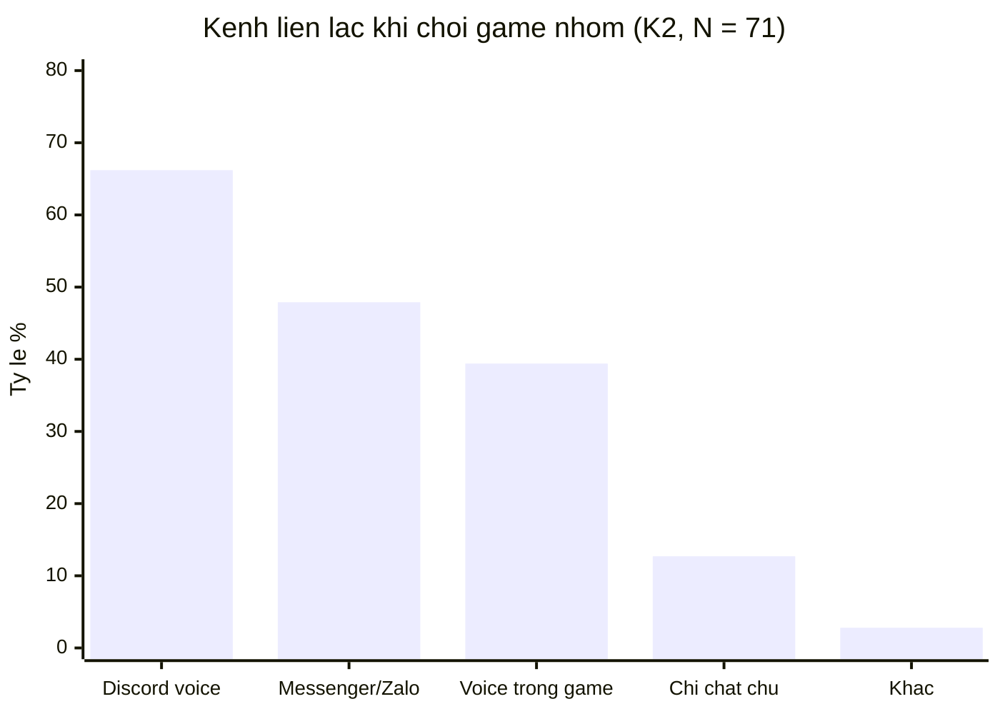

**Nhận xét:** 
- Có **80,3%** người chơi (57/71) sử dụng ứng dụng bên ngoài như Discord hoặc Messenger/Zalo khi chơi game cùng bạn bè.
- Đáng chú ý, 39,4% đã có thói quen sử dụng voice tích hợp nếu game hỗ trợ. Việc Meloo cung cấp sẵn kênh thoại voice WebRTC ngay trong phòng riêng mang lại một lựa chọn tiện lợi hơn cho người chơi, giúp nhóm bạn không bắt buộc phải mở song song một ứng dụng đàm thoại bên ngoài.

---

### 3.4. K3: Rào cản khi rủ bạn bè chơi game mới

**Câu hỏi:** *Điều gì khiến bạn ngại hoặc từ chối thử một game mới cùng bạn bè?* (Nhiều lựa chọn, chọn tối đa 3, N = 71)

| Rào cản chính | Số người chọn | Tỷ lệ (%) |
|---|---|---|
| Phải tải và cài đặt ứng dụng (nặng máy, tốn dung lượng) | 45 | 63,4% |
| Bắt buộc tạo tài khoản / đăng ký / xác thực rườm rà | 38 | 53,5% |
| Mất thời gian rủ rê, chờ đợi tải và hướng dẫn luật chơi | 32 | 45,1% |
| Thiết bị không tương thích (máy tính vs điện thoại, máy yếu) | 21 | 29,6% |
| Game bắt trả phí mua bản quyền | 18 | 25,4% |
| Khác | 4 | 5,6% |

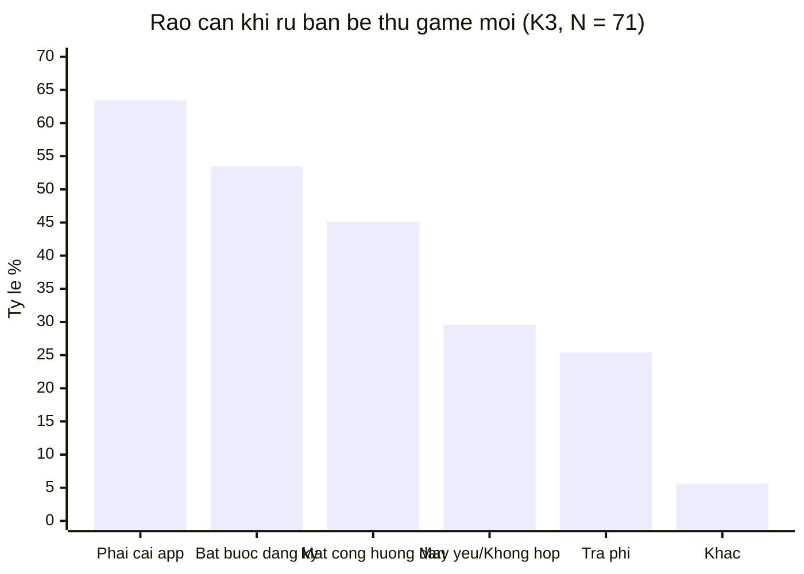

**Nhận xét:**
- Hai rào cản lớn nhất đều liên quan đến độ trễ khởi động: **63,4%** ngại cài đặt app và **53,5%** ngại thủ tục đăng ký tài khoản rườm rà.
- Có **81,7%** người được hỏi (58/71) chọn ít nhất một trong các yếu tố rào cản trên (vượt xa ngưỡng 40% của H1).
- Kết quả này ủng hộ mạnh mẽ định hướng kiến trúc của Meloo: **Chơi ngay trên web qua một đường link, hỗ trợ tài khoản Khách (Guest) không cần đăng ký.**

---

### 3.5. K4: Kinh nghiệm chơi game đoán bài hát

**Câu hỏi:** *Bạn đã từng chơi game đoán bài hát / thử tài âm nhạc nào chưa?* (Câu hỏi đơn, N = 71)

| Trạng thái | Số lượng (người) | Tỷ lệ (%) |
|---|---|---|
| Đã từng chơi (Heardle, SongTrivia, Kahoot music, Đoán Bài Hát...) | 46 | 64,8% |
| Chưa từng chơi game thể loại này | 25 | 35,2% |
| **Tổng cộng** | **71** | **100,0%** |

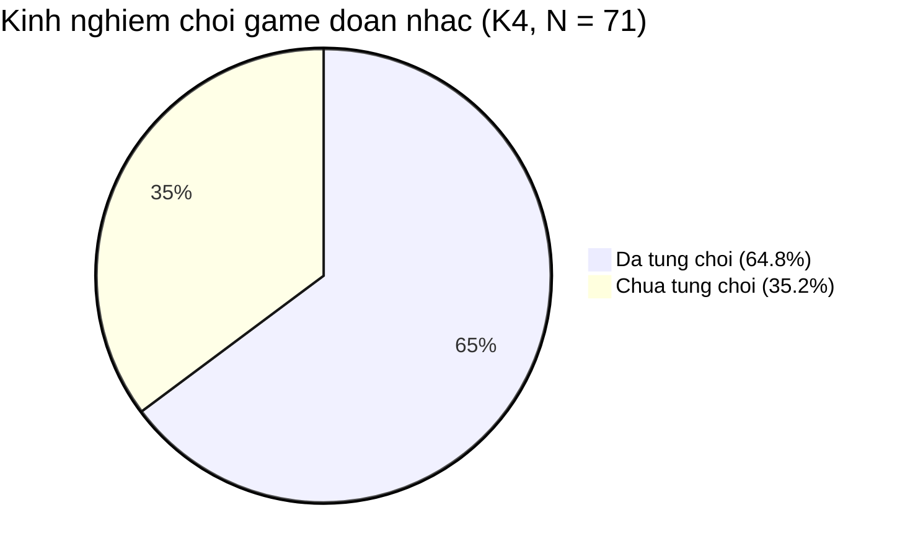

**Nhận xét:** Gần 2/3 người tham gia khảo sát (64,8%) đã quen thuộc với khái niệm game đố vui âm nhạc. Người dùng mục tiêu đã có nhận thức nền tảng tốt về thể loại này.

---

### 3.6. K5: Thể loại âm nhạc mong muốn đoán nhất

**Câu hỏi:** *Nếu chơi game đoán bài hát, bạn muốn đoán thể loại nhạc nào nhất?* (Chọn tối đa 2 thể loại, N = 71)

| Thể loại âm nhạc | Số người chọn | Tỷ lệ (%) |
|---|---|---|
| Nhạc trẻ Việt Nam (V-pop 2010s–2020s) | 52 | 73,2% |
| Nhạc Âu Mỹ (US-UK Pop, Rock, Hip-hop) | 29 | 40,8% |
| Nhạc V-pop xưa / hoài niệm (1990s–2000s) | 24 | 33,8% |
| Nhạc Hàn Quốc (K-pop) | 20 | 28,2% |
| Nhạc phim / Anime / Game OST | 10 | 14,1% |
| Khác (EDM, Indie quốc tế...) | 3 | 4,2% |
| **Tổng số lượt lựa chọn** | **138** | (Bình quân 1,94 lựa chọn/người, $\le 2 \times 71 = 142$) |

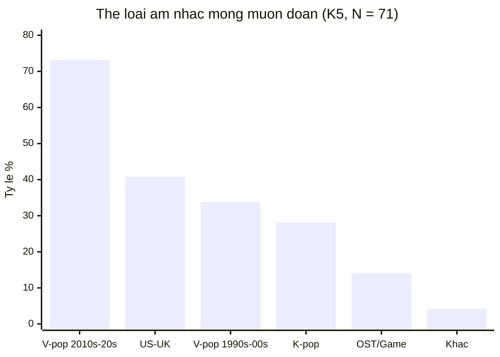

**Nhận xét:**
- Có **78,9%** người dùng (56/71) chọn ít nhất một danh mục nhạc Việt (V-pop hiện đại hoặc V-pop xưa), vượt xa ngưỡng 60% của H2.
- V-pop hiện đại chiếm ưu thế cao nhất (73,2%), tiếp theo là US-UK (40,8%) và V-pop hoài niệm (33,8%).
- **Định hướng kho nhạc:** Bộ đề mặc định của Meloo cần tập trung vào V-pop 2010s–2020s, đồng thời hỗ trợ bộ đề V-pop 1990s–2000s và US-UK để thỏa mãn các nhóm gu nhạc phổ biến.

---

### 3.7. K6: Điểm còn thiếu ở các game đoán nhạc đã từng chơi

**Câu hỏi:** *Những game đoán nhạc bạn từng chơi còn thiếu điều gì hoặc khiến bạn chưa hài lòng?* (Dành cho nhóm N_sub = 46 người đã từng chơi ở K4, nhiều lựa chọn)

| Hạn chế / Điểm chưa hài lòng | Số người chọn (N=46) | Tỷ lệ (%) |
|---|---|---|
| Ít bài hát Việt Nam / bài không hợp gu giới trẻ | 33 | 71,7% |
| Giao diện không có tiếng Việt / gõ tìm bài tiếng Việt bị lỗi dấu | 24 | 52,2% |
| Bắt buộc phải tải app / đăng ký tài khoản rườm rà | 22 | 47,8% |
| Chỉ chơi được một mình, thiếu chế độ phòng cùng bạn bè | 20 | 43,5% |
| Cách đoán trắc nghiệm 4 đáp án dễ đoán mò, thiếu kịch tính | 18 | 39,1% |
| Thiếu âm thanh thoại (voice) tích hợp khi chơi nhóm | 15 | 32,6% |
| Khác | 2 | 4,3% |

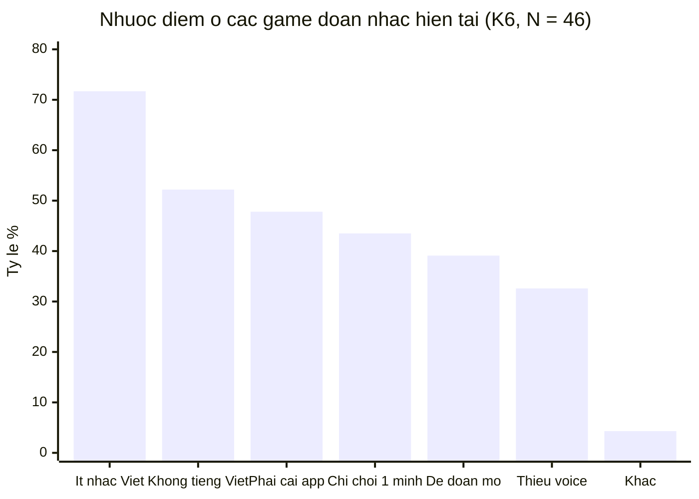

**Nhận xét:**
- Trong nhóm 46 người từng chơi, có tới **82,6%** (38/46 người) phản ánh việc **ít nhạc Việt** hoặc **giao diện không có tiếng Việt** (vượt xa ngưỡng 40% của H2).
- Ngoài ra, việc chơi trắc nghiệm 4 đáp án bị đánh giá là dễ đoán mò (39,1%), cho thấy cơ chế **nghe mở dần 5 mức (2s $\rightarrow$ 30s) và tìm kiếm tên bài không dấu** của Meloo là hướng đi khác biệt và hấp dẫn.

---

### 3.8. K7: Thói quen chơi mini-game hằng ngày

**Câu hỏi:** *Bạn có thói quen chơi các mini-game ngắn mỗi ngày (như Wordle, Heardle, giải đố, đố vui hằng ngày...) không?* (Câu hỏi đơn, N = 71)

| Tần suất chơi mini-game hằng ngày | Số lượng (người) | Tỷ lệ (%) |
|---|---|---|
| Chơi thường xuyên mỗi ngày | 16 | 22,5% |
| Thỉnh thoảng chơi vài ngày một tuần | 19 | 26,8% |
| Hiếm khi hoặc không bao giờ | 36 | 50,7% |
| **Tổng cộng** | **71** | **100,0%** |

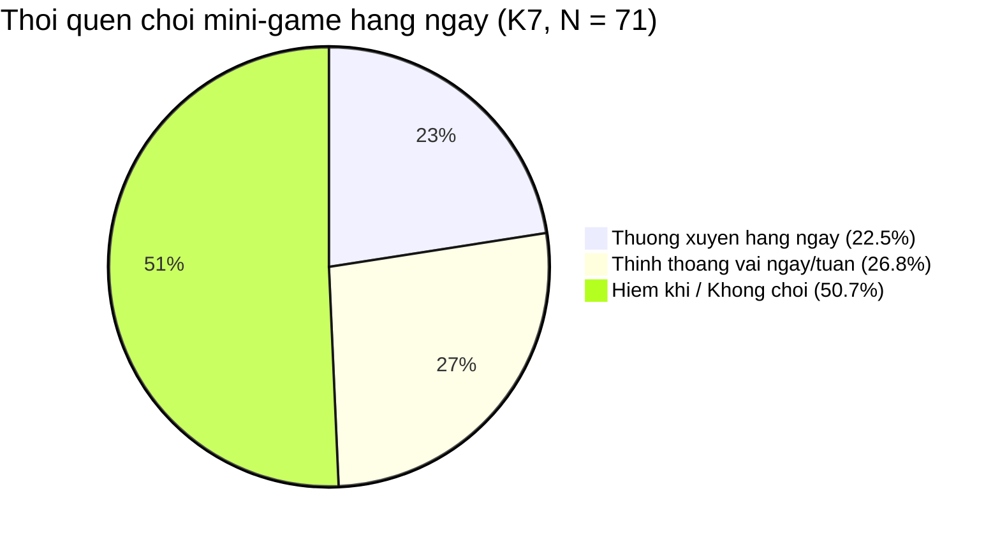

**Nhận xét & Đánh giá giả thuyết H3:**
- **Theo nghĩa nghiêm ngặt ("chơi hằng ngày"):** Chỉ có **22,5%** người tham gia chơi đều đặn mỗi ngày (thấp hơn ngưỡng 30% đề ra tại BIZ-02 mục 4).
- **Theo nghĩa mở rộng (thói quen chơi định kỳ $\ge 2-3$ ngày/tuần):** Tỷ lệ đạt **49,3%** (35/71 người, vượt ngưỡng 30%).
- **Bài học rút ra:** Việc duy trì thói quen chơi đơn độc mỗi ngày là một rào cản lớn với phần đông người dùng (chỉ 22,5% duy trì được thói quen này). Vì vậy, tính năng **Thử thách hằng ngày (Daily Challenge)** không thể hoạt động hiệu quả nếu chỉ là một tính năng chơi đơn thuần túy, mà bắt buộc phải gắn liền với **cơ chế chia sẻ so tài vào nhóm bạn** và **bảng xếp hạng theo chuỗi ngày (streak)** để tạo động lực duy trì.

---

### 3.9. K8: Thói quen chia sẻ kết quả và so tài

**Câu hỏi:** *Bạn có từng chụp ảnh / chia sẻ kết quả game hoặc thành tích của mình lên mạng xã hội hoặc nhóm chat với bạn bè không?* (Câu hỏi đơn, N = 71)

| Mức độ chia sẻ | Số lượng (người) | Tỷ lệ (%) |
|---|---|---|
| Thường xuyên chia sẻ để khoe / rủ bạn bè so tài | 12 | 16,9% |
| Thỉnh thoảng chia sẻ khi đạt kỷ lục hoặc điểm cao | 24 | 33,8% |
| Chưa bao giờ chia sẻ | 35 | 49,3% |
| **Tổng cộng** | **71** | **100,0%** |

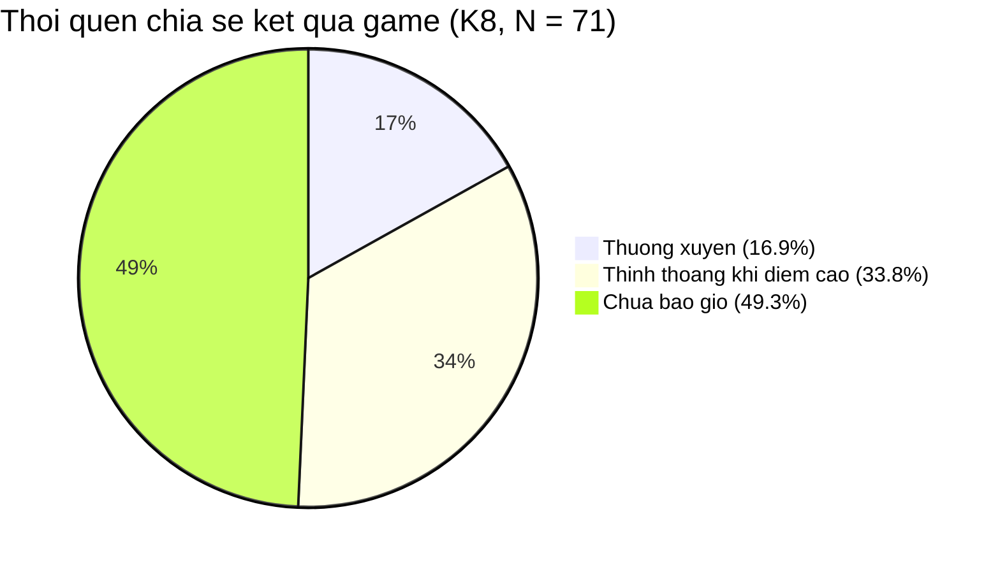

**Nhận xét:**
- Có **50,7%** người tham gia (36/71) có hành vi chia sẻ kết quả lên mạng xã hội hoặc nhóm chat (vượt ngưỡng 40% của H3).
- Điều này củng cố việc Meloo cần trang bị định dạng sao chép kết quả trực quan (dạng ký tự ô màu emoji như Wordle) để người dùng chia sẻ nhanh vào Zalo, Messenger, Discord chỉ bằng một thao tác.

---

### 3.10. K9 & K10: Nhu cầu tổ chức hoạt động & minigame sự kiện

**Câu hỏi K9:** *Bạn có từng làm người tổ chức hoạt động, quản trò, host cho lớp học, câu lạc bộ, nhóm bạn hoặc công ty không?* (Câu hỏi đơn, N = 71)
- Có, từng tổ chức / quản trò: **21 người (29,6%)** (vượt ngưỡng 20% của H4).
- Chưa từng tổ chức: **50 người (70,4%)**.

**Câu hỏi K10:** *Nếu có một web game đoán nhạc mở nhanh bằng link, cho phép tùy chọn chủ đề nhạc để làm phần khởi động (ice-breaker) 10 phút, bạn có muốn sử dụng không?* (Hỏi nhóm N_sub = 21 người ở K9)

| Mức độ quan tâm | Số người (N=21) | Tỷ lệ (%) |
|---|---|---|
| Rất quan tâm và chắc chắn muốn dùng thử | 9 | 42,9% |
| Quan tâm, có thể dùng nếu thao tác nhanh gọn | 6 | 28,6% |
| Không quan tâm / chưa thấy cần thiết | 6 | 28,6% |
| **Tổng cộng** | **21** | **100,0%** |

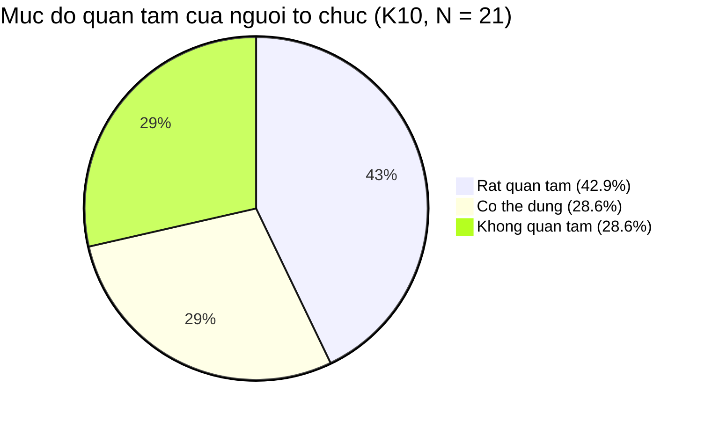

**Nhận xét & Quy tắc mã hóa:**
- Nhóm người dùng có thái độ tích cực ("quan tâm") được tính bằng tổng của hai mức: *Rất quan tâm (42,9%)* và *Có thể dùng thử (28,6%)*, đạt **71,4%** (15/21 người), đối lập với lựa chọn phủ định duy nhất là *Không quan tâm (28,6%)*.
- Con số 71,4% vượt ngưỡng 50% của H4, cho thấy Persona P3 (Người tổ chức sự kiện / quản trò) là có thật và có nhu cầu rõ ràng. Đây là cơ sở vững chắc cho giai đoạn mở rộng B2B / Host Mode ở Phase 2.

---

### 3.11. K11: Ý kiến về tính năng trả phí & Mức giá sẵn sàng chi trả

(Phục vụ nghiên cứu mô hình kinh doanh cho BIZ-08, N = 71)

#### a) Nhu cầu tính năng cao cấp (Nhiều lựa chọn)
| Tính năng nâng cao | Số người chọn | Tỷ lệ (%) |
|---|---|---|
| Kho bài hát độc quyền / bộ đề tuyển chọn theo chủ đề | 28 | 39,4% |
| Tự tạo bộ đề nhạc riêng từ danh sách yêu thích | 26 | 36,6% |
| Phòng chơi không giới hạn số lượng (chế độ Host màn hình lớn) | 18 | 25,4% |
| Không quảng cáo + Danh hiệu / Khung avatar độc quyền | 15 | 21,1% |
| Không muốn trả phí cho bất kỳ tính năng nào (chỉ dùng miễn phí) | 29 | 40,8% |

#### b) Mức giá sẵn sàng chi trả hằng tháng
| Khoảng giá đề xuất | Số lượng (người) | Tỷ lệ (%) |
|---|---|---|
| 0 đ (Chỉ dùng bản miễn phí hoàn toàn) | 29 | 40,8% |
| 19.000 – 29.000 đ/tháng (Mức sinh viên, tương đương 1 ly trà sữa/cà phê) | 27 | 38,0% |
| 49.000 – 69.000 đ/tháng | 12 | 16,9% |
| Trên 99.000 đ/tháng | 3 | 4,2% |
| **Tổng cộng** | **71** | **100,0%** |

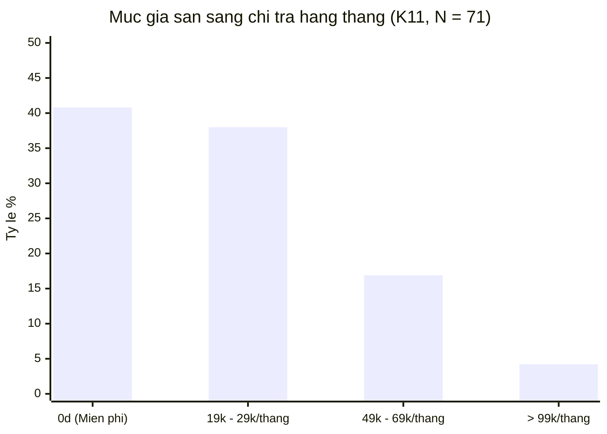

**Nhận xét:**
- Nhóm người dùng trẻ có độ nhạy cảm về giá rất cao: **40,8%** (29 người) kiên quyết chỉ dùng miễn phí.
- Tuy nhiên, có **38,0%** (27 người) sẵn sàng chi trả ở mức giá sinh viên (19.000 – 29.000 đ/tháng).
- **Chiến lược định giá cho BIZ-08:**
  - Mô hình cốt lõi phải là **Freemium**: miễn phí 100% tính năng chơi game cơ bản và phòng realtime.
  - Không thu phí tính năng cốt lõi trong MVP. Chỉ xem xét thu phí ở Phase 2 với gói cá nhân giá rẻ (~29.000 đ/tháng) cho bộ đề độc quyền / tự tạo, và gói sự kiện B2B cho người tổ chức.

---

## 4. Bốn phát hiện quan trọng (Key Insights)

1. **Trải nghiệm "Zero-Friction" (Không ma sát) là điều kiện tiên quyết:**
   Rào cản tải app (63,4%) và tạo tài khoản (53,5%) là nguyên nhân hàng đầu khiến các nhóm bạn từ bỏ game mới. Việc Meloo cho phép vào phòng ngay bằng một đường link web và dùng tên biệt danh tạm thời (Guest) là lợi thế cạnh tranh cốt tử so với SongPop hay các ứng dụng di động khác.

2. **V-pop là "vua", tìm kiếm không dấu là vũ khí:**
   78,9% người dùng mong muốn đoán nhạc Việt, trong đó 71,7% nhóm từng chơi thất vọng vì các game hiện tại thiếu bài hát Việt Nam hợp thị hiếu. Việc xây dựng kho nhạc V-pop phân loại theo thập niên kết hợp bộ máy tìm kiếm dung sai lỗi chính tả và không dấu tiếng Việt sẽ giải quyết triệt để nỗi đau này.

3. **Cơ chế lan tỏa qua thói quen chia sẻ và so tài (Viral Loop):**
   Hơn một nửa số người chơi (50,7%) có thói quen chia sẻ kết quả lên mạng xã hội/nhóm chat. Thử thách hằng ngày kết hợp nút chia sẻ kết quả dạng ký tự emoji (tương tự Wordle) sẽ là kênh chuyển đổi tự nhiên (organic growth) hiệu quả.

4. **Tích hợp Voice trực tiếp mang lại sự tiện lợi:**
   66,2% người chơi sử dụng Discord khi chơi game cùng bạn bè; việc Meloo tích hợp sẵn voice chat WebRTC trong phòng riêng mang lại một lựa chọn tiện lợi hơn cho người chơi, không bắt buộc phải mở ứng dụng đàm thoại bên ngoài.

---

## 5. Đề xuất điều chỉnh Backlog và lộ trình phát triển

### 5.1. Các tính năng đã có trong thiết kế / hợp đồng (Khảo sát củng cố tính cấp thiết)
1. **Chia sẻ kết quả Thử thách hằng ngày (BR-25, FE-DAILY-01 / MEL-75):**
   - Khảo sát củng cố tính cấp thiết của cơ chế chia sẻ thành tích ("Đúng ở 10s"). Giao diện cần bổ sung nút sao chép kết quả dạng ô vuông emoji (🟩 🟧 🟥) để chia sẻ nhanh vào nhóm chat.
2. **Vào phòng nhanh không cần tài khoản (BR-11, FE-ROOM-01 / MEL-58):**
   - Khảo sát xác nhận 81,7% ngại rào cản tải app/đăng ký. Cơ chế vào phòng bằng link 1 chạm và mã 6 ký tự đã thiết kế là hoàn toàn đúng đắn.
3. **Tìm kiếm bài hát tiếng Việt không dấu (BE-CAT-03 / MEL-36, đã merge):**
   - Đã được triển khai ở backend; đáp ứng đúng mong muốn của 52,2% người chơi về việc gõ tìm bài tiếng Việt không bị lỗi dấu.

### 5.2. Đề xuất tinh chỉnh mới (Dựa trên phản hồi khảo sát)
1. **Tinh chỉnh thứ tự bộ đề mặc định tại trang chủ (FE-SOLO-01 / MEL-47, đã merge):**
   - Kết quả K5 cho thấy V-pop hiện đại chiếm 73,2% và V-pop hoài niệm chiếm 33,8%. Đề xuất tạo ticket nhỏ để tinh chỉnh thứ tự hiển thị: đưa bộ đề "V-pop 2010s–2020s" lên vị trí nổi bật đầu tiên, tiếp theo là "V-pop 1990s–2000s" và "US-UK".
2. **Lộ trình Phase 2 (Sau đồ án):**
   - **Chế độ Host & Màn hình chiếu (B2B):** Giữ nguyên quyết định không đưa vào MVP để bảo vệ tiến độ đồ án; tiếp tục nghiên cứu thương mại hóa cho đối tượng quản trò (71,4% quan tâm ở K10) trong BIZ-08.
   - **Tự tạo bộ đề nhạc cá nhân:** Xem xét phát triển trong Phase 2 khi có giải pháp xử lý bản quyền và duyệt nội dung tự động.

---

## 6. Câu hỏi bảo vệ (Defense Q&A)

1. **"Cỡ mẫu 71 phản hồi có đủ độ tin cậy để đại diện cho người dùng Meloo không?"**
   - *Trả lời:* Với một đồ án môn học xây dựng sản phẩm MVP theo phương pháp Lean Startup, mẫu N = 71 là hợp lệ và đạt 142% mục tiêu ban đầu ($\ge 50$ mẫu). Mục tiêu của khảo sát là kiểm chứng định hướng và các giả thuyết then chốt (vào nhanh không cài app, nhu cầu nhạc Việt) chứ không nhằm mục đích tổng điều tra dân số học. Kết quả từ khảo sát còn được kiểm chứng chéo lần hai thông qua số liệu hành vi thực tế trong đợt thử nghiệm Beta kín và Beta công khai (BIZ-06, BIZ-07).

2. **"Nếu người dùng chỉ thích chơi miễn phí (40,8%), làm sao Meloo có thể thương mại hóa?"**
   - *Trả lời:* Đây là đặc thù điển hình của nhóm người dùng sinh viên. Do đó, mô hình của Meloo là Freemium: miễn phí trải nghiệm thi đấu cốt lõi để thu hút quy mô người dùng (tận dụng hiệu ứng mạng lưới). Doanh thu sẽ đến từ 2 nguồn: (1) Gói cá nhân giá rẻ (~29.000 đ/tháng) cho 38% người dùng có nhu cầu tùy biến giao diện và kho nhạc; (2) Gói B2B cho giáo viên, ban tổ chức sự kiện, doanh nghiệp cần công cụ ice-breaker chuyên nghiệp (được xác nhận bởi 71,4% người tổ chức ở K10).

3. **"Tại sao giả thuyết H3 ở câu K7 chỉ đạt 22,5% nếu tính nghĩa nghiêm ngặt, nhóm đã xử lý thế nào?"**
   - *Trả lời:* Khảo sát cho thấy việc hình thành thói quen chơi đơn lẻ mỗi ngày là rất khó đối với đa số người dùng (chỉ 22,5% chơi mỗi ngày). Nhóm đã nhìn nhận trung thực kết quả này và điều chỉnh thiết kế: Thử thách hằng ngày không thể đứng một mình mà phải gắn chặt với cơ chế so tài trong nhóm bạn (Group Challenge) và bảng xếp hạng chuỗi ngày (streak) để tạo áp lực xã hội tích cực kéo người chơi quay lại.

4. **"Tại sao không đưa tính năng tự tạo bộ đề vào ngay từ đầu khi có tới 36,6% người quan tâm?"**
   - *Trả lời:* Tự tạo bộ đề đòi hỏi giải quyết các bài toán kỹ thuật phức tạp như kiểm duyệt bản quyền nhạc, xử lý preview audio tự động và kiểm duyệt từ khóa nhạy cảm. Để đảm bảo tính khả thi và chất lượng cao nhất cho đồ án môn học, nhóm tập trung toàn lực vào cơ chế chơi realtime ổn định, an toàn và chống gian lận trong MVP, đưa tính năng tự tạo bộ đề vào lộ trình Phase 2.

---

## 7. Phụ lục: Bộ câu hỏi khảo sát Google Form chi tiết

*(Trích xuất từ bản thiết kế khảo sát BIZ-03)*

1. **K1:** Trong 3 tháng qua, bạn chơi game online cùng bạn bè bao lâu một lần? *(Hằng ngày / Vài lần một tuần / 1–3 lần một tháng / Hiếm khi / Không bao giờ)*
2. **K2:** Khi chơi game cùng bạn bè, bạn thường dùng gì để nói chuyện / trao đổi? *(Discord voice / Messenger, Zalo / Voice trong game / Chỉ chat chữ / Khác)*
3. **K3:** Điều gì khiến bạn ngại hoặc từ chối thử một game mới cùng bạn bè? *(Phải tải và cài đặt ứng dụng / Bắt buộc tạo tài khoản, đăng ký / Mất thời gian rủ rê, hướng dẫn / Thiết bị không tương thích, máy yếu / Game bắt trả phí / Khác)*
4. **K4:** Bạn đã từng chơi game đoán bài hát / thử tài âm nhạc nào chưa? *(Đã từng / Chưa từng)*
5. **K5:** Nếu chơi game đoán bài hát, bạn muốn đoán loại nhạc nào nhất? *(Chọn tối đa 2 thể loại: Nhạc trẻ Việt Nam V-pop 2010s–2020s / Nhạc Âu Mỹ US-UK / Nhạc V-pop xưa hoài niệm 1990s–2000s / Nhạc Hàn Quốc K-pop / Nhạc phim, Anime, Game OST / Khác)*
6. **K6:** Những game đoán nhạc bạn từng chơi còn thiếu điều gì hoặc khiến bạn chưa hài lòng? *(Ít bài hát Việt Nam / Giao diện không có tiếng Việt, lỗi gõ dấu / Bắt buộc tải app, đăng ký / Chỉ chơi 1 mình / Trắc nghiệm dễ đoán mò / Thiếu voice chat / Khác)*
7. **K7:** Bạn có thói quen chơi các mini-game ngắn mỗi ngày (Wordle, Heardle, đố vui...) không? *(Chơi thường xuyên mỗi ngày / Thỉnh thoảng chơi vài ngày một tuần / Hiếm khi hoặc không bao giờ)*
8. **K8:** Bạn có từng chụp ảnh / chia sẻ kết quả game hoặc thành tích của mình lên MXH hoặc nhóm chat không? *(Thường xuyên / Thỉnh thoảng khi điểm cao / Chưa bao giờ)*
9. **K9:** Bạn có từng làm người tổ chức hoạt động, quản trò, host cho lớp học, CLB, nhóm bạn hoặc công ty không? *(Đã từng / Chưa từng)*
10. **K10:** Nếu có web game đoán nhạc mở nhanh bằng link làm phần khởi động 10 phút, bạn có muốn sử dụng không? *(Rất quan tâm và chắc chắn muốn dùng thử / Quan tâm, có thể dùng nếu thao tác nhanh gọn / Không quan tâm, chưa thấy cần thiết)*
11. **K11:** Nếu Meloo có tính năng nâng cao, bạn sẵn sàng trả phí cho tính năng nào và mức giá nào? *(Kho nhạc độc quyền / Tự tạo bộ đề / Host mode không giới hạn / Bỏ quảng cáo & avatar / Không muốn trả phí. Mức giá: 0đ / 19k–29k / 49k–69k / >99k)*
12. **K12:** Thông tin nhân khẩu: Bạn bao nhiêu tuổi và nghề nghiệp hiện tại là gì? *(Nhóm tuổi: <18, 18–22, 23–26, >26. Nghề nghiệp: Sinh viên / Học sinh, Nhân viên văn phòng, Khác)*
