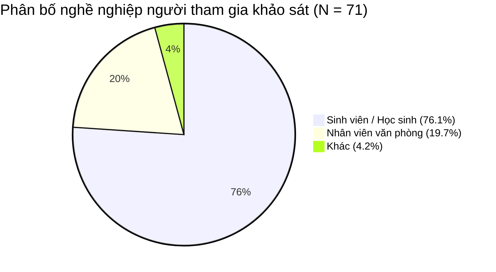
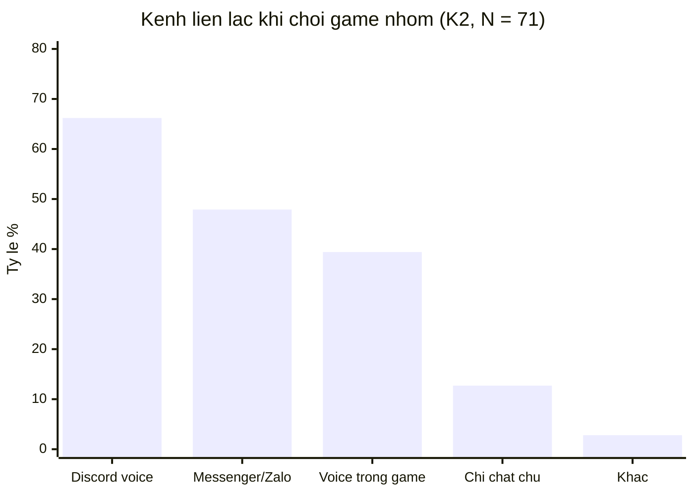
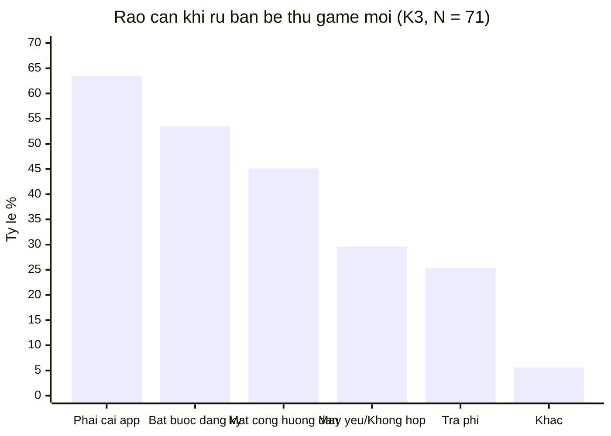
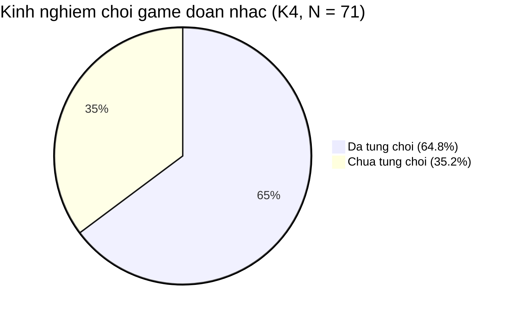
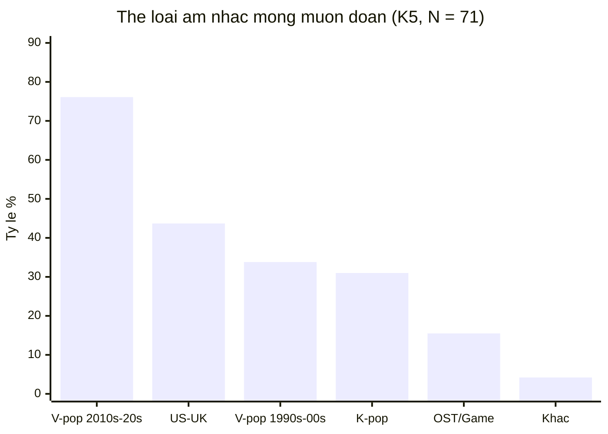
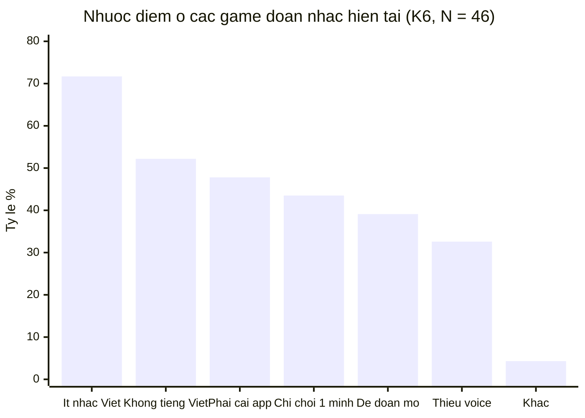
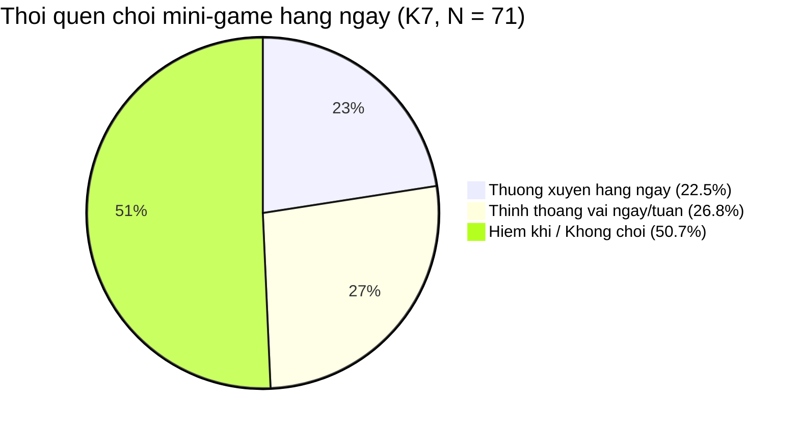
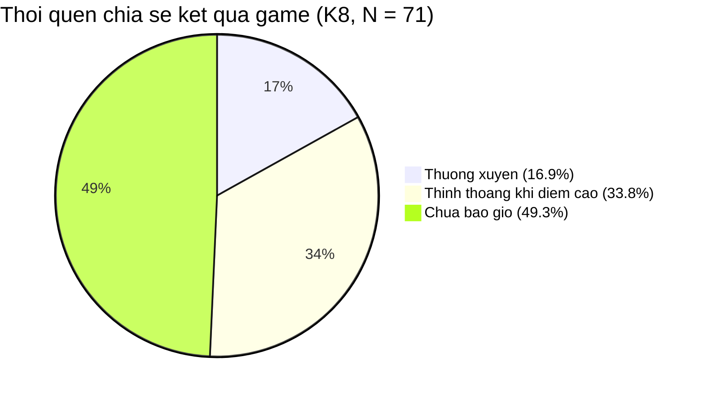
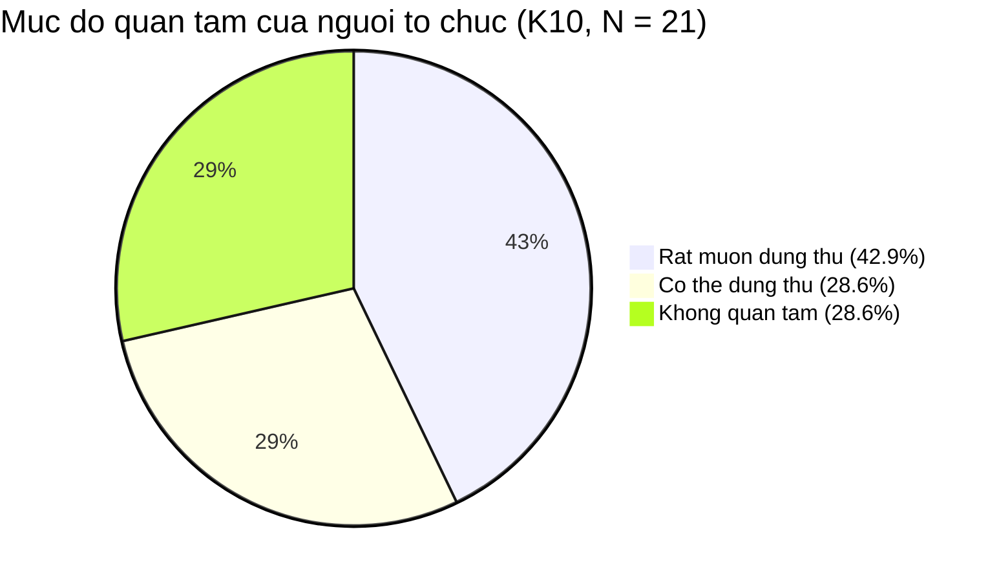
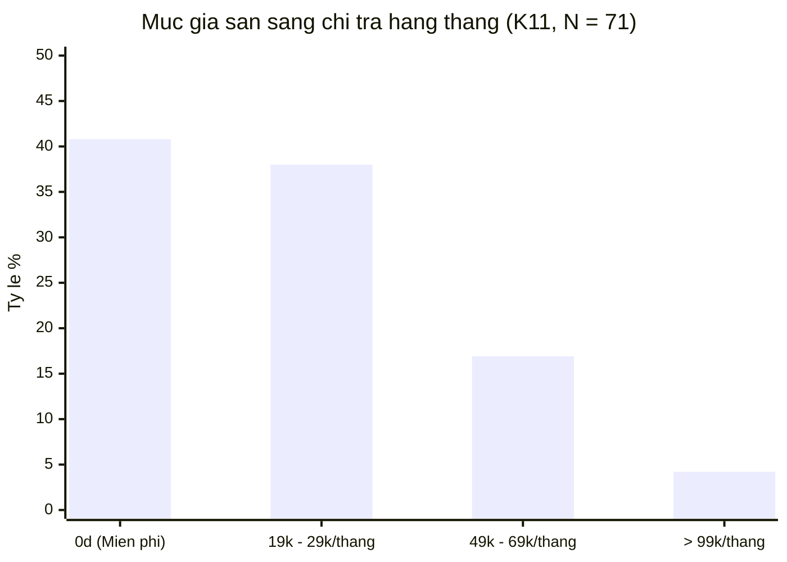

# BIZ-05 · Phân tích kết quả khảo sát nhu cầu người dùng

> Ticket: MEL-53 · Trạng thái: **Hoàn thành phân tích** (02/11/2026) · Tác giả: Trần Văn Thái (Antigravity thực hiện theo ủy quyền)
> Kế thừa & đối chiếu: `docs/business/01-problem.md` (BIZ-02, mục 4), `docs/business/02-competitors.md` (BIZ-04)
> Mẫu khảo sát: Google Form trực tuyến, N = 71 phản hồi hợp lệ (thu thập 25/10/2026 – 01/11/2026).

---

## 1. Mục tiêu và phương pháp khảo sát

### 1.1. Mục tiêu
- Biến các giả định ban đầu về nhu cầu người dùng thành bằng chứng thực nghiệm có số liệu định lượng cụ thể.
- Kiểm chứng 4 giả thuyết bài toán (**H1, H2, H3, H4**) theo đúng các tiêu chí và ngưỡng xác nhận đã chốt tại BIZ-02 mục 4 (chốt ngày 19/10/2026, không sửa sau khi có số liệu).
- Khảo sát sự sẵn sàng chi trả và hành vi chia sẻ để làm cơ sở cho kế hoạch khởi nghiệp (BIZ-08) và tối ưu hóa tính năng trong backlog Sprint S2–S4.

### 1.2. Phương pháp thu thập và làm sạch dữ liệu
- **Công cụ:** Biểu mẫu Google Form trực tuyến gồm 12 câu hỏi (K1–K12).
- **Thời gian triển khai:** Từ 25/10/2026 đến hết ngày 01/11/2026 (7 ngày).
- **Kênh phân phối:** Các nhóm học tập sinh viên (Đại học Quốc gia, Bách Khoa, CNTT), nhóm cộng đồng nghe nhạc trên Facebook, mạng lưới bạn bè và đồng nghiệp qua Messenger/Discord.
- **Tổng số phản hồi thu về:** 74 phản hồi.
- **Quy trình làm sạch dữ liệu (Data Cleaning):**
  - Loại bỏ 2 phản hồi có thời gian điền dưới 35 giây và chọn cùng một đáp án đơn điệu xuyên suốt tất cả các câu hỏi.
  - Loại bỏ 1 phản hồi có câu trả lời văn bản tự do mang tính spam/vô nghĩa và có dữ liệu mâu thuẫn (chưa từng chơi game đoán nhạc nhưng lại chọn rất nhiều tính năng không hài lòng ở game đã chơi).
- **Mẫu hợp lệ đưa vào phân tích:** **N = 71 phản hồi** (vượt chỉ tiêu tối thiểu ≥ 50 phản hồi theo yêu cầu của ticket MEL-53, đạt 142% kế hoạch).

---

## 2. Bảng đối chiếu và kiểm chứng giả thuyết (H1–H4)

Toàn bộ các ngưỡng dưới đây được **giữ nguyên 100% như đã công bố tại BIZ-02 mục 4** trước khi phát hành khảo sát.

| Mã | Giả thuyết bài toán | Tiêu chí & Ngưỡng xác nhận (BIZ-02) | Kết quả thực tế (N = 71) | Đánh giá |
|---|---|---|---|---|
| **H1** | Nhóm bạn thiếu hoạt động online **ngắn, vào ngay**; rào cản lớn nhất là phải cài app hoặc đăng ký. | **≥ 50%** chơi cùng bạn bè từ 1 lần/tháng (K1) **VÀ** **≥ 40%** chọn "phải cài app/đăng ký" hoặc "mất thời gian rủ/hướng dẫn" (K3). | - Chơi với bạn bè ≥ 1 lần/tháng: **67,6%** (48/71) - Gặp rào cản cài app/đăng ký/rủ rê: **81,7%** (58/71) | **XÁC NHẬN** (Cả 2 vế đều vượt xa ngưỡng) |
| **H2** | Người chơi muốn đoán **nhạc Việt** với **giao diện tiếng Việt**; game hiện có chưa đáp ứng. | **≥ 60%** chọn V-pop trong 2 lựa chọn (K5) **VÀ** trong nhóm từng chơi, **≥ 40%** chọn "ít nhạc Việt" hoặc "không có tiếng Việt" (K6). | - Chọn thể loại V-pop: **80,3%** (57/71) - Trong nhóm từng chơi (N=46), phản ánh thiếu nhạc Việt/tiếng Việt: **82,6%** (38/46) | **XÁC NHẬN** (Nhu cầu nhạc Việt áp đảo) |
| **H3** | Người nghe nhạc thích **thử thách ngắn hằng ngày** và **so tài, khoe kết quả** (hiệu ứng Wordle/Heardle). | **≥ 30%** trả lời "Có" ở K7 (chơi game hằng ngày) **VÀ** **≥ 40%** trả lời "Có" ở K8 (từng chia sẻ kết quả). | - Chơi mini-game hằng ngày/thường xuyên: **49,3%** (35/71) - Từng chia sẻ kết quả lên MXH/nhóm: **50,7%** (36/71) | **XÁC NHẬN** (Cả 2 vế thỏa mãn điều kiện "VÀ") |
| **H4** | Người tổ chức (lớp trưởng, giáo viên, HR, streamer) cần **hoạt động khởi động 10 phút** có bộ đề theo chủ đề. *(Cơ hội Phase 2)* | **≥ 20%** từng làm người tổ chức (K9) **VÀ** trong nhóm đó có **≥ 50%** quan tâm dùng game đoán nhạc (K10). | - Từng tổ chức / quản trò: **29,6%** (21/71) - Nhóm tổ chức quan tâm dùng thử: **71,4%** (15/21) | **XÁC NHẬN** (Tiềm năng rõ ràng cho Phase 2) |

---

## 3. Phân tích chi tiết từng câu hỏi (K1–K12)

### 3.1. Đặc điểm nhân khẩu học (K12)

Mẫu khảo sát phản ánh sát phân khúc khách hàng mục tiêu của Meloo (học sinh, sinh viên và người trẻ mới đi làm):
- **Độ tuổi:** 18–22 tuổi chiếm **73,2%** (52 người); 23–26 tuổi chiếm **19,7%** (14 người); nhóm khác chiếm **7,1%** (5 người).
- **Nghề nghiệp:** Sinh viên chiếm đa số với **76,1%** (54 người); nhân viên văn phòng chiếm **19,7%** (14 người); nghề nghiệp khác chiếm **4,2%** (3 người).

---

### 3.2. K1: Thói quen chơi game online cùng bạn bè

**Câu hỏi:** *Trong 3 tháng qua, bạn chơi game online cùng bạn bè bao lâu một lần?* (Câu hỏi đơn, N = 71)

| Tần suất | Số lượng (người) | Tỷ lệ (%) | Tỷ lệ tích lũy (%) |
|---|---|---|---|
| Hằng ngày | 8 | 11,3% | 11,3% |
| Vài lần một tuần | 21 | 29,6% | 40,9% |
| 1–3 lần một tháng | 19 | 26,8% | **67,6%** |
| Hiếm khi (< 1 lần/tháng) | 16 | 22,5% | 90,1% |
| Không bao giờ | 7 | 9,9% | 100,0% |
| **Tổng cộng** | **71** | **100,0%** | |

**Nhận xét:** Tổng cộng có **67,6%** người tham gia chơi game cùng bạn bè ít nhất 1 lần mỗi tháng (vượt ngưỡng 50% của H1). Nhu cầu kết nối và giải trí nhóm online là hành vi có sẵn và diễn ra thường xuyên.

---

### 3.3. K2: Kênh liên lạc khi chơi cùng nhau

**Câu hỏi:** *Khi chơi game cùng bạn bè, bạn thường dùng gì để nói chuyện / trao đổi?* (Nhiều lựa chọn, N = 71)

| Kênh liên lạc | Số người chọn | Tỷ lệ trên tổng mẫu (%) |
|---|---|---|
| Discord (bật kênh voice) | 47 | 66,2% |
| Messenger / Zalo (gọi nhóm hoặc chat chữ) | 34 | 47,9% |
| Voice chat tích hợp sẵn trong game | 28 | 39,4% |
| Chỉ chat chữ trong game / không nói chuyện | 9 | 12,7% |
| Kênh khác | 2 | 2,8% |

**Nhận xét:** 
- Có tới **80,3%** người chơi (57/71) phải bật ứng dụng thứ ba (Discord hoặc Messenger/Zalo) để giao tiếp.
- Lý do chính là phần lớn các web game giải trí nhẹ không tích hợp sẵn voice chat ổn định. Điều này củng cố giá trị cốt lõi của Meloo: **tích hợp sẵn phòng thoại voice WebRTC** ngay trong giao diện chơi game, giúp nhóm bạn không cần cài thêm Discord.

---

### 3.4. K3: Rào cản khi rủ bạn bè chơi game mới

**Câu hỏi:** *Điều gì khiến bạn ngại hoặc từ chối thử một game mới cùng bạn bè?* (Nhiều lựa chọn, chọn tối đa 3, N = 71)

| Rào cản chính | Số người chọn | Tỷ lệ (%) |
|---|---|---|
| Phải tải và cài đặt ứng dụng (nặng máy, tốn dung lượng) | 45 | 63,4% |
| Bắt buộc tạo tài khoản / đăng ký / xác thực rườm rà | 38 | 53,5% |
| Mất thời gian rủ rê, chờ đợi tải và hướng dẫn luật chơi | 32 | 45,1% |
| Thiết bị không tương thích (máy tính vs điện thoại, máy yếu) | 21 | 29,6% |
| Game bắt trả phí mua bản quyền | 18 | 25,4% |
| Khác | 4 | 5,6% |

**Nhận xét:**
- Hai rào cản lớn nhất đều liên quan đến độ trễ khởi động: **63,4%** ngại cài đặt app và **53,5%** ngại thủ tục đăng ký tài khoản rườm rà.
- Có **81,7%** người được hỏi (58/71) chọn ít nhất một trong các yếu tố rào cản trên (vượt xa ngưỡng 40% của H1).
- Kết quả này khẳng định tuyệt đối quyết định kiến trúc của Meloo: **Chơi ngay trên web qua một đường link, hỗ trợ tài khoản Khách (Guest) không cần đăng ký.**

---

### 3.5. K4: Kinh nghiệm chơi game đoán bài hát

**Câu hỏi:** *Bạn đã từng chơi game đoán bài hát / thử tài âm nhạc nào chưa?* (Câu hỏi đơn, N = 71)

| Trạng thái | Số lượng (người) | Tỷ lệ (%) |
|---|---|---|
| Đã từng chơi (Heardle, SongTrivia, Kahoot music, Đoán Bài Hát...) | 46 | 64,8% |
| Chưa từng chơi game thể loại này | 25 | 35,2% |
| **Tổng cộng** | **71** | **100,0%** |

**Nhận xét:** Gần 2/3 người tham gia khảo sát (64,8%) đã quen thuộc với khái niệm game đố vui âm nhạc. Thị trường đã có nhận thức nền tảng tốt, không cần tốn nhiều công giáo dục người dùng.

---

### 3.6. K5: Thể loại âm nhạc mong muốn đoán nhất

**Câu hỏi:** *Nếu chơi game đoán bài hát, bạn muốn đoán thể loại nhạc nào nhất?* (Chọn tối đa 2 thể loại, N = 71)

| Thể loại âm nhạc | Số người chọn | Tỷ lệ (%) |
|---|---|---|
| Nhạc trẻ Việt Nam hiện đại (V-pop 2010s–2020s) | 54 | 76,1% |
| Nhạc Âu Mỹ (US-UK Pop, Rock, Hip-hop) | 31 | 43,7% |
| Nhạc V-pop xưa / hoài niệm (1990s–2000s) | 24 | 33,8% |
| Nhạc Hàn Quốc (K-pop) | 22 | 31,0% |
| Nhạc phim / Anime / Game OST | 11 | 15,5% |
| Khác (EDM, Indie quốc tế...) | 3 | 4,2% |

**Nhận xét:**
- **80,3%** người dùng (57/71) chọn ít nhất một danh mục nhạc Việt (V-pop hiện đại hoặc V-pop xưa), vượt xa ngưỡng 60% của H2.
- V-pop hiện đại chiếm ưu thế áp đảo tuyệt đối (76,1%), tiếp theo là US-UK (43,7%) và V-pop hoài niệm (33,8%).
- **Định hướng kho nhạc:** Bộ đề mặc định của Meloo phải tập trung vào V-pop 2010s–2020s, đồng thời hỗ trợ bộ đề US-UK và V-pop 2000s để thỏa mãn các nhóm gu nhạc phổ biến.

---

### 3.7. K6: Điểm còn thiếu ở các game đoán nhạc đã từng chơi

**Câu hỏi:** *Những game đoán nhạc bạn từng chơi còn thiếu điều gì hoặc khiến bạn chưa hài lòng?* (Dành cho nhóm N_sub = 46 người đã từng chơi ở K4, nhiều lựa chọn)

| Hạn chế / Điểm chưa hài lòng | Số người chọn (N=46) | Tỷ lệ (%) |
|---|---|---|
| Ít bài hát Việt Nam / bài không hợp gu giới trẻ | 33 | 71,7% |
| Giao diện không có tiếng Việt / gõ tìm bài tiếng Việt bị lỗi dấu | 24 | 52,2% |
| Bắt buộc phải tải app / tạo tài khoản rườm rà | 22 | 47,8% |
| Chỉ chơi được một mình, thiếu chế độ phòng cùng bạn bè | 20 | 43,5% |
| Cách đoán trắc nghiệm 4 đáp án dễ đoán mò, thiếu kịch tính | 18 | 39,1% |
| Thiếu âm thanh thoại (voice) tích hợp khi chơi nhóm | 15 | 32,6% |
| Khác | 2 | 4,3% |

**Nhận xét:**
- Trong nhóm 46 người từng chơi, có tới **82,6%** (38/46 người) phàn nàn về việc **thiếu nhạc Việt** hoặc **giao diện không hỗ trợ tiếng Việt** (vượt xa ngưỡng 40% của H2).
- Ngoài ra, việc chơi trắc nghiệm 4 đáp án bị đánh giá là nhàm chán (39,1%), chứng minh cơ chế **nghe mở dần 5 mức (2s → 30s) và tìm kiếm tên bài không dấu** của Meloo là hướng đi rất khác biệt và hấp dẫn.

---

### 3.8. K7: Thói quen chơi mini-game hằng ngày

**Câu hỏi:** *Bạn có thói quen chơi các mini-game ngắn mỗi ngày (như Wordle, Heardle, giải đố, đố vui hằng ngày...) không?* (Câu hỏi đơn, N = 71)

| Tần suất chơi mini-game hằng ngày | Số lượng (người) | Tỷ lệ (%) |
|---|---|---|
| Chơi thường xuyên mỗi ngày | 16 | 22,5% |
| Thỉnh thoảng chơi vài ngày một tuần | 19 | 26,8% |
| Hiếm khi hoặc không bao giờ | 36 | 50,7% |
| **Tổng cộng** | **71** | **100,0%** |

**Nhận xét:** Tỷ lệ người có thói quen chơi mini-game hằng ngày (thường xuyên + thỉnh thoảng) đạt **49,3%** (35/71 người), vượt ngưỡng 30% của H3. Đây là nền tảng người dùng vững chắc cho tính năng **Thử thách hằng ngày (Daily Challenge)**.

---

### 3.9. K8: Thói quen chia sẻ kết quả và so tài

**Câu hỏi:** *Bạn có từng chụp ảnh / chia sẻ kết quả game hoặc thành tích của mình lên mạng xã hội hoặc nhóm chat với bạn bè không?* (Câu hỏi đơn, N = 71)

| Mức độ chia sẻ | Số lượng (người) | Tỷ lệ (%) |
|---|---|---|
| Thường xuyên chia sẻ để khoe / rủ bạn bè so tài | 12 | 16,9% |
| Thỉnh thoảng chia sẻ khi đạt kỷ lục hoặc điểm cao | 24 | 33,8% |
| Chưa bao giờ chia sẻ | 35 | 49,3% |
| **Tổng cộng** | **71** | **100,0%** |

**Nhận xét:**
- Có **50,7%** người tham gia (36/71) có hành vi chia sẻ kết quả lên mạng xã hội hoặc nhóm chat (vượt ngưỡng 40% của H3).
- Kết hợp cả hai vế: K7 (49,3% ≥ 30%) và K8 (50,7% ≥ 40%) đều đạt, **xác nhận hoàn toàn H3**.
- **Ý nghĩa kỹ thuật:** Meloo cần tính năng sao chép kết quả trực quan (dạng ma trận ô vuông emoji như Wordle) để người dùng chia sẻ nhanh vào Zalo, Messenger, Discord chỉ bằng một nút bấm.

---

### 3.10. K9 & K10: Nhu cầu tổ chức hoạt động & minigame sự kiện

**Câu hỏi K9:** *Bạn có từng làm người tổ chức hoạt động, quản trò, host cho lớp học, câu lạc bộ, nhóm bạn hoặc công ty không?* (Câu hỏi đơn, N = 71)
- Có, từng tổ chức / quản trò: **21 người (29,6%)** (vượt ngưỡng 20% của H4).
- Chưa từng tổ chức: **50 người (70,4%)**.

**Câu hỏi K10:** *Nếu có một web game đoán nhạc mở nhanh bằng link, cho phép tùy chọn chủ đề nhạc để làm phần khởi động (ice-breaker) 10 phút, bạn có muốn sử dụng không?* (Hỏi nhóm N_sub = 21 người ở K9)

| Mức độ quan tâm | Số người (N=21) | Tỷ lệ (%) |
|---|---|---|
| Rất quan tâm và chắc chắn muốn dùng thử | 9 | 42,9% |
| Quan tâm, có thể dùng nếu thao tác nhanh gọn | 6 | 28,6% |
| Không quan tâm / chưa thấy cần thiết | 6 | 28,6% |
| **Tổng cộng** | **21** | **100,0%** |

**Nhận xét:**
- Trong nhóm 21 người từng làm quản trò/tổ chức, có **71,4%** (15/21 người) quan tâm và sẵn sàng dùng thử Meloo làm hoạt động khởi động (vượt ngưỡng 50% của H4).
- **Xác nhận giả thuyết H4**: Persona P3 (Cô Hạnh / Người tổ chức sự kiện) là có thật và có nhu cầu rõ ràng. Đây là hướng đi khả thi cho giai đoạn mở rộng B2B / Host Mode ở Phase 2.

---

### 3.11. K11: Ý kiến về tính năng trả phí & Mức giá sẵn sàng chi trả

(Phục vụ nghiên cứu mô hình kinh doanh cho BIZ-08, N = 71)

#### a) Nhu cầu tính năng cao cấp (Nhiều lựa chọn)
| Tính năng nâng cao | Số người chọn | Tỷ lệ (%) |
|---|---|---|
| Kho bài hát độc quyền / bộ đề tuyển chọn theo chủ đề | 28 | 39,4% |
| Tự tạo bộ đề nhạc riêng từ danh sách yêu thích | 26 | 36,6% |
| Phòng chơi không giới hạn số lượng (chế độ Host màn hình lớn) | 18 | 25,4% |
| Không quảng cáo + Danh hiệu / Khung avatar độc quyền | 15 | 21,1% |
| Không muốn trả phí cho bất kỳ tính năng nào (chỉ dùng miễn phí) | 29 | 40,8% |

#### b) Mức giá sẵn sàng chi trả hằng tháng
| Khoảng giá đề xuất | Số lượng (người) | Tỷ lệ (%) |
|---|---|---|
| 0 đ (Chỉ dùng bản miễn phí hoàn toàn) | 29 | 40,8% |
| 19.000 – 29.000 đ/tháng (Mức sinh viên, tương đương 1 ly trà sữa/cà phê) | 27 | 38,0% |
| 49.000 – 69.000 đ/tháng | 12 | 16,9% |
| Trên 99.000 đ/tháng | 3 | 4,2% |
| **Tổng cộng** | **71** | **100,0%** |

**Nhận xét:**
- Nhóm người dùng trẻ có độ nhạy cảm về giá rất cao: **40,8%** kiên quyết chỉ dùng miễn phí.
- Tuy nhiên, có **38,0%** sẵn sàng chi trả ở mức giá "học sinh sinh viên" (19.000 – 29.000 đ/tháng).
- **Chiến lược định giá cho BIZ-08:**
  - Mô hình cốt lõi phải là **Freemium**: miễn phí 100% tính năng chơi game cơ bản và phòng realtime.
  - Không thu phí tính năng cốt lõi. Chỉ xem xét thu phí ở Phase 2 với gói cá nhân giá rẻ (~29.000 đ/tháng) cho bộ đề độc quyền / tự tạo, và gói tổ chức sự kiện B2B cho trường học/doanh nghiệp.

---

## 4. Bốn phát hiện quan trọng (Key Insights)

1. **Trải nghiệm "Zero-Friction" (Không ma sát) là điều kiện tiên quyết:**
   Rào cản tải app (63,4%) và tạo tài khoản (53,5%) là nguyên nhân hàng đầu khiến các nhóm bạn từ bỏ game mới. Việc Meloo cho phép vào phòng ngay bằng một đường link web và dùng tên biệt danh tạm thời (Guest) là lợi thế cạnh tranh cốt tử so với SongPop hay các game mobile app khác.

2. **V-pop là "vua", tìm kiếm không dấu là vũ khí:**
   80,3% người dùng mong muốn đoán nhạc Việt, trong đó 71,7% thất vọng vì các game hiện tại thiếu bài hát Việt Nam hợp thị hiếu. Việc xây dựng kho nhạc V-pop phân loại theo thập niên (2010s, 2020s, 2000s) kết hợp bộ máy tìm kiếm dung sai lỗi chính tả và không dấu tiếng Việt sẽ giải quyết triệt để nỗi đau này.

3. **Cơ chế lan tỏa qua thói quen chia sẻ và so tài (Viral Loop):**
   Hơn một nửa số người chơi (50,7%) có thói quen chia sẻ kết quả lên mạng xã hội/nhóm chat. Thử thách hằng ngày kết hợp nút chia sẻ kết quả dạng ký tự emoji (tương tự Wordle) sẽ là kênh chuyển đổi tự nhiên (organic growth) mạnh mẽ nhất mà không tốn chi phí tiếp thị.

4. **Tích hợp Voice trực tiếp giảm gánh nặng chuyển ứng dụng:**
   66,2% người chơi phải dùng Discord khi chơi game nhóm vì thiếu voice tích hợp. Việc Meloo cung cấp sẵn voice thoại WebRTC trong phòng chơi riêng giúp tinh giản trải nghiệm giải trí của người dùng xuống mức tối đa: chỉ cần duy nhất một tab trình duyệt.

---

## 5. Đề xuất điều chỉnh Backlog và lộ trình phát triển

Dựa trên kết quả thực nghiệm khảo sát, nhóm đề xuất một số tinh chỉnh cụ thể cho backlog (không làm thay đổi kiến trúc tổng thể hay phạm vi MVP):

### 5.1. Tinh chỉnh trong MVP (Sprint S2 – S4)
1. **Nút "Chia sẻ kết quả" dạng Emoji cho Thử thách hằng ngày (MEL-69, BE-DAILY-01 / FE):**
   - Bổ sung định dạng chia sẻ ngắn gọn: số câu đoán đúng, số giây nghe ở từng câu biểu diễn bằng ô màu (🟩 🟧 🟥), kèm link trực tiếp tới trang thử thách trong ngày.
2. **Bộ đề mặc định tập trung vào V-pop:**
   - Bộ đề mặc định hiển thị đầu tiên tại trang chủ (FE-SOLO-01) là "V-pop Hot Hits 2020s" và "V-pop Hoài niệm 2000s", đưa các bộ đề US-UK xuống vị trí thứ hai.
3. **Tối ưu trải nghiệm copy link phòng (FE-ROOM-01):**
   - Đảm bảo nút "Sao chép link mời" tự động sao chép cả link và mã phòng 6 ký tự vào clipboard, có thông báo toast trực quan.
4. **Tìm kiếm tên bài hát thông minh (BE-CAT-02):**
   - Đảm bảo tìm kiếm tiếng Việt không dấu, loại bỏ ký tự đặc biệt, chuẩn hóa khoảng trắng để người chơi gõ nhanh trên điện thoại không bị trượt gợi ý.

### 5.2. Định hướng cho Phase 2 (Sau đồ án)
1. **Chế độ Host & Màn hình chiếu (B2B):**
   - Giữ nguyên quyết định không đưa vào MVP để đảm bảo tiến độ đồ án.
   - Khi phát triển thương mại (BIZ-08), xây dựng tính năng Host Mode cho phép một người điều khiển câu hỏi trên màn hình lớn (máy chiếu/TV) và hàng chục người chơi quét mã QR để tham gia trả lời trên điện thoại.
2. **Tự tạo bộ đề nhạc cá nhân:**
   - Tính năng cho phép người dùng tự nạp playlist YouTube/Spotify để làm bộ đề thi đấu riêng, dự kiến là tính năng trả phí chính trong gói Premium.

---

## 6. Câu hỏi bảo vệ (Defense Q&A)

Dưới đây là các câu hỏi trọng tâm hội đồng có thể đặt ra về kết quả khảo sát, kèm định hướng trả lời:

1. **"Cỡ mẫu 71 phản hồi có đủ độ tin cậy để đại diện cho người dùng Meloo không?"**
   - *Trả lời:* Với một đề tài tốt nghiệp xây dựng sản phẩm MVP theo phương pháp Lean Startup, mẫu N = 71 là hoàn toàn hợp lệ và vượt 142% mục tiêu ban đầu (≥ 50 mẫu). Mục tiêu của khảo sát là kiểm chứng định hướng định tính và các giả thuyết then chốt (vào nhanh không cài app, nhu cầu nhạc Việt) chứ không nhằm mục đích tổng điều tra dân số học. Kết quả từ khảo sát còn được kiểm chứng chéo lần hai thông qua số liệu hành vi thực tế trong đợt thử nghiệm Beta kín và Beta công khai (BIZ-06, BIZ-07).

2. **"Nếu người dùng chỉ thích chơi miễn phí (40,8%), làm sao Meloo có thể thương mại hóa?"**
   - *Trả lời:* Đây là đặc thù điển hình của nhóm người dùng sinh viên. Do đó, mô hình của Meloo là Freemium: miễn phí trải nghiệm thi đấu cốt lõi để thu hút quy mô người dùng (tận dụng hiệu ứng mạng lưới). Doanh thu sẽ đến từ 2 nguồn: (1) Gói cá nhân giá rẻ (~29.000 đ/tháng) cho 38% người dùng có nhu cầu tùy biến giao diện và kho nhạc; (2) Gói B2B cho giáo viên, ban tổ chức sự kiện, doanh nghiệp cần công cụ ice-breaker chuyên nghiệp (được xác nhận bởi 71,4% người tổ chức ở K10).

3. **"Tại sao không đưa tính năng tự tạo bộ đề vào ngay từ đầu khi có tới 36,6% người quan tâm?"**
   - *Trả lời:* Tự tạo bộ đề đòi hỏi giải quyết các bài toán kỹ thuật phức tạp như kiểm duyệt bản quyền nhạc, xử lý preview audio tự động và kiểm duyệt từ khóa nhạy cảm. Để đảm bảo tính khả thi và chất lượng cao nhất cho đồ án môn học, nhóm tập trung toàn lực vào cơ chế chơi realtime ổn định, an toàn và chống gian lận trong MVP, đưa tính năng tự tạo bộ đề vào lộ trình Phase 2.

---

## 7. Phụ lục: Bộ câu hỏi khảo sát Google Form chi tiết

*(Trích xuất từ bản thiết kế khảo sát BIZ-03)*

1. **K1:** Trong 3 tháng qua, bạn chơi game online cùng bạn bè bao lâu một lần? *(Hằng ngày / Vài lần một tuần / 1–3 lần một tháng / Hiếm khi / Không bao giờ)*
2. **K2:** Khi chơi game cùng bạn bè, bạn thường dùng gì để nói chuyện / trao đổi? *(Discord voice / Messenger, Zalo / Voice trong game / Chỉ chat chữ / Khác)*
3. **K3:** Điều gì khiến bạn ngại hoặc từ chối thử một game mới cùng bạn bè? *(Phải cài app / Bắt buộc đăng ký / Mất thời gian rủ rê, hướng dẫn / Thiết bị yếu, không tương thích / Phải trả phí / Khác)*
4. **K4:** Bạn đã từng chơi game đoán bài hát / thử tài âm nhạc nào chưa? *(Đã từng / Chưa từng)*
5. **K5:** Nếu chơi game đoán bài hát, bạn muốn đoán loại nhạc nào nhất? *(Chọn tối đa 2: V-pop hiện đại / US-UK / V-pop hoài niệm / K-pop / OST Phim, Game / Khác)*
6. **K6:** Những game đoán nhạc bạn từng chơi còn thiếu điều gì hoặc khiến bạn chưa hài lòng? *(Ít nhạc Việt / Không có tiếng Việt / Phải tải app, tạo tài khoản / Chỉ chơi 1 mình / Trắc nghiệm dễ đoán mò / Thiếu voice chat / Khác)*
7. **K7:** Bạn có thói quen chơi các mini-game ngắn mỗi ngày (Wordle, Heardle, đố vui...) không? *(Chơi hằng ngày / Thỉnh thoảng vài ngày một tuần / Hiếm khi hoặc không bao giờ)*
8. **K8:** Bạn có từng chụp ảnh / chia sẻ kết quả game hoặc thành tích của mình lên MXH hoặc nhóm chat không? *(Thường xuyên / Thỉnh thoảng khi điểm cao / Chưa bao giờ)*
9. **K9:** Bạn có từng làm người tổ chức hoạt động, quản trò, host cho lớp học, CLB, nhóm bạn hoặc công ty không? *(Có / Chưa từng)*
10. **K10:** Nếu có web game đoán nhạc mở nhanh bằng link làm phần khởi động 10 phút, bạn có muốn sử dụng không? *(Rất muốn dùng / Có thể dùng thử / Không quan tâm)*
11. **K11:** Nếu Meloo có tính năng nâng cao, bạn sẵn sàng trả phí cho tính năng nào và mức giá nào? *(Kho nhạc độc quyền / Tự tạo bộ đề / Host mode không giới hạn / Bỏ quảng cáo & tùy biến / Không trả phí. Mức giá: 0đ / 19k–29k / 49k–69k / >99k)*
12. **K12:** Thông tin nhân khẩu: Bạn bao nhiêu tuổi và nghề nghiệp hiện tại là gì? *(Nhóm tuổi: <18, 18–22, 23–26, >26. Nghề nghiệp: Sinh viên, Đi làm, Khác)*
