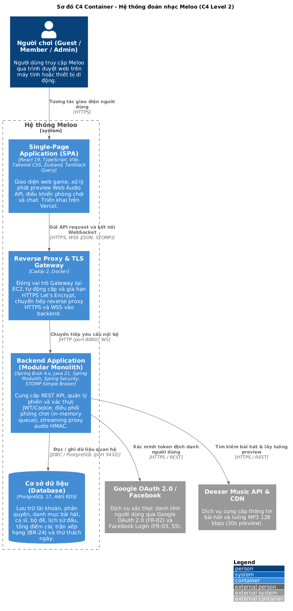
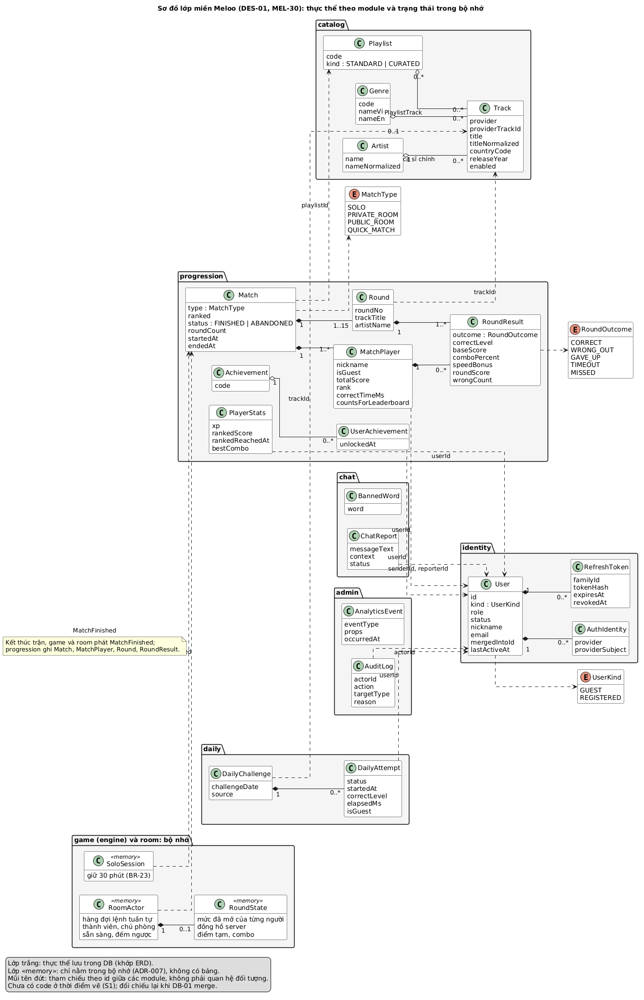

# Slide 1 · BÁO CÁO ĐỒ ÁN GIỮA KỲ
## Đề tài: Meloo — Web Game Đoán Tên Bài Hát Thời Gian Thực

- **Mã ticket:** DEF-00 (`MEL-116`) · **Mốc học phần:** Báo cáo định kỳ giữa kỳ (15% điểm quá trình)
- **Sinh viên thực hiện:** Trần Văn Thái (Product Owner & Tech Lead, điều phối AI Agents)
- **Giảng viên hướng dẫn:** `[HỎI THÁI: Họ tên giảng viên hướng dẫn]`
- **Ngày báo cáo:** `[HỎI THÁI: Ngày giờ và hình thức báo cáo sau khi xác nhận với giảng viên]`
- **Hồ sơ thiết kế đính kèm:** Thuyết minh chi tiết thiết kế hệ thống (`DOC-05` / `MEL-62`, [`docs/submissions/thuyet-minh-thiet-ke-chi-tiet.md`](../../submissions/thuyet-minh-thiet-ke-chi-tiet.md))
- **Tầm nhìn một câu:** *Trò chơi đoán tên bài hát 10–15 phút, vào ngay bằng một đường link trình duyệt, để nhóm bạn người Việt cùng chơi, trò chuyện và so tài bằng chính nhạc Việt họ nghe hằng ngày.*

> **Ghi chú trình bày (30s):** Giới thiệu tên đề tài, mục tiêu buổi báo cáo giữa kỳ (trình bày kết quả S0–S3, bộ tài liệu thiết kế DOC-05 và demo trực tiếp Chơi đơn + Phòng nhiều người trên production).

---

# Slide 2 · Bài toán thực tế & Phân tích đối thủ cạnh tranh

- **Thói quen nghe nhạc tại Việt Nam (`BIZ-02`):** **75%** người Việt nghe nhạc mỗi ngày, **93%** nghe trên điện thoại (Q&Me); YouTube 74%, Zing MP3 45%, TikTok 32%, Spotify 27% (Decision Lab Q4/2025, truy cập 19/10/2026) — nhưng chủ yếu là **nghe thụ động một mình**.
- **Sức hút dòng game đoán nhạc:** Heardle đạt **69 triệu lượt truy cập** (03/2022) trước khi Spotify mua lại và đóng cửa ngày 05/05/2023 (`01-problem.md`).
- **Đối chiếu 6 đối thủ (`BIZ-04` / `BIZ-09`, chơi thử & kiểm chứng 19/10 – 02/11/2026):**

| Tiêu chí | Meloo | SongTrivia | SongPop | musci.io | Kahoot! | Heardle (đóng) |
|---|---|---|---|---|---|---|
| Nền tảng & Vào ngay | Web, link (Khách) | Web | App iOS/Android | Web (chỉ 1 người) | Web/App (≤10 người free) | Web |
| Tiếng Việt & Nhạc Việt | **Có (V-pop lọc sâu)** | Không | Không | Có TV, không thấy nhạc Việt | Có TV, quiz cộng đồng | Không |
| Phòng realtime & Voice | **2–5 người + Voice** | Có phòng, không voice | Đấu 1-1/phòng app, không voice | Không thấy phòng/voice | Theo phiên host, không voice | Không |
| Cơ chế đoán & Mở dần | **5 mức (2→30s), gõ gợi ý** | Nghe cố định, gõ/chọn | Chọn 1/4 đáp án | 30s, chọn 1/4 đáp án | Quiz trắc nghiệm soạn sẵn | 6 mức (1→16s) |

> **Ghi chú trình bày (60s):** Nhấn mạnh 3 khoảng trống: (1) thiếu game đoán nhạc Việt chuyên biệt có tìm bài không dấu; (2) nhóm bạn phải ghép game ngoại với Discord; (3) trắc nghiệm 1/4 dễ đoán mò so với cơ chế mở dần 5 mức.

---

# Slide 3 · Khảo sát nhu cầu người dùng & Kiểm chứng giả thuyết (H1–H4)

- **Phương pháp (`BIZ-03` / `BIZ-05`):** Biểu mẫu Google Form 12 câu (`K1–K12`), triển khai 25/10 – 08/11/2026, mục tiêu **$N \ge 50$ phản hồi hợp lệ** (lọc bỏ mẫu < 35 giây hoặc mâu thuẫn nội tại).
- **Ngưỡng xác nhận chốt trước ngày 19/10/2026 (`docs/business/01-problem.md`, `03-survey.md`):**

| Mã | Giả thuyết bài toán | Tiêu chí & Ngưỡng xác nhận đặt trước | Số liệu thực tế (08/11/2026) |
|---|---|---|---|
| **H1** | Thiếu hoạt động nhóm ngắn, ngại cài app/đăng ký | $\ge 50\%$ chơi cùng bạn $\ge 1$ lần/tháng (`K1`) **VÀ** $\ge 40\%$ ngại cài app/đăng ký/hướng dẫn (`K3`) | `[CẦN SỐ LIỆU: xuất Google Sheets 08/11/2026]` |
| **H2** | Muốn đoán nhạc Việt với giao diện tiếng Việt | $\ge 60\%$ chọn V-pop ở `K5` **VÀ** $\ge 40\%$ nhóm từng chơi chê ít nhạc Việt/thiếu tiếng Việt (`K6`) | `[CẦN SỐ LIỆU: xuất Google Sheets 08/11/2026]` |
| **H3** | Thích thử thách hằng ngày & khoe kết quả | $\ge 30\%$ chơi mini-game hằng ngày (`K7`) **VÀ** $\ge 40\%$ từng chia sẻ kết quả (`K8`) | `[CẦN SỐ LIỆU: xuất Google Sheets 08/11/2026]` |
| **H4** | Người tổ chức cần hoạt động khởi động 10 phút | $\ge 20\%$ từng làm quản trò/host (`K9`) **VÀ** $\ge 50\%$ trong số đó quan tâm dùng thử (`K10`) | `[CẦN SỐ LIỆU: xuất Google Sheets 08/11/2026]` |

- **Kiểm chứng chéo giai đoạn 2 (`BIZ-06` / `BIZ-07`):** Đo hành vi thật trên production với KPI $\ge 30$ tài khoản đăng ký, $\ge 100$ trận đã chơi, tỷ lệ quay lại $\ge 2$ ngày đạt $\ge 30\%$, CSAT $\ge 4,0/5$.

> **Ghi chú trình bày (45s):** Trình bày tư duy thực nghiệm: đặt ngưỡng trước khi phát form để không chỉnh kết luận theo số liệu; nếu giả thuyết nào bị bác bỏ sẽ báo cáo trung thực và điều chỉnh trọng tâm bộ đề.

---

# Slide 4 · Phạm vi sản phẩm (MoSCoW) & Quy tắc nghiệp vụ cốt lõi

- **Phân bổ 136 ticket công việc theo MoSCoW (`PM-09` / `docs/process/01-project-plan.md`, snapshot 02/11/2026):**
  - **Must Have (99 tickets — 72,8%):** Khách vào ngay (`FR-01`), kho nhạc & tìm kiếm không dấu (`FR-05, FR-06`), chơi đơn luyện tập (`FR-07`), phòng nhiều người 2–5 người & chat chặn lộ đáp án (`FR-09, FR-11`), ghép trận nhanh tính rank & bảng xếp hạng (`FR-10, FR-14`), OAuth Google (`FR-02`), Admin & kiểm duyệt (`FR-16, FR-17`), đa ngôn ngữ `vi/en` (`FR-18`) và trọn bộ hồ sơ học thuật.
  - **Should Have (28 tickets — 20,6%):** Thử thách hằng ngày (`FR-08`), Voice chat WebRTC phòng riêng (`FR-12`), Facebook & xóa tài khoản (`FR-03`), huy hiệu (`FR-15`), PWA (`FR-19`), kiểm thử tải k6 (`QA-03`).
  - **Could Have / Phase 2 (8 tickets — 5,9%) & Won't Have:** Gói Premium, chế độ Host/Event, mở rộng Redis; **Won't:** phát cả bài, app native iOS/Android, thanh toán tiền thật trong môn học.
- **Luật chơi & Xếp hạng (`BR-01` → `BR-29`, cập nhật 01/11/2026 tại `MEL-149`):**
  - **5 mức nghe mở dần (`BR-01, BR-02`):** `2s (1.000đ) → 5s (800đ) → 10s (600đ) → 20s (400đ) → 30s (200đ)`; đoán sai hoặc bấm "Nghe thêm" đều mở mức kế tiếp (`BR-04`).
  - **Công thức điểm vòng (`BR-07, BR-08`):** $\text{Điểm vòng} = \text{Điểm cơ bản} \times (1 + \text{Combo } 0/10/20\%) + \lfloor 200 \times \text{ms còn lại} \div 45.000 \rfloor$.
  - **Công bằng xếp hạng (`BR-13, BR-20, BR-23, BR-24`):** Chỉ **Ghép trận nhanh** (người đã đăng nhập) tính điểm rank theo bảng cố định (sàn 0, bảng toàn thời gian); Chơi đơn là chế độ luyện tập và Phòng tự tạo không tính rank để chống cày điểm.

> **Ghi chú trình bày (60s):** Giải thích vì sao Must chiếm 72,8% (do bao gồm toàn bộ tài liệu bắt buộc của học phần) và lý do tách bạch Luyện tập / Phòng bạn bè với Ghép trận nhanh tính rank.

---

# Slide 5 · Kiến trúc hệ thống (C4 Model & Hạ tầng triển khai)

- **4 nguyên tắc kiến trúc bất biến (`DOC-04`, `ADR-001` → `ADR-008`):**
  1. **Server là trọng tài (`NFR-07`):** Đáp án, điểm và đồng hồ 45s do backend quyết; không payload REST/STOMP hay log nào lộ đáp án trước khi vòng kết thúc.
  2. **Modular Monolith (`ADR-001`):** Spring Boot 4.x + Spring Modulith gồm 11 module (`shared, identity, catalog, audio, game, room, chat, voice, progression, daily, admin`), giao tiếp qua `api/` và `events/`, kiểm tra tự động bằng `ApplicationModules.verify()`.
  3. **Contract-First (`ADR-002`):** Sinh code hai đầu từ `contracts/openapi.yaml` (OpenAPI 3.1) và `contracts/asyncapi.yaml` (AsyncAPI 3 STOMP).
  4. **Streaming Proxy Audio (`ADR-008`):** Cấp token mờ HMAC-SHA256 (`/api/v1/audio/{token}`, TTL $\le 2$ phút), cắt byte CBR 128 kbps (~16 KB/s: mức 2s $\approx 32\text{ KB}$) trực tiếp từ CDN mà không lưu đĩa hay nạp cả file vào Heap RAM.
- **Hạ tầng triển khai (`ADR-006`):** Vercel Edge (React 19 SPA) + Cloudflare DNS + AWS EC2 `t3.micro` (1 vCPU, 1 GB RAM + 2 GB swap, chạy Docker Caddy 2 & Backend) + AWS RDS PostgreSQL 17 (`Publicly Accessible = No`).

*(Sơ đồ chi tiết: [`c4-context.png`](../../uml/c4/c4-context.png) · [`c4-component-backend.png`](../../uml/c4/c4-component-backend.png) · [`deployment.png`](../../uml/deployment/deployment.png))*

> **Ghi chú trình bày (60s):** Chỉ rõ luồng bảo mật: client chỉ nhận token HMAC ngắn hạn, Caddy bọc TLS, RDS cô lập hoàn toàn trong Security Group riêng.

---

# Slide 6 · Mô hình Use Case & Lược đồ lớp chính

- **Mô hình Use Case (`DOC-02` / `MEL-29`):** **6 tác nhân** (Khách, Người chơi, Chủ phòng, Quản trị viên, Hệ thống API nhạc, Nhà cung cấp OAuth) và **34 use case** (14 use case đặc tả chi tiết, phủ 100% `FR-01` → `FR-19`).
- **Thiết kế Lược đồ lớp & CSDL (`DES-01` / `MEL-30`, `DOC-03` / `MEL-51`):**
  - **Module `game` (`game.png`):** Aggregate `Round` (POJO thuần không phụ thuộc framework), `ScoreCalculator`, `ComboTracker`, `TitleNormalizer` (`BR-05`), `SoloMatchManager` (giữ phiên 30 phút theo `BR-23`).
  - **Module `room` (`room.png`):** Mỗi phòng một `RoomActor` xử lý lệnh tuần tự trên hàng đợi riêng (`ADR-007`), triệt tiêu 100% race condition khi nhiều người đoán cùng mili-giây hoặc trùng lúc hết giờ 45.000 ms (`NFR-08`).
  - **Module `catalog` & `identity` (`catalog.png`, `identity.png`):** Interface `MusicProvider` (`DeezerMusicProvider` + cache), `TrackSearchService` (GIN trigram không dấu), `GuestAuthService` & `RefreshTokenService` (xoay vòng theo `family_id`, `ADR-005`).
  - **CSDL (`erd.png`):** **21 bảng chuẩn 3NF** qua 9 phiên bản Flyway (`V1..V9`), không dùng khóa ngoại chéo module; `progression` sở hữu lịch sử trận qua sự kiện `MatchFinished`.

*(Sơ đồ chi tiết: [`uc-00-tong-quat.png`](../../uml/usecase/uc-00-tong-quat.png) · [`game.png`](../../uml/class/game.png) · [`room.png`](../../uml/class/room.png) · [`erd.png`](../../architecture/data/erd.png))*

> **Ghi chú trình bày (60s):** Giải thích 2 điểm thiết kế đắt giá: tách `Round` thành domain thuần để dùng chung cho cả chơi đơn & nhiều người; dùng `RoomActor` đơn luồng cho mỗi phòng để không cần khóa DB trong trận.

---

# Slide 7 · Kết quả đã làm & Tiến độ theo Sprint (S0 → S3)

- **Tiến độ thực tế trên Jira tính đến ngày 06/11/2026 (tổng 136 ticket công việc):**

| Sprint | Thời gian | Mục tiêu trọng tâm | Tiến độ Jira (06/11) | Sản phẩm bàn giao nổi bật |
|---|---|---|---|---|
| **S0 · Khởi động** | 17/10 – 25/10 | Đăng ký đề tài, monorepo, CI, spike nhạc | **14 / 14 Done (100%)** | `BIZ-01..04`, `SET-02..05`, `SPK-01`, `ADR-001..008` |
| **S1 · Nền tảng** | 22/10 – 01/11 | SRS, Use Case, ERD, Auth khách, Kho nhạc, Production v0.1.0 | **27 / 27 Done (100%)** | `DOC-01..02`, `DES-01`, `CT-01`, `DB-01`, `BE-ID-01`, `BE-CAT-01..03`, `BE-GAME-01`, `FE-01`, `INF-01..02` |
| **S2 · Chơi đơn** | 28/10 – 08/11 | Luồng chơi đơn đầu-cuối (v0.2.0), Audio proxy, STOMP, UML & C4 | **29 / 29 Done (100%)** | `CT-02`, `BE-AUD-01`, `BE-SOLO-01`, `BE-RT-01`, `FE-SOLO-01..02`, `FE-GAME-01`, `QA-01`, `DOC-03..04`, `BIZ-05` |
| **S3 · Nhiều người** | 03/11 – 15/11 | Phòng realtime 2–5 người & Chat (v0.3.0), Thuyết minh `DOC-05` | **17 / 19 Done (89,5%)** | Đã xong `BE-ROOM-01..02`, `BE-CHAT-01`, `FE-ROOM-01..02`, `FE-CHAT-01`, `QA-02` (E2E multiplayer), `DOC-05` (`MEL-62`); đang làm `MEL-116`, còn `MEL-64` (Retro S3) |

- **Ảnh chụp bảng Jira Sprint 3:** `[CẦN HÌNH ẢNH: Thái chụp màn hình Jira Active Sprint S3 và chèn vào đây trước giờ báo cáo]`

> **Ghi chú trình bày (60s):** Nhấn mạnh dự án đang vượt tiến độ S3: toàn bộ tính năng kỹ thuật của S3 (phòng nhiều người realtime, chat chặn lộ đáp án, E2E nhiều người chơi) và hồ sơ nộp Mốc 2 (`DOC-05`) đều đã hoàn tất và merge vào `main`.

---

# Slide 8 · Demo trực tiếp trên Production & Video dự phòng

- **Môi trường Demo:** Production (Vercel Frontend + AWS EC2/RDS Backend) · **Video dự phòng (1–2 phút):** `[CẦN SỐ LIỆU: đường dẫn file/link video dự phòng do Thái quay theo demo-and-rehearsal.md]`
- **Kịch bản 1 — Chơi đơn đầu-cuối (`UC-01, UC-07, UC-08` — ~2 phút):**
  1. Mở trang chủ, nhập biệt danh Khách $\rightarrow$ vào chọn bộ đề trong $\le 30\text{s}$ (`NFR-10, BR-20`).
  2. Chọn bộ đề nhạc Việt $\rightarrow$ bắt đầu trận luyện tập 10 vòng (`BR-23`).
  3. Tại Vòng 1: mở DevTools Network chứng minh endpoint `/api/v1/audio/{token}` không lộ tên bài (`NFR-07, ADR-008`); thử đoán sai ca sĩ để hiện gợi ý vàng "Đúng ca sĩ!" (`BR-06`) và tự mở mức 5s (`BR-04`).
  4. Gõ tìm bài không dấu ở ô gợi ý (`BR-05`) $\rightarrow$ đoán đúng, xem điểm cơ bản + combo (`BR-02, BR-08`) và nguồn nhạc + link Deezer sau vòng (`BR-29`).
- **Kịch bản 2 — Phòng riêng nhiều người realtime (`UC-12, UC-13, UC-18, UC-21` — ~2 phút):**
  1. Trình duyệt A tạo phòng riêng (mã 6 ký tự bỏ `0, O, 1, I, L` theo `BR-11`), copy link mời sang Trình duyệt B (ẩn danh).
  2. Cả hai bấm Sẵn sàng, Chủ phòng bấm Bắt đầu (`BR-12`) $\rightarrow$ nạp trước audio 3s (`NFR-04`), đồng hồ server 45s đếm ngược (`BR-07`).
  3. Người A đoán đúng ở mức 2s: màn hình Người B hiện thông báo `"<Tên A> đúng ở mức 2s"` và điểm mới nhưng **tuyệt đối ẩn tên bài** (`BR-07`).
  4. Người A thử gõ tên bài đáp án vào khung Chat khi vòng chưa kết thúc $\rightarrow$ server chặn tin nhắn và cảnh báo lộ đáp án (`BR-16`). Hết vòng hiện bảng điểm & bục vinh danh.

> **Ghi chú trình bày (3–4 phút):** Chuyển sang trình duyệt chạy trực tiếp 2 kịch bản; nếu mạng hội trường chập chờn thì bật ngay video dự phòng 1–2 phút đã chuẩn bị sẵn.

---

# Slide 9 · Ma trận rủi ro & Giải pháp phòng ngừa

| Mã | Rủi ro trọng tâm | Mức độ | Giải pháp kỹ thuật & Quy trình đã triển khai |
|---|---|---|---|
| **R01** | **Lộ đáp án bài hát qua Network/DOM** khi người chơi mở DevTools | Cao / Nghiêm trọng | Zero-Knowledge Client (`NFR-07`): server chỉ cấp `/api/v1/audio/{token}` ký HMAC-SHA256 (TTL $\le 2$ phút), cắt byte CBR theo mức mở (`ADR-008`), ẩn token khỏi Tomcat access log (`MEL-127`). |
| **R02** | **Bản quyền & độ ổn định nguồn preview Deezer** (`LEG-02` kết luận "Chưa được phép") | Trung bình / Cao | PO ghi nhận ngoại lệ tự chấp nhận rủi ro cho bản beta học thuật (28/10/2026); kiểm tra preview trước vòng và tự đổi bài nếu lỗi (`BR-27`); thiết kế qua interface `MusicProvider` (`ADR-003`) sẵn sàng chuyển sang `FakeMusicProvider` hoặc Jamendo CC. |
| **R03** | **Race condition trong phòng nhiều người** (đoán sát mốc 45.000 ms) | Cao / Cao | Mỗi phòng một `RoomActor` xử lý lệnh tuần tự trên hàng đợi đơn luồng (`ADR-007, NFR-08`); phân xử theo mốc server nhận lệnh so với 45.000 ms (`BR-07`). |
| **R04** | **Tràn bộ nhớ trên máy chủ AWS EC2 1 GB RAM** hoặc hết 2.000 phút CI | Trung bình / Cao | Giới hạn JVM `-XX:MaxRAMPercentage=60` + 2 GB swapfile, streaming proxy buffer nhỏ 8–64 KB không nạp file vào Heap (`ADR-006, ADR-008`); lọc đường dẫn (`path filtering`) trong GitHub Actions. |
| **R05** | **AI Agent sửa lan man hoặc xung đột file nóng** | Cao / Cao | Chặn cứng bằng `scope-guard.yml`, `check-scope.sh`, khóa nhãn `hot-*`, kiểm thử kiến trúc `Spring Modulith verify()` và review chéo độc lập giữa các agent (`AGENTS.md`). |

> **Ghi chú trình bày (45s):** Nhấn mạnh mọi rủi ro đều đã có giải pháp chặn bằng code/CI hoặc phương án dự phòng rõ ràng (đặc biệt là R01, R02, R03).

---

# Slide 10 · Kế hoạch phần còn lại (S4 → S6) đến ngày bảo vệ cuối kỳ

- **Lộ trình 3 Sprint cuối hướng tới Mốc 3 (Nộp báo cáo cuối kỳ & Bảo vệ 02/12/2026):**

| Giai đoạn | Thời gian | Hạng mục công việc trọng tâm | Cổng kiểm soát chất lượng |
|---|---|---|---|
| **Sprint 4 · Beta công khai (v0.4.0)** | 16/11 – 22/11 (16 tickets) | Hợp đồng `CT-03` & migration `DB-02`; Đăng nhập Google & gộp khách (`BE-ID-02, FE-AUTH-02`); Lịch sử, thống kê & Bảng xếp hạng điểm rank (`BE-PROG-01, FE-PROF-01, FE-LB-01`); Phòng công khai & Ghép trận nhanh tính rank (`BE-ROOM-03, FE-ROOM-03`); Thử thách ngày (`BE-DAILY-01, FE-DAILY-01`); Admin API cơ bản (`BE-ADM-01`); Chính sách pháp lý (`LEG-01`). | Mở Beta công khai (`BIZ-07`), bắt đầu đo KPI người dùng thật trên Dashboard Admin. |
| **Sprint 5 · Hoàn thiện & Kiểm định** | 23/11 – 29/11 (18 tickets) | Voice chat WebRTC phòng riêng (`SPK-02, INF-03, BE/FE-RTC-01`); Huy hiệu (`BE-PROG-02, FE-PROF-02`); Trang Admin hoàn chỉnh (`BE/FE-ADM-01..02`); PWA (`FE-PWA-01`); Rà bảo mật OWASP (`SEC-01`), kiểm thử tải k6 (`QA-03`), UAT (`QA-04`), Kế hoạch khởi nghiệp (`BIZ-08`). | **Đóng băng tính năng (Feature Freeze) lúc 23:59 ngày 29/11/2026 (`PM-07`).** |
| **Sprint 6 · Phát hành & Bảo vệ (v1.0.0)** | 30/11 – 02/12 (8 tickets) | Chỉ sửa lỗi tồn đọng sau UAT (`BUG-00`), rà i18n (`FE-I18N-01`), hoàn thiện Báo cáo kiểm thử (`DOC-06`), Hướng dẫn sử dụng (`DOC-07`), Báo cáo cuối kỳ (`DOC-08`), Slide & Video bảo vệ (`DEF-01`), phát hành `v1.0.0` (`REL-01`). | Nộp bài trước hạn **03/12/2026 09:07**. |

> **Ghi chú trình bày (45s):** Kết thúc bài trình bày, khẳng định nguyên tắc "Đóng băng tính năng cuối S5" và "Cắt từ Should/Could nếu trễ, không bao giờ cắt Must", mời giảng viên đặt câu hỏi và góp ý.
