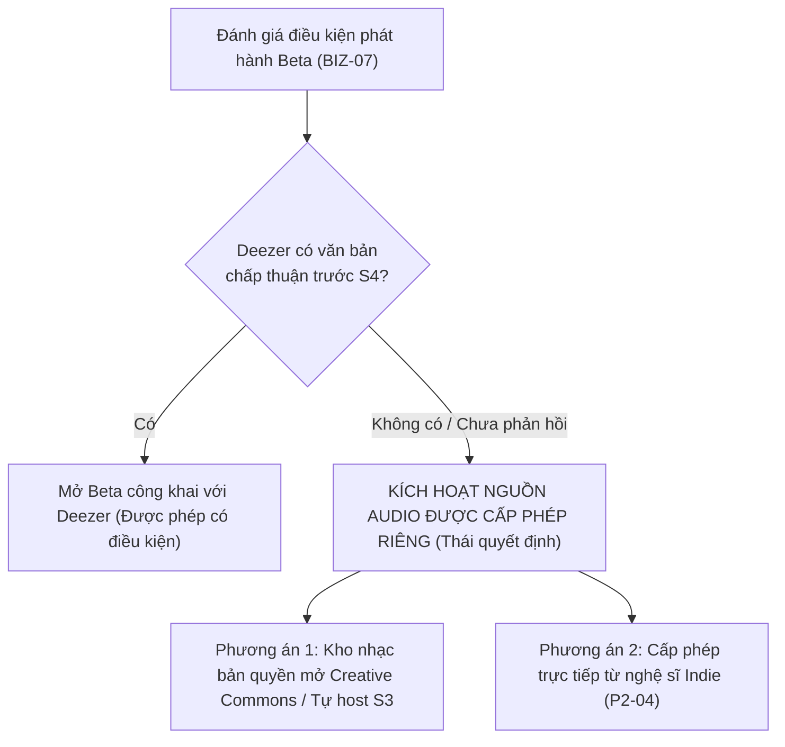

# Thẩm định quyền sử dụng preview nhạc cho Meloo (LEG-02)

- **Mã tài liệu:** LEG-02
- **Ngày lập:** 2026-10-28 · Sprint S1
- **Trạng thái:** Chờ phản hồi từ nhà cung cấp (Pending) · Thẩm định ToS hoàn tất
- **Thuộc ticket:** MEL-120
- **Phụ thuộc:** SPK-01 (MEL-25, đã merge qua PR #16)
- **Tác giả:** Antigravity (nghiên cứu & soạn thảo) · **Phê duyệt:** Chờ Trần Văn Thái (PO / Tech Lead) quyết định

---

## 1. Mục tiêu & Bối cảnh pháp lý

### 1.1. Mục tiêu
Xác định cơ sở pháp lý, phân tích các điều khoản dịch vụ (Terms of Service - ToS) và thẩm định quyền sử dụng đoạn nghe thử (preview) âm thanh tối đa 30 giây của các nhà cung cấp bên thứ ba (Deezer, Apple/iTunes) trong trò chơi đoán nhạc trực tuyến Meloo. Thiết lập cổng phê duyệt (Release Gate) rõ ràng cho đợt thử nghiệm công khai (Beta công khai - BIZ-07, MEL-78) nhằm bảo đảm tuân thủ Luật Sở hữu trí tuệ Việt Nam và các thỏa thuận dịch vụ quốc tế.

### 1.2. Bối cảnh kỹ thuật của Meloo
Meloo là nền tảng web game đoán tên bài hát trực tuyến nhiều người chơi (2–5 người/phòng) được xây dựng dưới dạng đồ án học thuật phi thương mại. Cơ chế chơi cốt lõi (BR-02) là mở dần đoạn nghe thử theo các mốc thời gian: 2 → 5 → 10 → 20 → 30 giây; đoán càng sớm điểm càng cao.

Để chống gian lận và bảo đảm công bằng (NFR-07, ADR-008):
- Client chỉ nhận token HMAC mờ (`/api/v1/audio/{token}`), không nhận URL trực tiếp của nhà cung cấp. Tên bài hát, ca sĩ và mã định danh (`trackId`) hoàn toàn không lộ trước thời điểm kết thúc vòng (`ROUND_END`).
- Backend làm nhiệm vụ streaming proxy chuyển tiếp trực tiếp luồng byte từ URL preview có chữ ký của nhà cung cấp (`hdnea` của Deezer, có hạn sống ~15 phút).
- URL có chữ ký chỉ được giữ tạm thời trong bộ nhớ RAM của tiến trình backend (in-memory cache) trong thời gian vòng đấu diễn ra (tối đa 15 phút theo hạn URL), tuyệt đối không lưu trữ vĩnh viễn trên cơ sở dữ liệu hay ổ cứng máy chủ.
- Backend chỉ truyền đúng số lượng byte tương ứng với mốc nghe được mở (2s, 5s, 10s, 20s, 30s) và không hỗ trợ tua trước.

---

## 2. Phân tích Điều khoản dịch vụ của các nhà cung cấp

### 2.1. Deezer for Developers (Nguồn đề xuất chính có điều kiện)
Tham chiếu: [Deezer Developer Terms of Use](https://developers.deezer.com/termsofuse), rà soát ngày 2026-10-21 và 2026-10-28.

| Tiêu chí | Quy định chính xác trong ToS Deezer | Phân tích đối với Meloo | Rủi ro pháp lý |
|---|---|---|:---:|
| **Phạm vi sử dụng** (Section IV) | *"The use of the Content is limited to a strictly private use within a family scope"* và *"The Service is strictly limited for a non-commercial purpose and in a non-commercial environment"*. | Meloo là đồ án học thuật phi thương mại. Tuy nhiên, giới hạn *"within a family scope"* (trong phạm vi gia đình) là một ràng buộc rất hẹp, đặt dấu hỏi lớn cho việc vận hành phòng chơi 2–5 người giữa những người dùng không cùng gia đình trên Internet. | **RỦI RO CAO**: Cần Deezer làm rõ văn bản về việc áp dụng ngoài phạm vi gia đình cho web game đố vui. |
| **Lưu trữ & Tải nội dung** (Section V) | Nghiêm cấm vượt qua các biện pháp bảo vệ kỹ thuật nhằm mục đích tải nội dung (*circumvent protection measures for the purpose of downloading the Content*). ToS **không có** điều khoản nào quy định về việc lưu trữ tạm thời (caching) tệp audio hay metadata. | Meloo không tải hay ghi tệp audio ra đĩa. Việc backend lưu tạm URL có chữ ký (`hdnea`) trong bộ nhớ RAM trong thời gian vòng chơi (< 15 phút) là **giải pháp kỹ thuật tự thiết kế của nhóm** nhằm giảm áp lực mạng, không phải là quyền đã được ToS công khai phê duyệt sẵn. | **TRUNG BÌNH (Vùng xám)**: Tuân thủ tinh thần không lưu trữ tệp vĩnh viễn, nhưng vẫn cần sự chấp thuận từ nhà cung cấp. |
| **Truyền phát & Proxy** | ToS **không có** điều khoản quy định về streaming proxy hoặc phát qua máy chủ trung gian. | Meloo dùng streaming proxy trên server để cắt đoạn 2/5/10/20/30s nhằm bảo vệ tính công bằng (chống người chơi inspect mạng để lộ đáp án). | **TRUNG BÌNH (Vùng xám)**: Phục vụ luật chơi chống gian lận nhưng nằm ngoài luồng phát tiêu chuẩn của ToS. |
| **Ghi nhận nguồn (Attribution)** (Section IV) | ToS chung **không có** điều khoản quy định attribution bắt buộc; trái lại Section IV cấm liên kết Dịch vụ/Nội dung với bất kỳ nhãn hiệu hay logo nào (*shall not be associated with any trademark, brand name, or logo*) trừ khi tuân thủ Trademark Guidelines riêng. | Meloo chủ động hiển thị logo Deezer, tên bài, ca sĩ và liên kết deep link tại `RoundEndSummary` để tôn trọng quyền tác giả và quảng bá cho nhà cung cấp. Đây là nỗ lực tự thân của nhóm, cần đối chiếu với Trademark Guidelines riêng của Deezer. | **TRUNG BÌNH**: Cần xác nhận với Deezer về mẫu hiển thị logo và liên kết. |
| **Lãnh thổ & Bản quyền** | ToS **không có** điều khoản cụ thể về giới hạn phân phối theo lãnh thổ (Section XI chỉ quy định luật áp dụng là pháp luật Cộng hòa Pháp). | Thực tế phân phối bản thu phụ thuộc vào catalog storefront từng quốc gia. SPK-01 đo tại Việt Nam đạt 94,3% (66/70 bài). Catalog có thể biến động bất kỳ lúc nào theo bản quyền của hãng đĩa. | **RỦI RO VẬN HÀNH**: Cần cơ chế fallback bỏ qua bài lỗi trong adapter kho nhạc. |

> [!NOTE]
> **Về căn cứ pháp lý theo Luật Sở hữu trí tuệ Việt Nam (Luật 50/2005/QH11, sửa đổi bởi Luật 07/2022/QH15):**
> - Đối với tác phẩm âm nhạc (quyền tác giả): Điều 25 khoản 1 điểm a quy định ngoại lệ không phải xin phép, không phải trả tiền bản quyền khi *"Tự sao chép một bản nhằm mục đích nghiên cứu khoa học, giảng dạy của cá nhân và không nhằm mục đích thương mại"*, đi kèm điều kiện tại khoản 2 (*"không được làm ảnh hưởng đến việc khai thác bình thường tác phẩm, không gây phương hại đến các quyền của tác giả, chủ sở hữu quyền tác giả; phải thông tin về tên tác giả và nguồn gốc, xuất xứ của tác phẩm"*).
> - Đối với bản ghi âm (quyền liên quan): Điều 32 khoản 1 điểm a cũng quy định giới hạn tương tự: *"Tự sao chép một bản nhằm mục đích nghiên cứu khoa học, giảng dạy của cá nhân và không nhằm mục đích thương mại"*.
> - **Phân tích giới hạn:** Cả Điều 25 và Điều 32 đều chỉ giới hạn ở hành vi *"tự sao chép một bản ... của cá nhân"*. Việc máy chủ backend streaming proxy phát đoạn nhạc qua mạng cho phòng 2–5 người chơi hoặc nhóm thử nghiệm Closed Beta nhiều khả năng **vượt ra ngoài phạm vi ngoại lệ tự sao chép của cá nhân**. Ngoài ra, các ngoại lệ luật định của quốc gia không mặc nhiên giải trừ nghĩa vụ ràng buộc theo hợp đồng dân sự khi chấp nhận ToS của Deezer. Do đó, việc sử dụng nội bộ vẫn cần được xem xét thận trọng và cần tham vấn chuyên gia pháp lý.

### 2.2. Apple / iTunes Search API (Nguồn dự phòng kỹ thuật)
Tham chiếu: [Apple Services Base Terms](https://www.apple.com/legal/internet-services/itunes/) và [Apple Search API / Affiliate Program Terms](https://performance-partners.apple.com/search-api), rà soát ngày 2026-10-21 và 2026-10-28.

* **Quy định chính thức của Apple:** Đoạn nghe thử 30 giây được cung cấp nhằm mục đích tiếp thị và cho phép người dùng nghe thử trước khi mua nội dung trên iTunes Store hoặc thuê bao Apple Music.
* **Điều khoản hạn chế nghiêm ngặt:** Điều khoản của Apple quy định rõ ràng rằng đoạn nghe thử:
  > *"is not used for independent entertainment value apart from its promotional purpose"*
  > *(không được sử dụng nhằm mục đích tạo ra giá trị giải trí độc lập tách rời khỏi mục đích quảng bá của dịch vụ)*.
* **Đánh giá pháp lý:** Trò chơi đoán nhạc Meloo sử dụng đoạn nghe thử trực tiếp làm nội dung chơi game giải trí, do đó vi phạm trực tiếp định nghĩa "tạo ra giá trị giải trí độc lập" nếu không có hợp đồng thương mại riêng với Apple.
* **Kết luận đối với iTunes (AC 3):**
  > [!CAUTION]
  > Theo Acceptance Criteria 3: iTunes được giữ ở trạng thái **tắt mặc định** và **tuyệt đối không kích hoạt** trong bất kỳ môi trường thử nghiệm nào nếu không có hợp đồng thương mại riêng bằng văn bản với Apple. Không suy rộng quyền sử dụng từ Search API hoặc Apple RSS feed.

---

## 3. Nhật ký liên hệ nhà cung cấp (AC 1)

Nhằm làm rõ quyền sử dụng cho trường hợp đặc thù của Meloo, nhóm phát triển đã tiến hành liên hệ chính thức tới Deezer.

### 3.1. Thông tin gửi thư
* **Đơn vị nhận:** Email hỗ trợ chung `support@deezer.com` (kênh hỗ trợ đối tác chung; *lưu ý: trang Developers ToS không công khai email, kênh cần xác minh chính thức*).
* **Cổng hỗ trợ nhà phát triển chính thức:** `https://developers.deezer.com/support` (yêu cầu đăng nhập tài khoản Deezer để gửi yêu cầu hỗ trợ kỹ thuật).
* **Người gửi:** Trần Văn Thái (Chủ sở hữu dự án & Lập trình viên chính).
* **Ngày giờ gửi:** **2026-10-28, khoảng 08:17** (Sprint S1).
* **Trạng thái:** **Đang chờ phản hồi (Pending)**.

### 3.2. Nội dung thư chính thức đã gửi (Bản 1 - Gửi ngày 28/10/2026 lúc ~08:17)

#### 3.2.1. Nguyên văn tiếng Anh (Bản 1)
```text
Subject: [Developer Inquiry] Confirmation of 30s Audio Preview Usage & Proxy Streaming for Educational Music Quiz Web App (Meloo)

Dear Deezer Developer Support Team,

My name is Tran Van Thai, and I am the lead developer of Meloo (https://github.com/ThaiDevv/meloo), an educational web-based music guessing game project developed in Vietnam.

We are preparing for an open beta trial and would like to formally inquire and seek written confirmation/clarification regarding our intended use of Deezer's 30-second audio previews under the Deezer Developer Terms of Use.

1. Application & Gameplay Overview:
- Meloo is a non-commercial educational project for multiplayer song-guessing games (2–5 players per room in real time).
- In each round, players listen to a progressively unlocked snippet of a track (2s, 5s, 10s, 20s, and up to 30s maximum) and guess the title.

2. Technical Integration & Anti-Cheat Proxy Mechanism:
- Fair-play Architecture: If the direct Deezer preview URL were sent directly to the client browser, players could inspect the browser network tab to reveal the track ID, metadata, or audio file directly before guessing.
- Server-side Short-lived Proxy: To prevent cheating and ensure fairness:
  * Our backend resolves the track metadata and temporary signed preview URL via Deezer API.
  * The signed Deezer URL is held temporarily ONLY in backend memory for the duration of the active game round (maximum 15 minutes, never persisted in any database or disk storage).
  * The backend delivers audio chunks to clients via short-lived HMAC-signed tokens (e.g., /api/v1/audio/{token}) corresponding strictly to the unlocked duration (2s, 5s, 10s, 20s, 30s).
  * No audio files are permanently downloaded, copied, cached on disk, or redistributed outside the ephemeral gameplay session.
- Attribution: We display full Deezer attribution (track title, artist name, and a direct link to Deezer track/album pages) once the round concludes.

3. Questions for Confirmation:
Could you kindly confirm:
a. Does this multiplayer trivia gameplay and ephemeral server-side streaming proxy (restricted strictly to 2/5/10/20/30-second progressive snippets) comply with Deezer Developer Terms of Use?
b. Is holding the signed preview URL transiently in server memory during an active round (max 15 minutes) acceptable?
c. Are there specific attribution guidelines, territory restrictions, or developer program agreements required for our upcoming public beta?

We greatly appreciate your time and guidance in ensuring full compliance with Deezer's policies.

Sincerely,
Tran Van Thai
Lead Developer, Meloo Project
Email: [tranvanthai...@...]
```

#### 3.2.2. Bản dịch tiếng Việt đối chiếu (Bản 1)
```text
Tiêu đề: [Câu hỏi dành cho nhà phát triển] Xác nhận quyền sử dụng đoạn nghe thử 30 giây & Cơ chế truyền trực tuyến qua máy chủ trung gian cho ứng dụng web game đoán nhạc học thuật (Meloo)

Kính gửi Đội ngũ Hỗ trợ Nhà phát triển Deezer,

Tôi tên là Trần Văn Thái, lập trình viên chính của dự án Meloo (https://github.com/ThaiDevv/meloo) — một dự án đồ án học thuật về web game đoán tên bài hát được phát triển tại Việt Nam.

Chúng tôi đang chuẩn bị cho đợt thử nghiệm mở (open beta) và muốn chính thức liên hệ để xin xác nhận/làm rõ bằng văn bản về việc sử dụng các đoạn nghe thử (preview) 30 giây từ Deezer theo Điều khoản sử dụng dành cho nhà phát triển của Deezer.

1. Tổng quan ứng dụng & Luật chơi:
- Meloo là đồ án học thuật phi thương mại, phục vụ trò chơi đoán bài hát nhiều người chơi (2–5 người/phòng theo thời gian thực).
- Trong mỗi vòng, người chơi sẽ nghe đoạn nhạc được mở dần theo từng mốc thời gian (2 giây, 5 giây, 10 giây, 20 giây và tối đa là 30 giây) để đoán tên bài hát.

2. Tích hợp kỹ thuật & Cơ chế chống gian lận qua máy chủ trung gian (Proxy):
- Kiến trúc đảm bảo công bằng: Nếu gửi trực tiếp đường dẫn preview của Deezer về trình duyệt người chơi, họ có thể mở tab Network để xem mã bài hát (track ID), thông tin bài hát hoặc file âm thanh trước khi đoán.
- Máy chủ trung gian tạm thời (Server-side Short-lived Proxy): Để chống gian lận và giữ tính công bằng:
  * Máy chủ của chúng tôi gọi Deezer API để lấy thông tin bài hát và đường dẫn preview có chữ ký tạm thời.
  * Đường dẫn preview có chữ ký của Deezer CHỈ được lưu tạm trong bộ nhớ RAM của máy chủ trong suốt thời gian vòng chơi diễn ra (tối đa 15 phút, tuyệt đối không lưu vào cơ sở dữ liệu hay ổ cứng).
  * Máy chủ truyền các đoạn âm thanh nhỏ về trình duyệt người chơi thông qua mã token HMAC có thời hạn ngắn (ví dụ: /api/v1/audio/{token}), tương ứng chính xác với độ dài đoạn nhạc được mở ở mốc đó (2s, 5s, 10s, 20s, 30s).
  * Tuyệt đối không tải vĩnh viễn, không sao chép, không lưu bộ nhớ đệm trên đĩa, và không phát tán lại file âm thanh ra bên ngoài phiên chơi tức thời này.
- Ghi nhận nguồn: Khi vòng chơi kết thúc, hệ thống hiển thị đầy đủ thông tin nguồn Deezer (tên bài hát, nghệ sĩ và đường dẫn trực tiếp đến trang bài hát/album trên Deezer).

3. Các câu hỏi cần Deezer xác nhận:
Kính mong quý đội ngũ giải đáp giúp chúng tôi:
a. Lối chơi đố vui nhiều người cùng cơ chế truyền phát âm thanh tạm thời qua máy chủ trung gian (giới hạn nghiêm ngặt theo các đoạn cắt nhỏ 2/5/10/20/30 giây) như trên có phù hợp với Điều khoản sử dụng dành cho nhà phát triển của Deezer hay không?
b. Việc lưu tạm thời đường dẫn preview có chữ ký trong bộ nhớ RAM của máy chủ suốt thời gian vòng chơi (< 15 phút) có được chấp thuận không?
c. Deezer có quy định riêng nào về cách hiển thị nguồn (attribution), giới hạn vùng lãnh thổ, hoặc có yêu cầu ký thỏa thuận đối tác nhà phát triển nào cho đợt beta công khai sắp tới của chúng tôi hay không?

Chúng tôi rất trân trọng thời gian và sự hướng dẫn của quý đội ngũ nhằm đảm bảo dự án tuân thủ đầy đủ các chính sách của Deezer.

Trân trọng,
Trần Văn Thái
Lập trình viên chính, Dự án Meloo
```

### 3.3. Bản nháp câu hỏi bổ sung (Bản 2 - Dự kiến gửi qua cổng support của Deezer)
Nhằm làm rõ thêm điều khoản giới hạn trong phạm vi gia đình (*family scope*) được phát hiện qua đợt rà soát ToS, nhóm đã chuẩn bị sẵn câu hỏi bổ sung để gửi tiếp khi mở ticket hỗ trợ trên cổng `https://developers.deezer.com/support` hoặc khi nhận được thư phản hồi đầu tiên:
```text
Question 3.b (Additional inquiry):
Does Section IV's restriction regarding "strictly private use within a family scope" permit non-commercial testing among small study groups or student peers (2-5 users per room in an educational project)?
(Bản dịch: Quy định tại Mục IV về việc sử dụng "nghiêm ngặt trong phạm vi gia đình" có cho phép thử nghiệm phi thương mại trong các nhóm học tập nhỏ hoặc bạn học sinh viên từ 2–5 người/phòng trong một đồ án giáo dục hay không?)
```

### 3.4. Quy tắc xử lý thời hạn phản hồi (Quy tắc mốc S4)
* Do quy trình phản hồi của các hãng cung cấp quốc tế thường kéo dài nhiều ngày hoặc nhiều tuần:
  * Nếu Deezer phản hồi chấp thuận bằng văn bản trước Sprint S4: Bổ sung phản hồi (đã che thông tin cá nhân/nhạy cảm) vào tài liệu này và chuyển kết luận sang **"Được phép có điều kiện"**.
  * **Nếu đến hết Sprint S4 (chuẩn bị mở Beta) mà vẫn chưa có phản hồi chính thức:** Tự động kết luận là **"Chưa có kết luận / Không đủ căn cứ pháp lý" (No-go)** đối với việc dùng preview Deezer cho Public Beta. Cổng phát hành BIZ-07 sẽ kích hoạt phương án nguồn nhạc thay thế được cấp phép riêng do Thái quyết định.

---

## 4. Giới hạn lưu giữ URL preview, Attribution & Lãnh thổ (AC 2)

Dựa trên phân tích ToS và thiết kế hệ thống, các giới hạn tự áp đặt sau đây phải được áp dụng nghiêm ngặt trong mã nguồn để hạn chế tối đa rủi ro vi phạm:

1. **Giới hạn lưu giữ URL và Audio (Storage Boundaries):**
   - **Tuyệt đối không lưu tệp audio:** Backend không lưu trữ tệp `.mp3` xuống ổ cứng (EBS), cơ sở dữ liệu (PostgreSQL) hay bất kỳ hệ thống lưu trữ đối tượng nào (S3).
   - **Giới hạn in-memory cache:** URL preview có chữ ký của Deezer (`hdnea`, thời hạn hiệu lực ~900 giây / 15 phút) chỉ được phép lưu tạm thời trong bộ nhớ RAM của tiến trình backend trong phạm vi vòng đấu hiện tại (`Round`). Khi vòng đấu kết thúc hoặc quá 15 phút, mục cache này phải bị hủy ngay lập tức. Không tái sử dụng URL ký giữa các phiên hoặc các vòng đấu khác nhau.
2. **Quy định ghi nhận nguồn (Attribution Standards):**
   - Màn hình kết thúc vòng (`RoundEndSummary`) và màn hình tổng kết trận (`GameResultModal`) bắt buộc hiển thị:
     * Logo biểu trưng của Deezer kèm dòng chữ *"Phát đoạn nghe thử qua Deezer"* (Powered by Deezer).
     * Tên bài hát và tên nghệ sĩ chính xác theo metadata của Deezer.
     * Liên kết có thể nhấp (clickable link) trỏ trực tiếp về trang bài hát trên dịch vụ Deezer để khuyến khích người chơi nghe trọn vẹn bản quyền.
3. **Giới hạn lãnh thổ (Territorial Restrictions):**
   - Hệ thống chấp nhận rằng preview nhạc chỉ khả dụng tại các vùng lãnh thổ mà Deezer có bản quyền phân phối (storefront Việt Nam và quốc tế).
   - Khi API Deezer trả về lỗi không tìm thấy preview hoặc tệp audio không khả dụng tại IP của server (HTTP 404 hoặc stream rỗng), backend phải ghi nhận trạng thái bài hát bị lỗi, tự động bỏ qua và chuyển sang bài hát hợp lệ khác, không làm gián đoạn phòng chơi.

---

## 5. Nguồn audio được cấp phép riêng thay thế cho Beta (AC 4)

Trong trường hợp không nhận được văn bản chấp thuận từ Deezer trước thời điểm phát hành Beta công khai (BIZ-07), nhóm phát triển chuẩn bị sẵn 2 phương án nguồn audio được cấp phép riêng đáp ứng đầy đủ yêu cầu của AC 4:



### 5.1. Hai phương án nguồn audio cấp phép riêng (AC 4)
1. **Phương án 1 (Khuyến nghị kỹ thuật): Kho nhạc bản quyền tự do Creative Commons (CC-BY / CC0) tự host:**
   - Sử dụng các bản thu từ các nền tảng mở như Free Music Archive (FMA), Musopen hoặc Wikimedia Commons có giấy phép CC0 (Public Domain) hoặc CC-BY (ghi công tác giả).
   - Lưu trữ các đoạn preview 30 giây được chuẩn hóa trực tiếp trên AWS S3 và phân phối qua CloudFront.
   - *Ưu điểm:* 100% sạch về pháp lý, tự chủ hoàn toàn về bitrate, offset thời gian và không phụ thuộc vào hạ tầng hay ToS của bên thứ ba.
2. **Phương án 2: Hợp tác cấp phép trực tiếp với nghệ sĩ Indie:**
   - Liên hệ trực tiếp các nghệ sĩ trẻ / indie tại Việt Nam để xin cấp quyền sử dụng các bản nhạc độc lập phục vụ quảng bá trong game (phù hợp định hướng phát triển bài hát tài trợ P2-04).

### 5.2. Biện pháp quản lý phạm vi thử nghiệm: Closed Beta (< 50 người)
* Đây là biện pháp giới hạn quy mô thử nghiệm nhằm hạn chế phát tán ra công chúng, không phải là một "nguồn audio cấp phép riêng".
* Nếu Thái quyết định giới hạn đợt thử nghiệm thành Closed Beta (chỉ mở cho danh sách mời dưới 50 người dùng bao gồm sinh viên trong lớp và giảng viên), đợt thử nghiệm này giảm thiểu rủi ro lan truyền trên mạng mở. Tuy nhiên, rủi ro điều khoản "family scope" của Deezer và ranh giới ngoại lệ tự sao chép của Luật SHTT vẫn tồn tại và cần được Thái cân nhắc, tham vấn.

---

## 6. Đề xuất ma trận quyết định Go/No-go cho Beta (Chờ Thái quyết định)

| Môi trường / Mục đích | Nguồn nhạc áp dụng | Đề xuất của agent | Rủi ro pháp lý & Điều kiện áp dụng |
|---|---|:---:|---|
| **Môi trường phát triển & Đồ án nội bộ** (Local dev, CI/CD, bảo vệ tốt nghiệp) | Deezer (MP3 128 kbps) | **ĐỀ XUẤT NỘI BỘ (CHỜ THAM VẤN / THÁI QUYẾT ĐỊNH)** | Chưa có kết luận pháp lý chính thức. Chỉ nên giới hạn nghiêm ngặt trên môi trường máy cá nhân của lập trình viên (localhost); streaming qua mạng nội bộ cần được tham vấn pháp lý hoặc chờ Deezer xác nhận. |
| **Thử nghiệm đóng** (Closed Beta nội bộ, giới hạn < 50 người dùng) | Deezer (MP3 128 kbps) | **CHỜ THÁI QUYẾT ĐỊNH** | Tồn tại rủi ro vi phạm điều khoản *"family scope"* của Deezer và vượt ngoài ngoại lệ tự sao chép cá nhân của Luật SHTT. Nếu Thái chấp nhận rủi ro này thì áp dụng kèm attribution đầy đủ; nếu không, chuyển sang Phương án 1 (nhạc Creative Commons tự host). |
| **Beta công khai** (Public Beta - BIZ-07 / MEL-78) | Deezer (MP3 128 kbps) | **NO-GO (CHƯA ĐỦ ĐIỀU KIỆN)** | **Tuyệt đối không mở Public Beta với Deezer** khi chưa có văn bản chấp thuận từ Deezer. Nếu đến hết S4 không có phản hồi, Thái quyết định kích hoạt Phương án 1 (nhạc Creative Commons tự host). |
| **Mọi môi trường** (Dev, Beta, Production) | Apple / iTunes Preview | **NO-GO (TẮT MẶC ĐỊNH)** | Vi phạm điều khoản cấm tạo giá trị giải trí độc lập của Apple. Tuyệt đối không kích hoạt nếu không có hợp đồng thương mại riêng với Apple (khớp AC 3). |

---

## 7. Câu hỏi bảo vệ đồ án (Defense Q&A)

1. **Tại sao Meloo không gửi trực tiếp URL preview từ nhà cung cấp cho người chơi mà phải dùng máy chủ làm proxy trung gian?**
   - *Trả lời:* Nếu gửi thẳng URL của nhà cung cấp về trình duyệt, người chơi chỉ cần mở tab Network trong công cụ lập trình (DevTools) là sẽ thấy ngay `trackId`, tên bài hát hoặc metadata trong URL/header, phá vỡ hoàn toàn tính công bằng của game (NFR-07). Máy chủ làm streaming proxy với token mờ HMAC ngắn hạn (`/api/v1/audio/{token}`) giúp che giấu toàn bộ thông tin bài hát trước khi vòng chơi kết thúc, đồng thời kiểm soát chính xác độ dài byte phát tương ứng với từng mức thời gian mở dần 2/5/10/20/30 giây.

2. **Việc máy chủ làm proxy và điều khoản "family scope" của Deezer được xử lý ra sao?**
   - *Trả lời:* Rà soát pháp lý của nhóm chỉ ra rằng ToS của Deezer giới hạn sử dụng *"within a family scope"* và cấm vượt rào kỹ thuật để tải nội dung. Đồng thời, ngoại lệ tại Điều 25 và 32 Luật SHTT Việt Nam cũng chỉ áp dụng cho việc tự sao chép của cá nhân. Mặc dù Meloo tuân thủ nguyên tắc không lưu trữ tệp audio ra đĩa và chỉ cache tạm URL ký trong RAM < 15 phút, rủi ro pháp lý vẫn tồn tại khi phát qua mạng. Nhóm đã chủ động gửi thư làm rõ (Bản 1 ngày 28/10/2026) và đang chuẩn bị gửi câu hỏi bổ sung về phạm vi gia đình (Bản 2), đồng thời đặt quy định Release Gate (AC 6): Public Beta bị chặn (No-go) cho đến khi Deezer chấp thuận bằng văn bản. Nếu không có phản hồi trước S4, dự án sẽ chuyển sang kho nhạc bản quyền tự do Creative Commons do Thái quyết định.

3. **Tại sao nhóm không sử dụng iTunes Search API dù độ phủ bản thu của Apple đạt 100% trong bài đo SPK-01?**
   - *Trả lời:* Điều khoản của Apple quy định rõ ràng rằng đoạn nghe thử *"is not used for independent entertainment value apart from its promotional purpose"*. Vì game đoán nhạc sử dụng âm thanh làm nội dung giải trí chính, việc dùng iTunes sẽ vi phạm ToS của Apple nếu không có hợp đồng thương mại riêng. Ngược lại, Deezer sử dụng định dạng MP3 128 kbps giúp tiết kiệm hơn 52% băng thông mạng máy chủ so với định dạng AAC 268 kbps của Apple.

4. **Nếu nhà cung cấp không phản hồi thư hoặc từ chối cấp quyền, dự án xử lý thế nào để không bị dừng đợt Beta?**
   - *Trả lời:* Nhóm đã thiết kế sẵn kiến trúc Adapter cho kho nhạc và có 2 phương án nguồn audio cấp phép riêng: chuyển sang sử dụng kho nhạc bản quyền mở Creative Commons (CC-BY / CC0 tự host trên S3) hoặc hợp tác với nghệ sĩ Indie (P2-04). Kiến trúc streaming proxy qua token mờ của Meloo hoàn toàn độc lập với nguồn phát, sẵn sàng chuyển đổi nguồn nhạc mà không cần thay đổi kiến trúc hệ thống.
