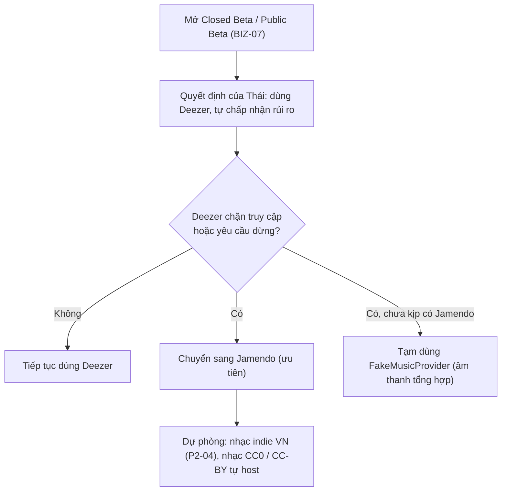

# Thẩm định quyền sử dụng preview nhạc cho Meloo (LEG-02)

- **Mã tài liệu:** LEG-02
- **Ngày lập:** 2026-10-28 · Sprint S1 · **Cập nhật:** 2026-10-28 (sau phản hồi của Deezer)
- **Trạng thái:** Đã có phản hồi bằng văn bản của Deezer: **không có đường xin duyệt** cho dự án như Meloo · Thái quyết định (2026-10-28) vẫn dùng Deezer ở mọi môi trường và tự chấp nhận rủi ro; Jamendo là nguồn thay thế ưu tiên nếu cần đổi
- **Thuộc ticket:** MEL-120
- **Phụ thuộc:** SPK-01 (MEL-25, đã merge qua PR #16)
- **Tác giả:** Antigravity (bản đầu, PR #39) · Claude (cập nhật sau phản hồi của Deezer) · **Phê duyệt:** Trần Văn Thái (PO / Tech Lead), thể hiện bằng việc merge PR này; các dòng ghi "Đề xuất" ở Mục 6 chỉ có hiệu lực khi Thái duyệt bằng việc merge

---

## 1. Mục tiêu & Bối cảnh pháp lý

### 1.1. Mục tiêu
Xác định cơ sở pháp lý, phân tích các điều khoản dịch vụ (Terms of Service - ToS) và thẩm định quyền sử dụng đoạn nghe thử (preview) âm thanh tối đa 30 giây của các nhà cung cấp bên thứ ba (Deezer, Apple/iTunes và nguồn thay thế Jamendo) trong trò chơi đoán nhạc trực tuyến Meloo. Thiết lập cổng phê duyệt (Release Gate) rõ ràng cho đợt thử nghiệm công khai (Beta công khai - BIZ-07, MEL-78) nhằm bảo đảm tuân thủ Luật Sở hữu trí tuệ Việt Nam và các thỏa thuận dịch vụ quốc tế.

### 1.2. Bối cảnh kỹ thuật của Meloo
Meloo là nền tảng web game đoán tên bài hát trực tuyến nhiều người chơi (2–5 người/phòng) được xây dựng dưới dạng đồ án học thuật phi thương mại. Cơ chế chơi cốt lõi (BR-02) là mở dần đoạn nghe thử theo các mốc thời gian: 2 → 5 → 10 → 20 → 30 giây; đoán càng sớm điểm càng cao.

Để chống gian lận và bảo đảm công bằng (NFR-07, ADR-008):
- Client chỉ nhận token HMAC mờ (`/api/v1/audio/{token}`), không nhận URL trực tiếp của nhà cung cấp. Tên bài hát, ca sĩ và mã định danh (`trackId`) hoàn toàn không lộ trước thời điểm kết thúc vòng (`ROUND_END`).
- Backend làm nhiệm vụ streaming proxy chuyển tiếp trực tiếp luồng byte từ URL preview có chữ ký của nhà cung cấp (`hdnea` của Deezer, có hạn sống ~15 phút).
- URL có chữ ký chỉ được giữ tạm thời trong bộ nhớ RAM của tiến trình backend (in-memory cache) trong thời gian vòng đấu diễn ra (tối đa 15 phút theo hạn URL), tuyệt đối không lưu trữ vĩnh viễn trên cơ sở dữ liệu hay ổ cứng máy chủ.
- Backend chỉ truyền đúng số lượng byte tương ứng với mốc nghe được mở (2s, 5s, 10s, 20s, 30s) và không hỗ trợ tua trước.

---

## 2. Phân tích Điều khoản dịch vụ của các nhà cung cấp

### 2.1. Deezer for Developers (nguồn dùng cho dev/test; không dùng cho Public Beta)
Tham chiếu: [Deezer Developer Terms of Use](https://developers.deezer.com/termsofuse), rà soát ngày 2026-10-21 và 2026-10-28.

| Tiêu chí | Quy định chính xác trong ToS Deezer | Phân tích đối với Meloo | Rủi ro pháp lý |
|---|---|---|:---:|
| **Phạm vi sử dụng** (Section IV) | *"The use of the Content is limited to a strictly private use within a family scope"* và *"The Service is strictly limited for a non-commercial purpose and in a non-commercial environment"*. | Meloo là đồ án học thuật phi thương mại. Tuy nhiên, giới hạn *"within a family scope"* (trong phạm vi gia đình) là một ràng buộc rất hẹp, đặt dấu hỏi lớn cho việc vận hành phòng chơi 2–5 người giữa những người dùng không cùng gia đình trên Internet. | **RỦI RO CAO**: Cần Deezer làm rõ văn bản về việc áp dụng ngoài phạm vi gia đình cho web game đố vui. |
| **Lưu trữ & Tải nội dung** (Section V) | Nghiêm cấm vượt qua các biện pháp bảo vệ kỹ thuật nhằm mục đích tải nội dung (*circumvent protection measures for the purpose of downloading the Content*). ToS **không có** điều khoản nào quy định về việc lưu trữ tạm thời (caching) tệp audio hay metadata. | Meloo không tải hay ghi tệp audio ra đĩa. Việc backend lưu tạm URL có chữ ký (`hdnea`) trong bộ nhớ RAM trong thời gian vòng chơi (< 15 phút) là **giải pháp kỹ thuật tự thiết kế của nhóm** nhằm giảm áp lực mạng, không phải là quyền đã được ToS công khai phê duyệt sẵn. | **TRUNG BÌNH (Vùng xám)**: Tuân thủ tinh thần không lưu trữ tệp vĩnh viễn, nhưng vẫn cần sự chấp thuận từ nhà cung cấp. |
| **Truyền phát & Proxy** | ToS **không có** điều khoản quy định về streaming proxy hoặc phát qua máy chủ trung gian. | Meloo dùng streaming proxy trên server để cắt đoạn 2/5/10/20/30s nhằm bảo vệ tính công bằng (chống người chơi inspect mạng để lộ đáp án). | **TRUNG BÌNH (Vùng xám)**: Phục vụ luật chơi chống gian lận nhưng nằm ngoài luồng phát tiêu chuẩn của ToS. |
| **Ghi nhận nguồn (Attribution)** (Section IV) | ToS chung **không có** điều khoản quy định attribution bắt buộc; trái lại Section IV cấm liên kết Dịch vụ/Nội dung với bất kỳ nhãn hiệu hay logo nào (*shall not be associated with any trademark, brand name, or logo*) trừ khi tuân thủ Trademark Guidelines riêng. | Meloo chủ động hiển thị logo Deezer, tên bài, ca sĩ và liên kết deep link tại `RoundEndSummary` để tôn trọng quyền tác giả và quảng bá cho nhà cung cấp. Đây là nỗ lực tự thân của nhóm, cần đối chiếu với Trademark Guidelines riêng của Deezer. | **TRUNG BÌNH**: Cần xác nhận với Deezer về mẫu hiển thị logo và liên kết. |
| **Lãnh thổ & Bản quyền** | ToS **không có** điều khoản cụ thể về giới hạn phân phối theo lãnh thổ (Section XI chỉ quy định luật áp dụng là pháp luật Cộng hòa Pháp). | Thực tế phân phối bản thu phụ thuộc vào catalog storefront từng quốc gia. SPK-01 đo tại Việt Nam đạt 94,3% (66/70 bài). Catalog có thể biến động bất kỳ lúc nào theo bản quyền của hãng đĩa. | **RỦI RO VẬN HÀNH**: Cần cơ chế fallback bỏ qua bài lỗi trong adapter kho nhạc. |

> **Cập nhật 2026-10-28:** Deezer đã trả lời bằng văn bản (Mục 3.4): không nhận đăng ký ứng dụng API mới, không có mốc mở lại và không xác nhận cách dùng của Meloo. Các mức rủi ro trong bảng trên vì vậy không còn đường làm rõ chính thức; Thái quyết định vẫn dùng Deezer ở mọi môi trường và tự chấp nhận rủi ro (Mục 6).

> [!NOTE]
> **Về căn cứ pháp lý theo Luật Sở hữu trí tuệ Việt Nam (Luật 50/2005/QH11, sửa đổi bởi Luật 07/2022/QH15):**
> - Đối với tác phẩm âm nhạc (quyền tác giả): Điều 25 khoản 1 điểm a quy định ngoại lệ không phải xin phép, không phải trả tiền bản quyền khi *"Tự sao chép một bản nhằm mục đích nghiên cứu khoa học, giảng dạy, học tập của cá nhân và không nhằm mục đích thương mại"*, đi kèm điều kiện tại khoản 2 (*"không được làm ảnh hưởng đến việc khai thác bình thường tác phẩm, không gây phương hại đến các quyền của tác giả, chủ sở hữu quyền tác giả; phải thông tin về tên tác giả và nguồn gốc, xuất xứ của tác phẩm"*).
> - Đối với bản ghi âm (quyền liên quan): Điều 32 khoản 1 điểm a quy định giới hạn tương tự nhưng khác chữ: *"Tự sao chép một bản nhằm mục đích nghiên cứu khoa học, học tập của cá nhân và không nhằm mục đích thương mại"* (điểm b riêng về giảng dạy), kèm điều kiện tại khoản 2 (không ảnh hưởng việc khai thác bình thường, không gây phương hại đến quyền của người biểu diễn, nhà sản xuất bản ghi âm, tổ chức phát sóng, và phải thông tin về nguồn). Trích theo Luật 07/2022/QH15; chưa đối chiếu văn bản hợp nhất mới nhất.
> - **Phân tích giới hạn:** Cả Điều 25 và Điều 32 đều chỉ giới hạn ở hành vi *"tự sao chép một bản ... của cá nhân"*. Việc máy chủ backend streaming proxy phát đoạn nhạc qua mạng cho phòng 2–5 người chơi hoặc nhóm thử nghiệm Closed Beta nhiều khả năng **vượt ra ngoài phạm vi ngoại lệ tự sao chép của cá nhân**. Ngoài ra, các ngoại lệ luật định của quốc gia không mặc nhiên giải trừ nghĩa vụ ràng buộc theo hợp đồng dân sự khi chấp nhận ToS của Deezer. Do đó, việc sử dụng nội bộ vẫn cần được xem xét thận trọng và cần tham vấn chuyên gia pháp lý.

### 2.2. Apple / iTunes Search API (Nguồn dự phòng kỹ thuật)
Tham chiếu: [Apple Services Base Terms](https://www.apple.com/legal/internet-services/itunes/) và [Apple Search API / Affiliate Program Terms](https://performance-partners.apple.com/search-api), rà soát ngày 2026-10-21 và 2026-10-28.

* **Quy định chính thức của Apple:** Đoạn nghe thử 30 giây được cung cấp nhằm mục đích tiếp thị và cho phép người dùng nghe thử trước khi mua nội dung trên iTunes Store hoặc thuê bao Apple Music.
* **Điều khoản hạn chế nghiêm ngặt:** Điều khoản của Apple quy định rõ ràng rằng đoạn nghe thử:
  > *"is not used for independent entertainment value apart from its promotional purpose"*
  > *(không được sử dụng nhằm mục đích tạo ra giá trị giải trí độc lập tách rời khỏi mục đích quảng bá của dịch vụ)*.
* **Đánh giá pháp lý:** Trò chơi đoán nhạc Meloo sử dụng đoạn nghe thử trực tiếp làm nội dung chơi game giải trí, do đó vi phạm trực tiếp định nghĩa "tạo ra giá trị giải trí độc lập" nếu không có hợp đồng thương mại riêng với Apple.
* **Kết luận đối với iTunes (AC 3):**
  > [!CAUTION]
  > Theo Acceptance Criteria 3: iTunes được giữ ở trạng thái **tắt mặc định** và **tuyệt đối không kích hoạt** trong bất kỳ môi trường thử nghiệm nào nếu không có hợp đồng thương mại riêng bằng văn bản với Apple. Không suy rộng quyền sử dụng từ Search API hoặc Apple RSS feed.

---

## 3. Nhật ký liên hệ nhà cung cấp (AC 1)

Nhằm làm rõ quyền sử dụng cho trường hợp đặc thù của Meloo, Thái đã liên hệ Deezer qua email hỗ trợ. Giờ trong mục này tính theo múi giờ +0700 và được đối chiếu với hộp thư Gmail của Thái (đọc bằng công cụ chỉ đọc ngày 2026-10-28), không phải số liệu tự khai.

### 3.1. Thông tin gửi thư
* **Đơn vị nhận:** Email hỗ trợ chung `support@deezer.com`. Trang Developers và ToS không công khai địa chỉ email; Deezer đã trả lời thư gửi tới địa chỉ này và mở ticket hỗ trợ, nên kênh này liên lạc được, nhưng chưa được Deezer công bố là kênh dành riêng cho nhà phát triển.
* **Cổng hỗ trợ nhà phát triển:** `https://developers.deezer.com/support` (yêu cầu đăng nhập tài khoản Deezer). Chưa dùng.
* **Người gửi:** Trần Văn Thái (Chủ sở hữu dự án & Lập trình viên chính).
* **Bản 1:** gửi **2026-10-28 08:16** tới `support@deezer.com` (nội dung ở 3.2).
* **Bản 2 (câu hỏi bổ sung về phạm vi gia đình):** gửi **2026-10-28 09:11**, trả lời trong cùng chuỗi thư (nội dung ở 3.3).
* **Ticket hỗ trợ:** **8870718**, mở **2026-10-28 14:30** sau khi Thái yêu cầu chuyển cho nhân viên thật.
* **Trạng thái:** **Đã có phản hồi từ nhân viên Deezer (16:38 cùng ngày)**, xem 3.4.

### 3.2. Nội dung thư chính thức đã gửi (Bản 1 - Gửi 2026-10-28 lúc 08:16)

#### 3.2.1. Nguyên văn tiếng Anh (Bản 1)
```text
Subject: [Developer Inquiry] Confirmation of 30s Audio Preview Usage & Proxy Streaming for Educational Music Quiz Web App (Meloo)

Dear Deezer Developer Support Team,

My name is Tran Van Thai, and I am the lead developer of Meloo (https://github.com/ThaiDevv/meloo), an educational web-based music guessing game project developed in Vietnam.

We are preparing for an open beta trial and would like to formally inquire and seek written confirmation/clarification regarding our intended use of Deezer's 30-second audio previews under the Deezer Developer Terms of Use.

1. Application & Gameplay Overview:
- Meloo is a non-commercial educational project for multiplayer song-guessing games (2–5 players per room in real time).
- In each round, players listen to a progressively unlocked snippet of a track (2s, 5s, 10s, 20s, and up to 30s maximum) and guess the title.

2. Technical Integration & Anti-Cheat Proxy Mechanism:
- Fair-play Architecture: If the direct Deezer preview URL were sent directly to the client browser, players could inspect the browser network tab to reveal the track ID, metadata, or audio file directly before guessing.
- Server-side Short-lived Proxy: To prevent cheating and ensure fairness:
  * Our backend resolves the track metadata and temporary signed preview URL via Deezer API.
  * The signed Deezer URL is held temporarily ONLY in backend memory for the duration of the active game round (maximum 15 minutes, never persisted in any database or disk storage).
  * The backend delivers audio chunks to clients via short-lived HMAC-signed tokens (e.g., /api/v1/audio/{token}) corresponding strictly to the unlocked duration (2s, 5s, 10s, 20s, 30s).
  * No audio files are permanently downloaded, copied, cached on disk, or redistributed outside the ephemeral gameplay session.
- Attribution: We display full Deezer attribution (track title, artist name, and a direct link to Deezer track/album pages) once the round concludes.

3. Questions for Confirmation:
Could you kindly confirm:
a. Does this multiplayer trivia gameplay and ephemeral server-side streaming proxy (restricted strictly to 2/5/10/20/30-second progressive snippets) comply with Deezer Developer Terms of Use?
b. Is holding the signed preview URL transiently in server memory during an active round (max 15 minutes) acceptable?
c. Are there specific attribution guidelines, territory restrictions, or developer program agreements required for our upcoming public beta?

We greatly appreciate your time and guidance in ensuring full compliance with Deezer's policies.

Sincerely,
Tran Van Thai
Lead Developer, Meloo Project
Email: [tranvanthai...@...]
```

#### 3.2.2. Bản dịch tiếng Việt đối chiếu (Bản 1)
```text
Tiêu đề: [Câu hỏi dành cho nhà phát triển] Xác nhận quyền sử dụng đoạn nghe thử 30 giây & Cơ chế truyền trực tuyến qua máy chủ trung gian cho ứng dụng web game đoán nhạc học thuật (Meloo)

Kính gửi Đội ngũ Hỗ trợ Nhà phát triển Deezer,

Tôi tên là Trần Văn Thái, lập trình viên chính của dự án Meloo (https://github.com/ThaiDevv/meloo) — một dự án đồ án học thuật về web game đoán tên bài hát được phát triển tại Việt Nam.

Chúng tôi đang chuẩn bị cho đợt thử nghiệm mở (open beta) và muốn chính thức liên hệ để xin xác nhận/làm rõ bằng văn bản về việc sử dụng các đoạn nghe thử (preview) 30 giây từ Deezer theo Điều khoản sử dụng dành cho nhà phát triển của Deezer.

1. Tổng quan ứng dụng & Luật chơi:
- Meloo là đồ án học thuật phi thương mại, phục vụ trò chơi đoán bài hát nhiều người chơi (2–5 người/phòng theo thời gian thực).
- Trong mỗi vòng, người chơi sẽ nghe đoạn nhạc được mở dần theo từng mốc thời gian (2 giây, 5 giây, 10 giây, 20 giây và tối đa là 30 giây) để đoán tên bài hát.

2. Tích hợp kỹ thuật & Cơ chế chống gian lận qua máy chủ trung gian (Proxy):
- Kiến trúc đảm bảo công bằng: Nếu gửi trực tiếp đường dẫn preview của Deezer về trình duyệt người chơi, họ có thể mở tab Network để xem mã bài hát (track ID), thông tin bài hát hoặc file âm thanh trước khi đoán.
- Máy chủ trung gian tạm thời (Server-side Short-lived Proxy): Để chống gian lận và giữ tính công bằng:
  * Máy chủ của chúng tôi gọi Deezer API để lấy thông tin bài hát và đường dẫn preview có chữ ký tạm thời.
  * Đường dẫn preview có chữ ký của Deezer CHỈ được lưu tạm trong bộ nhớ RAM của máy chủ trong suốt thời gian vòng chơi diễn ra (tối đa 15 phút, tuyệt đối không lưu vào cơ sở dữ liệu hay ổ cứng).
  * Máy chủ truyền các đoạn âm thanh nhỏ về trình duyệt người chơi thông qua mã token HMAC có thời hạn ngắn (ví dụ: /api/v1/audio/{token}), tương ứng chính xác với độ dài đoạn nhạc được mở ở mốc đó (2s, 5s, 10s, 20s, 30s).
  * Tuyệt đối không tải vĩnh viễn, không sao chép, không lưu bộ nhớ đệm trên đĩa, và không phát tán lại file âm thanh ra bên ngoài phiên chơi tức thời này.
- Ghi nhận nguồn: Khi vòng chơi kết thúc, hệ thống hiển thị đầy đủ thông tin nguồn Deezer (tên bài hát, nghệ sĩ và đường dẫn trực tiếp đến trang bài hát/album trên Deezer).

3. Các câu hỏi cần Deezer xác nhận:
Kính mong quý đội ngũ giải đáp giúp chúng tôi:
a. Lối chơi đố vui nhiều người cùng cơ chế truyền phát âm thanh tạm thời qua máy chủ trung gian (giới hạn nghiêm ngặt theo các đoạn cắt nhỏ 2/5/10/20/30 giây) như trên có phù hợp với Điều khoản sử dụng dành cho nhà phát triển của Deezer hay không?
b. Việc lưu tạm thời đường dẫn preview có chữ ký trong bộ nhớ RAM của máy chủ suốt thời gian vòng chơi (< 15 phút) có được chấp thuận không?
c. Deezer có quy định riêng nào về cách hiển thị nguồn (attribution), giới hạn vùng lãnh thổ, hoặc có yêu cầu ký thỏa thuận đối tác nhà phát triển nào cho đợt beta công khai sắp tới của chúng tôi hay không?

Chúng tôi rất trân trọng thời gian và sự hướng dẫn của quý đội ngũ nhằm đảm bảo dự án tuân thủ đầy đủ các chính sách của Deezer.

Trân trọng,
Trần Văn Thái
Lập trình viên chính, Dự án Meloo
```

### 3.3. Câu hỏi bổ sung về phạm vi gia đình (Bản 2, đã gửi 2026-10-28 09:11)
Nội dung dưới đây là bản đã gửi thật, lấy từ hộp thư Gmail của Thái.

#### 3.3.1. Nguyên văn tiếng Anh (Bản 2)
```text
Dear Deezer Developer Support Team,

Following up on my inquiry sent earlier today (2026-10-28) regarding Meloo, an educational, non-commercial music guessing game, I would like to add one more question that arose while reviewing the Deezer Developer Terms of Use.

Section IV states that "the use of the Content is limited to a strictly private use within a family scope." Meloo is a student project where 2-5 players join a room to guess a track from progressively unlocked previews. The players may not belong to the same family; they would be classmates, friends and instructors invited to test the project.

Additional question:
Does the restriction on "strictly private use within a family scope" permit non-commercial testing among small groups of students or peers (2-5 users per room) in an educational project? If it does not, could you please tell us whether a developer program agreement or another arrangement exists that would allow this kind of use?

A written reply would be very helpful, as it determines whether we can use Deezer previews at all in our upcoming beta.

Thank you for your time and guidance.

Sincerely,
Tran Van Thai
Lead Developer, Meloo Project
https://github.com/ThaiDevv/meloo
```

#### 3.3.2. Bản dịch tiếng Việt đối chiếu (Bản 2)
```text
Kính gửi Đội ngũ Hỗ trợ Nhà phát triển Deezer,

Tiếp theo thư tôi đã gửi sáng nay (28/10/2026) về Meloo, một game đoán nhạc phi thương mại phục vụ học tập, tôi xin bổ sung một câu hỏi phát sinh khi rà soát Điều khoản sử dụng dành cho nhà phát triển của Deezer.

Mục IV quy định việc sử dụng Nội dung "giới hạn nghiêm ngặt trong mục đích riêng tư trong phạm vi gia đình". Meloo là đồ án sinh viên, mỗi phòng 2-5 người cùng đoán một bài hát qua đoạn preview được mở dần. Người chơi có thể không cùng gia đình; họ là bạn học, bạn bè và giảng viên được mời thử nghiệm.

Câu hỏi bổ sung:
Quy định "chỉ dùng riêng tư trong phạm vi gia đình" có cho phép thử nghiệm phi thương mại trong các nhóm nhỏ gồm sinh viên hoặc bạn học (2-5 người mỗi phòng) trong một đồ án giáo dục hay không? Nếu không, Deezer có thỏa thuận dành cho nhà phát triển hoặc cách sắp xếp nào khác cho phép cách dùng này không?

Một phản hồi bằng văn bản sẽ rất hữu ích, vì nó quyết định việc chúng tôi có thể dùng preview của Deezer trong đợt beta sắp tới hay không.

Cảm ơn quý đội ngũ đã dành thời gian hướng dẫn.

Trân trọng,
Trần Văn Thái
Lập trình viên chính, Dự án Meloo
```

### 3.4. Phản hồi của Deezer (AC 1)

#### 3.4.1. Diễn biến (giờ +0700, theo hộp thư của Thái)
| Giờ | Ai | Nội dung chính |
|---|---|---|
| 08:17 | Deezer Virtual Agent (trợ lý ảo) | Xếp yêu cầu vào "professional or business use", chuyển sang cổng Deezer Business |
| 09:11 | Deezer Virtual Agent | Phân tích điều khoản chuẩn; không xác nhận cách dùng của Meloo (trích dẫn ở 3.4.2) |
| 14:20 | Thái | Trả lời: dự án sinh viên phi thương mại, đề nghị chuyển cho nhóm duyệt API theo Section IX |
| 14:20 | Deezer Virtual Agent | Gợi ý lại biểu mẫu Business; thư đóng hồ sơ tự động |
| 14:29 | Thái | Yêu cầu nối với nhân viên thật, đề nghị không đóng hồ sơ |
| 14:30 | Deezer Virtual Agent | Mở ticket **8870718** |
| 16:38 | Nhân viên Deezer, Customer Care Tier 2 | Trả lời về quyền truy cập API (trích dẫn ở 3.4.3) |

Hai thư đầu và các thư giữa ngày đều là của trợ lý ảo, không phải quyết định của bộ phận có thẩm quyền. Chỉ thư lúc 16:38 là của nhân viên thật.

#### 3.4.2. Thư của trợ lý ảo lúc 09:11 (trích)
> *"The terms do not indicate that a non-commercial educational project is automatically permitted merely because it is limited to 2–5 participants. They state that use of the Services and Content is limited to a strictly private use within a family scope. A group of classmates, friends, or instructors would not clearly fall within that stated scope."*
>
> *"...the standard Developer Terms do not provide written confirmation that Meloo’s proposed multiplayer preview gameplay or its server-side proxy arrangement is permitted."*
>
> *"...you should not treat the current terms as approval for the proposed public beta. Any permission or alternative arrangement for this use would need to be reviewed and approved in advance by Deezer."*

Ý nghĩa: đây là cách đọc điều khoản chuẩn, không phải lập trường pháp lý chính thức. Nhưng nó khớp với ToS đã trích ở Mục 2.1.

#### 3.4.3. Thư của nhân viên Deezer lúc 16:38, ticket 8870718 (trích; đã bỏ tên cá nhân)
> *"Deezer is currently not accepting new application registrations for API access."*
>
> *"If you already have an app with API access, it should continue to work for now, but there’s no guarantee this will remain unchanged."*
>
> *"The web SDK has been retired and is no longer available."*
>
> *"There is no official timeline for when—or if—API access will be opened up to new applications."*
>
> *"...you may want to explore alternative solutions until Deezer’s API platform becomes available again."*

Thư còn chỉ biểu mẫu partnership của Deezer, dành cho việc tích hợp với phần cứng, xe hơi hoặc sản phẩm khác.

#### 3.4.4. Thư này trả lời và không trả lời điều gì
* **Trả lời:** không có đường đăng ký ứng dụng mới; không có mốc thời gian mở lại; Deezer khuyên tìm giải pháp thay thế.
* **Không trả lời:** (a) điều khoản "phạm vi gia đình" có áp dụng cho nhóm nhỏ phi thương mại hay không; (b) proxy cắt đoạn và giữ URL ký trong RAM có chấp nhận được không; (c) các endpoint công khai không cần đăng ký có được dùng cho dự án như Meloo hay không.
* **Quan sát kỹ thuật (2026-10-28, do Claude kiểm tra):** tìm kiếm, bảng xếp hạng và link preview của Deezer vẫn trả HTTP 200 mà không cần ứng dụng hay token; link preview trả `audio/mpeg` 479.827 byte, khớp một đoạn 30 giây ở 128 kbps. Quan sát này chỉ chứng minh Deezer **chạy được hôm nay**, không chứng minh việc dùng đó được **cho phép**.

### 3.5. Kết luận AC 1 và quy tắc mốc S4
* AC 1 yêu cầu xác nhận bằng văn bản từ Deezer. Deezer đã trả lời bằng văn bản và **không xác nhận** quyền sử dụng; kết luận về nguồn Deezer cho Public Beta là **"Không được phép / không có đường duyệt" (No-go)**.
* Theo ghi chú của ticket, khi không có xác nhận thì BIZ-07 (MEL-78) **không được dùng preview của provider**. Phần nguồn thay thế ở Mục 5.
* **Ngoại lệ do Thái quyết định:** Thái vẫn dùng Deezer cho Closed Beta và Public Beta. Quyết định này trái với kết luận ở trên, với AC 6 của ticket và với ghi chú "BR-27 và mục 5" trong `docs/srs/02-business-rules.md`. Tài liệu ghi nhận đây là ngoại lệ có chủ đích và **không** coi đó là sự cho phép của Deezer (Mục 6).
* Quy tắc mốc S4 giữ lại để dùng nếu Deezer đổi chính sách: nếu Deezer có phê duyệt bằng văn bản trước khi mở Public Beta thì bổ sung bằng chứng (đã che thông tin cá nhân) vào Mục 3 và đánh giá lại Mục 6. Hết S4 mà không có phê duyệt thì kết luận vẫn là No-go.
* Thái có thể hỏi thêm Deezer qua chính ticket 8870718 (câu hỏi về endpoint công khai và phạm vi gia đình). Việc này không bắt buộc để hoàn thành LEG-02.

---

## 4. Giới hạn lưu giữ URL preview, Attribution & Lãnh thổ (AC 2)

Dựa trên phân tích ToS và thiết kế hệ thống, các giới hạn tự áp đặt sau đây phải được áp dụng nghiêm ngặt trong mã nguồn để hạn chế tối đa rủi ro vi phạm:

Các giới hạn dưới đây áp dụng khi dùng Deezer. Với Jamendo, xem thêm điều kiện ở Mục 5.1.

1. **Giới hạn lưu giữ URL và Audio (Storage Boundaries):**
   - **Tuyệt đối không lưu tệp audio:** Backend không lưu trữ tệp `.mp3` xuống ổ cứng (EBS), cơ sở dữ liệu (PostgreSQL) hay bất kỳ hệ thống lưu trữ đối tượng nào (S3).
   - **Giới hạn in-memory cache:** URL preview có chữ ký của Deezer (`hdnea`, thời hạn hiệu lực ~900 giây / 15 phút) chỉ được phép lưu tạm thời trong bộ nhớ RAM của tiến trình backend trong phạm vi vòng đấu hiện tại (`Round`). Khi vòng đấu kết thúc hoặc quá 15 phút, mục cache này phải bị hủy ngay lập tức. Không tái sử dụng URL ký giữa các phiên hoặc các vòng đấu khác nhau.
2. **Quy định ghi nhận nguồn (Attribution Standards):**
   - Màn hình kết thúc vòng (`RoundEndSummary`) và màn hình tổng kết trận (`GameResultModal`) bắt buộc hiển thị:
     * Logo biểu trưng của Deezer kèm dòng chữ *"Phát đoạn nghe thử qua Deezer"* (Powered by Deezer).
     * Tên bài hát và tên nghệ sĩ chính xác theo metadata của Deezer.
     * Liên kết có thể nhấp (clickable link) trỏ trực tiếp về trang bài hát trên dịch vụ Deezer để khuyến khích người chơi nghe trọn vẹn bản quyền.
3. **Giới hạn lãnh thổ (Territorial Restrictions):**
   - Hệ thống chấp nhận rằng preview nhạc chỉ khả dụng tại các vùng lãnh thổ mà Deezer có bản quyền phân phối (storefront Việt Nam và quốc tế).
   - Khi API Deezer trả về lỗi không tìm thấy preview hoặc tệp audio không khả dụng tại IP của server (HTTP 404 hoặc stream rỗng), backend phải ghi nhận trạng thái bài hát bị lỗi, tự động bỏ qua và chuyển sang bài hát hợp lệ khác, không làm gián đoạn phòng chơi.

---

## 5. Nguồn audio được cấp phép riêng thay thế cho Beta (AC 4)

Deezer không có đường xin duyệt (Mục 3.4). Tài liệu này đề xuất nguồn audio được cấp phép riêng cho beta, nhưng Thái quyết định (2026-10-28) vẫn dùng Deezer ở mọi môi trường (Mục 6). Vì vậy AC 4 (chọn nguồn audio được cấp phép riêng) **không được thực hiện theo quyết định đó**; Jamendo được ghi nhận là nguồn thay thế ưu tiên khi cần chuyển.



### 5.1. Nguồn thay thế ưu tiên: Jamendo API
Tham chiếu: [Jamendo API Terms of Use](https://devportal.jamendo.com/api_terms_of_use), đọc ngày 2026-10-28. Trang trả về một số câu bị cắt, nên bảng dưới chỉ gồm những câu đọc được nguyên vẹn.

| Chủ đề | Điều khoản (trích) | Hệ quả đối với Meloo |
|---|---|---|
| **Giấy phép nội dung** (3.1) | *"Each Content available through the API is published on the JAMENDO Platform under a Creative Commons license."* Loại giấy phép cụ thể nằm ở trang của từng bài. | Mỗi bài có giấy phép riêng; Meloo phải đọc và lọc theo giấy phép khi nhập catalog. |
| **Phi thương mại** (3.3) | *"The API may be used freely for non-commercial uses."* Cách dùng khác, gồm thương mại, phải liên hệ bộ phận cấp phép của Jamendo (`licensing@jamendo.com`). | Phù hợp đồ án phi thương mại. Nếu Meloo sau này thu phí hoặc quảng cáo thì phải xin phép lại. |
| **Lưu trữ / cache** (3.3) | *"Applications must not be specifically designed to cache the content nor offering an offline access to the content."* Cache chỉ ở mức "reasonably necessary for the operation of the Application". | Khớp thiết kế proxy không lưu audio của ADR-008. Không được tự lưu bản sao hàng loạt từ Jamendo. |
| **Ghi nhận nguồn** (4.1) | Ghi tên nghệ sĩ (Members) là tác giả; ghi Jamendo là nhà cung cấp; có liên kết trực tiếp từ mỗi bài tới trang bài đó trên Jamendo. | Mở rộng yêu cầu attribution ở Mục 4 cho Jamendo; hiển thị khi vòng kết thúc, không lộ đáp án trước đó. |
| **Giới hạn tần suất** (3.3) | Jamendo bảo lưu quyền giới hạn số lượng và tần suất yêu cầu; **không nêu con số**. | Cần cache metadata hợp lý và theo dõi lỗi 429. |
| **Proxy cắt đoạn 2/5/10/20/30s** | **Không được đề cập** trong trang điều khoản. | Chưa có xác nhận. Cần hỏi Jamendo (xem 5.1.2). |

#### 5.1.1. Điều kiện nếu chuyển sang Jamendo
* Chỉ dùng các bài có giấy phép cho phép cách dùng của Meloo. Giấy phép CC có biến thể (ví dụ cấm sửa đổi) có thể ảnh hưởng việc cắt đoạn ngắn; cần xác minh trước khi nhập bài thuộc biến thể đó.
* Hiển thị đầy đủ ghi nhận nguồn theo điều 4.1.
* Không lưu audio ngoài mức cần thiết cho vận hành; giữ thiết kế proxy không persist audio (Mục 4, ADR-008).

#### 5.1.2. Việc chưa xác minh (cần làm trước khi chuyển sang Jamendo)
1. Trang tài liệu `tracks` của API Jamendo: có trả trường giấy phép, URL stream và cờ cho phép tải hay không. Chưa đọc được trang này.
2. Đo thử một mẫu như SPK-01: số bài dùng được theo giấy phép, độ dài và bitrate của đoạn nghe, độ phủ theo thể loại. Quy mô kho hiện tại **chưa rõ**: các nguồn đọc được chỉ là số liệu cũ (hàng chục nghìn đến hơn 300.000 bài).
3. Hỏi Jamendo (`licensing@jamendo.com`) rằng việc stream qua proxy server và cắt đoạn ngắn có phù hợp điều khoản không, vì điều khoản không nói.

#### 5.1.3. Đánh đổi chính
Jamendo là kho nhạc của nghệ sĩ độc lập, **không có bài hit** của các hãng đĩa. Trải nghiệm game đổi từ "đoán bài hit quen thuộc" sang "đoán trong bộ đề theo thể loại hoặc tâm trạng". Đây là thay đổi về sản phẩm cần Thái cân nhắc khi thiết kế bộ đề.

#### 5.1.4. Ảnh hưởng kỹ thuật (chỉ ghi nhận, ngoài phạm vi ticket này)
Backend hiện có interface `MusicProvider` và enum `MusicProvider` {`DEEZER`, `ITUNES`}, chọn nguồn bằng cấu hình `meloo.catalog.provider.type`. Thêm Jamendo cần giá trị enum mới, adapter mới, và chỗ lưu thông tin giấy phép/ghi công của từng bài (bảng `track` hiện chưa có cột này). Module `audio` mới có khung, chưa có proxy phát nhạc. Các việc này cần ticket riêng.

### 5.2. Phương án dự phòng
1. **Nhạc indie Việt Nam (P2-04):** liên hệ trực tiếp nghệ sĩ để xin quyền sử dụng trong game. Rõ ràng về pháp lý nhưng tốn công liên hệ, quy mô nhỏ.
2. **Tự host nhạc CC0 / CC-BY** (Free Music Archive, Musopen, Wikimedia Commons): chỉ dùng bản có giấy phép cho phép phân phối lại. Lưu preview trên S3 khác với nguyên tắc không lưu audio ở Mục 4, nên chỉ áp dụng với nội dung mà giấy phép cho phép.

### 5.3. Biện pháp quản lý phạm vi thử nghiệm: Closed Beta (< 50 người)
* Đây là biện pháp giới hạn quy mô thử nghiệm nhằm hạn chế phát tán ra công chúng, không phải là một "nguồn audio cấp phép riêng".
* Giới hạn quy mô (danh sách mời dưới 50 người, gồm sinh viên trong lớp và giảng viên) giảm rủi ro lan truyền trên mạng mở nhưng **không giải quyết** điều khoản "family scope" của Deezer và ranh giới ngoại lệ tự sao chép của Luật SHTT. Thái chọn vẫn dùng Deezer cho Closed Beta (Mục 6), nên rủi ro này được chấp nhận chứ không được giải quyết.

---

## 6. Ma trận quyết định Go/No-go

Ghi chú cách đọc: cột "Trạng thái" cho biết dòng đó là **quyết định của Thái** (lấy từ trao đổi ngày 2026-10-28), **kết luận từ căn cứ** (có bằng chứng ở Mục 2-3) hay **đề xuất** (chờ điều kiện ở 5.1.2). Tài liệu này không tuyên bố bất kỳ cách dùng Deezer nào là tuân thủ hay được Deezer cho phép.

| Môi trường / Mục đích | Nguồn nhạc | Kết luận | Trạng thái | Điều kiện và rủi ro |
|---|---|:---:|:---:|---|
| **Dev, test với nhóm bạn, bảo vệ đồ án** | Deezer | **DÙNG, TỰ CHẤP NHẬN RỦI RO** | Quyết định của Thái | Deezer chưa xác nhận cách dùng này. Rủi ro chính: Deezer chặn truy cập bất kỳ lúc nào. Khi bảo vệ, nói rõ tình trạng pháp lý với hội đồng theo tài liệu này. |
| **Closed Beta** (danh sách mời < 50 người) | Deezer | **DÙNG, TỰ CHẤP NHẬN RỦI RO** | Quyết định của Thái | Vượt khỏi "phạm vi gia đình": Deezer nói nhóm bạn học, bạn bè, giảng viên *"would not clearly fall within"* phạm vi đó và không có đường xin duyệt. |
| **Public Beta** (BIZ-07 / MEL-78) | Deezer | **DÙNG, TỰ CHẤP NHẬN RỦI RO (trái với kết luận từ căn cứ)** | Quyết định của Thái, ngoại lệ so với AC 6 | Deezer viết: *"you should not treat the current terms as approval for the proposed public beta"* và không có đường duyệt. Rủi ro cao hơn hai dòng trên: nhiều người dùng, link công khai, dễ bị chú ý; Deezer có thể chặn khiến game mất nguồn nhạc giữa lúc mở beta. |
| **Điều kiện tối thiểu cho ba dòng Deezer ở trên** | Deezer | **ĐỀ XUẤT** | Chờ Thái duyệt khi merge | (1) Không ghi "tuân thủ" hay "được Deezer cho phép" ở bất kỳ đâu: giao diện, trang giới thiệu, báo cáo, slide; (2) vẫn phi thương mại: không quảng cáo, không thu phí; (3) không lưu audio, URL ký chỉ trong RAM, hiển thị attribution (Mục 4); (4) có cách tắt nhanh nguồn Deezer; (5) có đường lui chạy được: `FakeMusicProvider` (3 file âm thanh tổng hợp tự sinh, không dính bản quyền) hoặc Jamendo khi xong 5.1.2; (6) Deezer yêu cầu dừng thì dừng. |
| **Khi Deezer chặn hoặc yêu cầu dừng** | Jamendo | **CHUYỂN SANG** | Đề xuất, nguồn thay thế ưu tiên | Sau khi hoàn thành 5.1.2: giấy phép từng bài, đo mẫu, hỏi Jamendo về proxy; kèm ghi công theo 4.1. |
| **Mọi môi trường** | Apple / iTunes | **NO-GO** | Kết luận từ căn cứ | Điều khoản Apple cấm giá trị giải trí độc lập; chỉ bật nếu có hợp đồng thương mại riêng với Apple (khớp AC 3). |

### 6.1. Ghi nhận ngoại lệ
Quyết định dùng Deezer cho Closed Beta và Public Beta khác với: (a) kết luận ở Mục 3.5; (b) AC 6 của ticket MEL-120 ("không dùng preview từ provider để phát beta công khai trước khi có kết luận Được phép hoặc Được phép có điều kiện"); (c) ghi chú "BR-27 và mục 5" trong `docs/srs/02-business-rules.md`. Tài liệu ghi nhận đây là ngoại lệ do Thái quyết định, **chưa** sửa SRS vì nằm ngoài phạm vi ticket. Kết luận LEG-02 vì vậy là "Chưa được phép", không phải "Được phép có điều kiện".

---

## 7. Câu hỏi bảo vệ đồ án (Defense Q&A)

1. **Tại sao Meloo không gửi trực tiếp URL preview từ nhà cung cấp cho người chơi mà phải dùng máy chủ làm proxy trung gian?**
   - *Trả lời:* Nếu gửi thẳng URL của nhà cung cấp về trình duyệt, người chơi chỉ cần mở tab Network trong công cụ lập trình (DevTools) là sẽ thấy ngay `trackId`, tên bài hát hoặc metadata trong URL/header, phá vỡ hoàn toàn tính công bằng của game (NFR-07). Máy chủ làm streaming proxy với token mờ HMAC ngắn hạn (`/api/v1/audio/{token}`) giúp che giấu toàn bộ thông tin bài hát trước khi vòng chơi kết thúc, đồng thời kiểm soát chính xác độ dài byte phát tương ứng với từng mức thời gian mở dần 2/5/10/20/30 giây.

2. **Điều khoản "family scope" của Deezer được xử lý ra sao, và Deezer đã trả lời thế nào?**
   - *Trả lời:* ToS của Deezer giới hạn sử dụng *"within a family scope"* và cấm vượt rào kỹ thuật để tải nội dung; ngoại lệ tại Điều 25 và 32 Luật SHTT chỉ áp dụng cho việc tự sao chép của cá nhân, nên không bao phủ việc phát qua mạng cho phòng nhiều người. Nhóm đã gửi hai thư hỏi Deezer (08:16 và 09:11 ngày 28/10/2026) và mở ticket 8870718. Nhân viên Deezer trả lời rằng hiện không nhận đăng ký ứng dụng API mới, không có mốc mở lại, và khuyên tìm giải pháp thay thế; Deezer cũng không xác nhận cách dùng của Meloo. Vì vậy Deezer **chưa được cho phép ở bất kỳ môi trường nào**; chủ dự án quyết định vẫn dùng và tự chấp nhận rủi ro (Mục 6), và nhóm không tuyên bố việc đó là tuân thủ điều khoản.

3. **Tại sao nhóm không sử dụng iTunes Search API dù độ phủ bản thu của Apple đạt 100% trong bài đo SPK-01?**
   - *Trả lời:* Điều khoản của Apple quy định rõ ràng rằng đoạn nghe thử *"is not used for independent entertainment value apart from its promotional purpose"*. Vì game đoán nhạc sử dụng âm thanh làm nội dung giải trí chính, việc dùng iTunes sẽ vi phạm ToS của Apple nếu không có hợp đồng thương mại riêng. Ngược lại, Deezer sử dụng định dạng MP3 128 kbps giúp tiết kiệm hơn 52% băng thông mạng máy chủ so với định dạng AAC 268 kbps của Apple.

4. **Nếu Deezer chặn truy cập giữa chừng thì dự án xử lý thế nào?**
   - *Trả lời:* Có ba lớp. Trước hết `FakeMusicProvider` với âm thanh tổng hợp tự sinh, không dính bản quyền, vẫn chứng minh cơ chế mở dần 2/5/10/20/30 giây. Tiếp theo, nguồn thay thế ưu tiên là Jamendo API, kho nhạc Creative Commons của nghệ sĩ độc lập, có điều khoản cho dùng API tự do cho mục đích phi thương mại và yêu cầu ghi công. Cuối cùng là nhạc indie Việt Nam hoặc nhạc CC0/CC-BY tự host. Việc đổi nguồn không đổi kiến trúc proxy token HMAC của Meloo vì cơ chế này không phụ thuộc nguồn phát; tuy vậy cần thêm adapter, giá trị enum nhà cung cấp mới và nơi lưu giấy phép từng bài, và điều khoản Jamendo chưa nói về proxy nên còn một câu hỏi chờ gửi Jamendo. Đánh đổi lớn nhất là kho nhạc độc lập không có bài hit.

5. **Vì sao vẫn dùng Deezer ở mọi môi trường dù Deezer không xác nhận và không có đường duyệt?**
   - *Trả lời:* Các endpoint công khai của Deezer (tìm kiếm, bảng xếp hạng, link preview) vẫn chạy mà không cần đăng ký ứng dụng vào ngày 28/10/2026, và nhân viên Deezer nói truy cập hiện có "should continue to work for now". Nhóm hiểu rằng điều này không phải sự cho phép. Chủ dự án quyết định tự chấp nhận rủi ro vì đây là đồ án phi thương mại, rủi ro thực tế chủ yếu là bị chặn truy cập chứ không phải tranh chấp quy mô lớn; đó là đánh giá của chủ dự án, không có bằng chứng từ Deezer. Nhóm minh bạch về tình trạng này, giữ các điều kiện tối thiểu ở Mục 6 và có đường lui chạy được.
