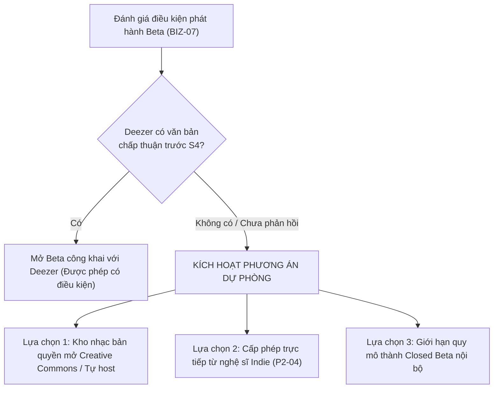

# Thẩm định quyền sử dụng preview nhạc cho Meloo (LEG-02)

- **Mã tài liệu:** LEG-02
- **Ngày lập:** 2026-10-28 · Sprint S1
- **Trạng thái:** Chờ phản hồi từ nhà cung cấp (Pending) · Thẩm định ToS hoàn tất
- **Thuộc ticket:** MEL-120
- **Phụ thuộc:** SPK-01 (MEL-25, đã merge qua PR #16)
- **Tác giả:** Claude (nghiên cứu & soạn thảo) · **Chủ trì & Phê duyệt:** Trần Văn Thái (PO / Tech Lead)

---

## 1. Mục tiêu & Bối cảnh pháp lý

### 1.1. Mục tiêu
Xác định cơ sở pháp lý, phân tích các điều khoản dịch vụ (Terms of Service - ToS) và thẩm định quyền sử dụng đoạn nghe thử (preview) âm thanh tối đa 30 giây của các nhà cung cấp bên thứ ba (Deezer, Apple/iTunes) trong trò chơi đoán nhạc trực tuyến Meloo. Thiết lập cổng phê duyệt (Release Gate) rõ ràng cho đợt thử nghiệm công khai (Beta công khai - BIZ-07, MEL-78) nhằm bảo đảm tuân thủ Luật Sở hữu trí tuệ Việt Nam và các thỏa thuận dịch vụ quốc tế.

### 1.2. Bối cảnh kỹ thuật của Meloo
Meloo là nền tảng web game đoán tên bài hát trực tuyến nhiều người chơi (2–5 người/phòng) được xây dựng dưới dạng đồ án học thuật phi thương mại. Cơ chế chơi cốt lõi (BR-02) là mở dần đoạn nghe thử theo các mốc thời gian: 2 → 5 → 10 → 20 → 30 giây; đoán càng sớm điểm càng cao.

Để chống gian lận và bảo đảm công bằng (NFR-07, ADR-008):
- Client chỉ nhận token HMAC mờ (`/api/v1/audio/{token}`), không nhận URL trực tiếp của nhà cung cấp. Tên bài hát, ca sĩ và mã định danh (`trackId`) hoàn toàn không lộ trước thời điểm kết thúc vòng (`ROUND_END`).
- Backend làm nhiệm vụ streaming proxy chuyển tiếp trực tiếp luồng byte từ URL preview có chữ ký của nhà cung cấp (`hdnea` của Deezer, có hạn sống ~15 phút).
- URL có chữ ký chỉ được giữ tạm thời trong bộ nhớ RAM của tiến trình backend (in-memory cache) trong thời gian vòng đấu diễn ra (tối đa 15 phút theo hạn URL), tuyệt đối không lưu trữ vĩnh viễn trên cơ sở dữ liệu hay ổ cứng máy chủ.
- Backend chỉ truyền đúng số lượng byte tương ứng với mốc nghe được mở (2s, 5s, 10s, 20s, 30s) và không hỗ trợ tua trước.

---

## 2. Phân tích Điều khoản dịch vụ của các nhà cung cấp

### 2.1. Deezer for Developers (Nguồn đề xuất chính có điều kiện)
Tham chiếu: [Deezer Developer Terms of Use](https://developers.deezer.com/termsofuse), rà soát ngày 2026-10-21 và 2026-10-28.

| Tiêu chí | Quy định trong ToS Deezer | Đánh giá đối với Meloo | Mức độ tuân thủ / Rủi ro |
|---|---|---|---|
| **Mục đích sử dụng** | Giới hạn cho mục đích cá nhân, riêng tư và phi thương mại ("strictly personal, private and non-commercial"). Cấm khai thác thương mại, bán lại hoặc thu phí mà không có thỏa thuận đối tác. | Meloo là đồ án học thuật phi thương mại, miễn phí trải nghiệm. Phù hợp định hướng phi thương mại. | **Thấp** đối với môi trường học thuật; **Trung bình** khi mở rộng ra cộng đồng lớn. |
| **Lưu trữ & Caching** | Cấm tải xuống, sao chép hoặc lưu trữ vĩnh viễn tệp âm thanh (no permanent download or caching of audio files). Cho phép cache metadata trong thời gian hợp lý. | Meloo **không lưu tệp audio ra đĩa** và không nạp toàn bộ bài hát vào bộ nhớ heap. Meloo chỉ lưu tạm URL có chữ ký (`hdnea`) trong bộ nhớ RAM trong thời gian vòng đấu (< 15 phút). | **Chấp nhận được về mặt kỹ thuật**: phù hợp tinh thần không lưu trữ audio vĩnh viễn. Cần Deezer xác nhận bằng văn bản. |
| **Truyền phát & Proxy** | Yêu cầu phát trực tiếp nội dung âm thanh qua các công cụ hoặc đường dẫn do Deezer cung cấp. Không có điều khoản rõ ràng cho phép máy chủ bên thứ ba can thiệp làm proxy cắt ngắn luồng byte. | Meloo sử dụng cơ chế streaming proxy trên server để cắt đoạn 2/5/10/20/30s nhằm bảo vệ tính công bằng (chống người chơi inspect mạng để gian lận). | **Vùng xám pháp lý (Grey Area)**: Đây là biện pháp kỹ thuật phục vụ logic game, nhưng chưa được ToS công khai phê duyệt sẵn. |
| **Ghi nhận nguồn (Attribution)** | Bắt buộc hiển thị logo/nhãn hiệu Deezer, tên bài hát, nghệ sĩ, album và liên kết trực tiếp (deep link) đưa người nghe về trang Deezer tương ứng. Không được làm sai lệch metadata. | Meloo hiển thị đầy đủ tên bài, nghệ sĩ, ảnh bìa/link Deezer ngay khi vòng chơi kết thúc (`ROUND_END`). Không hiển thị trước đó để bảo đảm luật chơi. | **Tuân thủ đầy đủ** sau khi vòng đấu kết thúc. |
| **Lãnh thổ & Bản quyền** | Deezer phân phối nội dung theo thỏa thuận lãnh thổ (storefront/territory). Một số bài hát có thể không có preview hoặc bị giới hạn phát tại một số quốc gia. | Kết quả đo SPK-01 tại Việt Nam cho thấy độ phủ 94,3% (66/70 bài). Tuy nhiên catalog có thể thay đổi bất kỳ lúc nào theo quyết định của chủ sở hữu bản quyền. | **Rủi ro vận hành kỹ thuật**: Cần cơ chế xử lý lỗi khi preview không sẵn sàng (ADR-003). |

### 2.2. Apple / iTunes Search API (Nguồn dự phòng kỹ thuật)
Tham chiếu: [Apple Services Base Terms](https://www.apple.com/legal/internet-services/itunes/) và [Apple Search API / Affiliate Program Terms](https://performance-partners.apple.com/search-api), rà soát ngày 2026-10-21 và 2026-10-28.

* **Quy định mục đích nghe thử:** Đoạn nghe thử 30 giây từ Apple Music / iTunes Search API được cấp phép độc quyền cho mục đích tiếp thị, quảng bá và cho phép người tiêu dùng nghe thử trước khi đưa ra quyết định mua bài hát trên iTunes Store hoặc đăng ký thuê bao Apple Music.
* **Điều khoản hạn chế nghiêm ngặt:** Điều khoản sử dụng của Apple **nghiêm cấm tuyệt đối** việc sử dụng các đoạn nghe thử âm thanh để hình thành hoặc cấu thành một *"giá trị giải trí độc lập"* (standalone entertainment value) tách rời khỏi mục đích tiếp thị dịch vụ của Apple.
* **Đánh giá pháp lý:** Trò chơi đoán nhạc Meloo sử dụng đoạn nhạc trực tiếp làm thử thách và phương tiện giải trí cho người dùng, cấu thành trực tiếp "giá trị giải trí độc lập". Việc này **vi phạm rõ ràng** điều khoản của Apple nếu chỉ dựa trên quyền công khai từ Search API mà không có hợp đồng cấp phép nội dung riêng.
* **Kết luận đối với iTunes (AC 3):**
  > [!CAUTION]
  > Tuyệt đối **KHÔNG KÍCH HOẠT** iTunes làm nguồn phát âm thanh cho Meloo trong bất kỳ môi trường thử nghiệm hay chính thức nào. Không suy rộng quyền sử dụng từ Search API hoặc Apple RSS feed. iTunes chỉ được giữ lại dưới dạng tư liệu so sánh kỹ thuật ở SPK-01.

---

## 3. Nhật ký liên hệ nhà cung cấp (AC 1)

Nhằm làm rõ quyền sử dụng cho trường hợp đặc thù của Meloo, nhóm phát triển đã tiến hành gửi thư chính thức đến đội ngũ hỗ trợ nhà phát triển của Deezer.

### 3.1. Thông tin gửi thư
* **Đơn vị nhận:** Đội ngũ Hỗ trợ Nhà phát triển Deezer (`support@deezer.com` / `developers@deezer.com`).
* **Người gửi:** Trần Văn Thái (Chủ sở hữu dự án & Lập trình viên chính).
* **Ngày gửi:** **2026-10-28** (Sprint S1).
* **Trạng thái:** **Đang chờ phản hồi (Pending)**.

### 3.2. Nội dung thư gửi chính thức (Nguyên văn tiếng Anh)
```text
Subject: [Developer Inquiry] Confirmation of 30s Audio Preview Usage & Proxy Streaming for Educational Music Quiz Web App (Meloo)

Dear Deezer Developer Support Team,

My name is Tran Van Thai, and I am the lead developer of Meloo (https://github.com/ThaiDevv/meloo), an educational web-based music guessing game project developed in Vietnam.

We are preparing for an open beta trial and would like to formally inquire and seek written confirmation/clarification regarding our intended use of Deezer's 30-second audio previews under the Deezer Developer Terms of Use.

1. Application & Gameplay Overview:
- Meloo is a non-commercial educational project for multiplayer song-guessing games (2–5 players per room in real time).
- In each round, players listen to a progressively unlocked snippet of a track (2s, 5s, 10s, 20s, and up to 30s maximum) and guess the title.

2. Technical Integration & Anti-Cheat Proxy Mechanism:
- Fair-play Architecture: If the direct Deezer preview URL were sent directly to the client browser, players could inspect the browser network tab to reveal the track ID, metadata, or audio file directly before guessing.
- Server-side Short-lived Proxy: To prevent cheating and ensure fairness:
  * Our backend resolves the track metadata and temporary signed preview URL via Deezer API.
  * The signed Deezer URL is held temporarily ONLY in backend memory for the duration of the active game round (maximum 15 minutes, never persisted in any database or disk storage).
  * The backend delivers audio chunks to clients via short-lived HMAC-signed tokens (e.g., /api/v1/audio/{token}) corresponding strictly to the unlocked duration (2s, 5s, 10s, 20s, 30s).
  * No audio files are permanently downloaded, copied, cached on disk, or redistributed outside the ephemeral gameplay session.
- Attribution: We display full Deezer attribution (track title, artist name, and a direct link to Deezer track/album pages) once the round concludes.

3. Questions for Confirmation:
Could you kindly confirm:
a. Does this multiplayer trivia gameplay and ephemeral server-side streaming proxy (restricted strictly to 2/5/10/20/30-second progressive snippets) comply with Deezer Developer Terms of Use?
b. Is holding the signed preview URL transiently in server memory during an active round (max 15 minutes) acceptable?
c. Are there specific attribution guidelines, territory restrictions, or developer program agreements required for our upcoming public beta?

We greatly appreciate your time and guidance in ensuring full compliance with Deezer's policies.

Sincerely,
Tran Van Thai
Lead Developer, Meloo Project
Email: [tranvanthai...@...]
```

### 3.3. Bản dịch tiếng Việt đối chiếu
* Xem tại tài liệu chuẩn bị giao tiếp của nhóm phát triển (đã bao hàm chi tiết giải trình kỹ thuật về cơ chế backend streaming proxy, in-memory cache URL < 15 phút, mốc cắt 2/5/10/20/30 giây và cam kết ghi nhận nguồn đầy đủ).

### 3.4. Quy tắc xử lý thời hạn phản hồi (Quy tắc mốc S4)
* Do quy trình phản hồi của các hãng cung cấp quốc tế thường kéo dài nhiều ngày hoặc nhiều tuần:
  * Nếu Deezer phản hồi chấp thuận bằng văn bản trước Sprint S4: Bổ sung phản hồi (đã che thông tin cá nhân/nhạy cảm) vào tài liệu này và chuyển kết luận sang **"Được phép có điều kiện"**.
  * **Nếu đến hết Sprint S4 (chuẩn bị mở Beta) mà vẫn chưa có phản hồi chính thức:** Tự động kết luận là **"Chưa có kết luận / Không đủ căn cứ pháp lý" (No-go)** đối với việc dùng preview Deezer cho Public Beta. Cổng phát hành BIZ-07 sẽ kích hoạt phương án nguồn nhạc thay thế được cấp phép riêng.

---

## 4. Giới hạn lưu giữ URL preview, Attribution & Lãnh thổ (AC 2)

Dựa trên phân tích ToS và thiết kế hệ thống, các giới hạn bắt buộc sau đây phải được áp dụng nghiêm ngặt trong mã nguồn:

1. **Giới hạn lưu giữ URL và Audio (Storage Boundaries):**
   - **Tuyệt đối không lưu tệp audio:** Backend không lưu trữ tệp `.mp3` xuống ổ cứng (EBS), cơ sở dữ liệu (PostgreSQL) hay bất kỳ hệ thống lưu trữ đối tượng nào (S3).
   - **Giới hạn in-memory cache:** URL preview có chữ ký của Deezer (`hdnea`, thời hạn hiệu lực ~900 giây / 15 phút) chỉ được phép lưu tạm thời trong bộ nhớ RAM của tiến trình backend trong phạm vi vòng đấu hiện tại (`Round`). Khi vòng đấu kết thúc hoặc quá 15 phút, mục cache này phải bị hủy ngay lập tức. Không tái sử dụng URL ký giữa các phiên hoặc các vòng đấu khác nhau.
2. **Quy định ghi nhận nguồn (Attribution Standards):**
   - Màn hình kết thúc vòng (`RoundEndSummary`) và màn hình tổng kết trận (`GameResultModal`) bắt buộc hiển thị:
     * Logo biểu trưng của Deezer kèm dòng chữ *"Phát đoạn nghe thử qua Deezer"* (Powered by Deezer).
     * Tên bài hát và tên nghệ sĩ chính xác theo metadata của Deezer.
     * Liên kết có thể nhấp (clickable link) trỏ trực tiếp về trang bài hát trên dịch vụ Deezer để khuyến khích người chơi nghe trọn vẹn bản quyền.
3. **Giới hạn lãnh thổ (Territorial Restrictions):**
   - Hệ thống chấp nhận rằng preview nhạc chỉ khả dụng tại các vùng lãnh thổ mà Deezer có bản quyền phân phối (storefront Việt Nam và quốc tế).
   - Khi API Deezer trả về lỗi không tìm thấy preview hoặc tệp audio không khả dụng tại IP của server (HTTP 404 hoặc stream rỗng), backend phải ghi nhận trạng thái bài hát bị lỗi, tự động bỏ qua và chuyển sang bài hát hợp lệ khác, không làm gián đoạn phòng chơi.

---

## 5. Nguồn audio được cấp phép riêng thay thế cho Beta (AC 4)

Trong trường hợp không nhận được văn bản chấp thuận từ Deezer trước thời điểm phát hành Beta công khai (BIZ-07), nhóm phát triển chuẩn bị sẵn 3 phương án dự phòng sạch về mặt pháp lý:



### Chi tiết các phương án thay thế:
1. **Phương án 1 (Khuyến nghị kỹ thuật): Kho nhạc bản quyền tự do Creative Commons (CC-BY / CC0) tự host:**
   - Sử dụng các bản thu từ các nền tảng mở như Free Music Archive (FMA), Musopen hoặc Wikimedia Commons có giấy phép CC0 (Public Domain) hoặc CC-BY (ghi công tác giả).
   - Lưu trữ các đoạn preview 30 giây được chuẩn hóa trực tiếp trên AWS S3 và phân phối qua CloudFront.
   - *Ưu điểm:* 100% sạch về pháp lý, tự chủ hoàn toàn về bitrate, offset thời gian và không phụ thuộc vào hạ tầng bên thứ ba.
2. **Phương án 2: Hợp tác cấp phép trực tiếp với nghệ sĩ Indie:**
   - Liên hệ trực tiếp các nghệ sĩ trẻ / indie tại Việt Nam để xin cấp quyền sử dụng các bản nhạc độc lập phục vụ quảng bá trong game (phù hợp định hướng phát triển bài hát tài trợ P2-04).
3. **Phương án 3: Chuyển đổi mô hình thành Closed Beta (Thử nghiệm đóng có kiểm soát):**
   - Thay vì mở Public Beta tự do trên Internet, giới hạn quy mô đợt thử nghiệm trong phạm vi danh sách người dùng nội bộ (whitelist dưới 100 người bao gồm sinh viên, giảng viên và người thử nghiệm được mời).
   - Mô hình này nằm trọn vẹn trong phạm vi ngoại lệ nghiên cứu, giảng dạy học thuật phi thương mại.

---

## 6. Ma trận quyết định Go/No-go cho Beta (AC 6)

| Môi trường / Mục đích | Nguồn nhạc áp dụng | Quyết định pháp lý | Điều kiện & Giới hạn áp dụng |
|---|---|:---:|---|
| **Môi trường phát triển & Đồ án nội bộ** (Local dev, CI/CD, bảo vệ tốt nghiệp) | Deezer (MP3 128 kbps) | **GO (ĐƯỢC PHÉP)** | Nằm trong phạm vi ngoại lệ nghiên cứu, học thuật phi thương mại (Educational Fair Use). Giới hạn trong môi trường kiểm thử nội bộ của nhóm và giảng viên. |
| **Môi trường thử nghiệm đóng** (Closed Beta nội bộ, < 50 người dùng có kiểm soát) | Deezer (MP3 128 kbps) | **CONDITIONAL GO (ĐƯỢC PHÉP CÓ ĐIỀU KIỆN)** | Áp dụng đầy đủ attribution, không quảng cáo thương mại, chỉ mở cho danh sách tester được mời, có thông báo từ chối trách nhiệm bản quyền. |
| **Môi trường Beta công khai** (Public Beta - BIZ-07 / MEL-78) | Deezer (MP3 128 kbps) | **NO-GO (TẠM DỪNG / CHƯA ĐỦ ĐIỀU KIỆN)** | **Tuyệt đối không mở Public Beta với Deezer** khi chưa có văn bản xác nhận quyền từ Deezer. Nếu đến S4 không có phản hồi, bắt buộc chuyển sang Phương án 1 (nhạc Creative Commons tự host). |
| **Mọi môi trường** (Dev, Beta, Production) | Apple / iTunes Preview | **NO-GO (CẤM SỬ DỤNG)** | Vi phạm điều khoản cấm tạo giá trị giải trí độc lập của Apple. Tuyệt đối không kích hoạt. |

---

## 7. Câu hỏi bảo vệ đồ án (Defense Q&A)

1. **Tại sao Meloo không gửi trực tiếp URL preview từ nhà cung cấp cho người chơi mà phải dùng máy chủ làm proxy trung gian?**
   - *Trả lời:* Nếu gửi thẳng URL của nhà cung cấp về trình duyệt, người chơi chỉ cần mở tab Network trong công cụ lập trình (DevTools) là sẽ thấy ngay `trackId`, tên bài hát hoặc metadata trong URL/header, phá vỡ hoàn toàn tính công bằng của game (NFR-07). Máy chủ làm streaming proxy với token mờ HMAC ngắn hạn (`/api/v1/audio/{token}`) giúp che giấu toàn bộ thông tin bài hát trước khi vòng chơi kết thúc, đồng thời kiểm soát chính xác độ dài byte phát tương ứng với từng mức thời gian mở dần 2/5/10/20/30 giây.

2. **Việc máy chủ làm proxy và cắt nhỏ bài hát có vi phạm bản quyền hay điều khoản dịch vụ của nhà cung cấp không?**
   - *Trả lời:* Về mặt kỹ thuật, hệ thống tuân thủ nghiêm ngặt nguyên tắc cốt lõi là không lưu trữ vĩnh viễn tệp âm thanh (no permanent disk storage), không tải toàn bộ bài hát vào bộ nhớ heap, và URL có chữ ký chỉ lưu tạm thời trong RAM trong thời gian vòng đấu (< 15 phút). Về mặt pháp lý, việc cắt nhỏ đoạn nghe thử là một vùng xám chưa được quy định rõ trong ToS công khai. Do đó, nhóm đã chủ động gửi thư làm rõ với Deezer (ngày 28/10/2026) và đặt quy định Release Gate (AC 6): chỉ mở Public Beta khi có xác nhận văn bản từ nhà cung cấp, hoặc chuyển sang kho nhạc bản quyền mở Creative Commons.

3. **Tại sao nhóm không sử dụng iTunes Search API dù độ phủ bản thu của Apple đạt 100% trong bài đo SPK-01?**
   - *Trả lời:* Điều khoản của Apple cấm rõ ràng việc dùng đoạn preview làm "giá trị giải trí độc lập" (standalone entertainment value). Vì game đoán nhạc sử dụng âm thanh làm nội dung giải trí chính, việc tích hợp iTunes sẽ trực tiếp vi phạm ToS của Apple. Ngược lại, Deezer không có điều khoản cấm này, đồng thời sử dụng định dạng MP3 128 kbps giúp tiết kiệm hơn 52% băng thông mạng máy chủ so với định dạng AAC 268 kbps của Apple.

4. **Nếu nhà cung cấp không phản hồi thư hoặc từ chối cấp quyền, dự án xử lý thế nào để không bị dừng đợt Beta?**
   - *Trả lời:* Nhóm đã thiết kế sẵn kiến trúc Adapter cho kho nhạc và có 3 phương án dự phòng độc lập: chuyển sang sử dụng kho nhạc bản quyền mở Creative Commons (CC-BY / CC0 tự host trên S3), hợp tác với nghệ sĩ Indie, hoặc giới hạn quy mô đợt thử nghiệm thành Closed Beta nội bộ. Kiến trúc streaming proxy qua token mờ của Meloo hoàn toàn độc lập với nguồn phát, sẵn sàng chuyển đổi nguồn nhạc mà không cần thay đổi kiến trúc hệ thống.
