# BỘ HỒ SƠ THUYẾT MINH CHI TIẾT THIẾT KẾ HỆ THỐNG
## ĐỀ TÀI: NỀN TẢNG WEB GAME ĐOÁN TÊN BÀI HÁT THỜI GIAN THỰC MELOO

> **Mã tài liệu:** DOC-05 · **Mã ticket Jira:** MEL-62 · **Mốc bàn giao:** Mốc 2 (Sprint S3)
> **Sinh viên thực hiện:** Trần Văn Thái · **Người kiểm tra / Phản biện:** Codex (AI Reviewer)
> **Hạn nộp chính thức:** 16/11/2026, 09:07 · **Trạng thái:** Hoàn thành biên soạn hồ sơ thiết kế
> **Căn cứ tài liệu nền tảng:** BIZ-02 (MEL-18), BIZ-04 (MEL-20), BIZ-05 (MEL-53), DOC-01/SRS v1 (MEL-28), DOC-02/Use Cases (MEL-29), DES-01/Data Model (MEL-30), DOC-03/UML (MEL-51), DOC-04/Architecture (MEL-52), ADR-001..008 (MEL-26, MEL-118, MEL-136).

---

## LỜI NÓI ĐẦU VÀ TỔNG QUAN BÀN GIAO MỐC 2

Tài liệu này là bản **Thuyết minh chi tiết thiết kế hệ thống** hoàn chỉnh của đề tài **Meloo - Web game đoán tên bài hát trực tuyến theo thời gian thực**, được xây dựng phục vụ đánh giá tiến độ học thuật Mốc 2 theo chuẩn đầu ra của học phần. Báo cáo tập hợp toàn bộ các kết quả phân tích nghiệp vụ, mô hình hóa yêu cầu, kiến trúc hệ thống C4, thiết kế phần mềm hướng đối tượng UML, mô hình cơ sở dữ liệu quan hệ ERD và các quyết định kỹ thuật then chốt (ADR) đã được kiểm chứng và phê duyệt trong các Sprint S0 đến S3 của dự án.

Hồ sơ được cấu trúc thành 7 phần nội dung chính và phụ lục, trình bày bằng văn phong học thuật tiếng Việt mạch lạc, hệ thống ký hiệu chuẩn hóa (FR-xx, NFR-xx, BR-xx, UC-xx, ADR-0xx) và nhúng toàn bộ 25 sơ đồ kỹ thuật chất lượng cao được kết xuất từ mã nguồn PlantUML phiên bản mới nhất trong kho lưu trữ.

---

## MỤC LỤC TỔNG THỂ

- [PHẦN I: GIỚI THIỆU TỔNG QUAN VÀ PHÁT BIỂU BÀI TOÁN](#phần-i-giới-thiệu-tổng-quan-và-phát-biểu-bài-toán)
  - [1.1. Meloo trong một câu và tầm nhìn sản phẩm](#11-meloo-trong-một-câu-và-tầm-nhìn-sản-phẩm)
  - [1.2. Bối cảnh thị trường và vấn đề thực tế](#12-bối-cảnh-thị-trường-và-vấn-đề-thực-tế)
  - [1.3. Khảo sát nhu cầu người dùng và kiểm chứng giả thuyết (H1–H4)](#13-khảo-sát-nhu-cầu-người-dùng-và-kiểm-chứng-giả-thuyết-h1h4)
  - [1.4. Chân dung người dùng mục tiêu (Personas P1–P4)](#14-chân-dung-người-dùng-mục-tiêu-personas-p1p4)
  - [1.5. Phân tích đối thủ cạnh tranh và giá trị khác biệt](#15-phân-tích-đối-thủ-cạnh-tranh-và-giá-trị-khác-biệt)
- [PHẦN II: ĐẶC TẢ YÊU CẦU PHẦN MỀM (SRS) VÀ QUY TẮC NGHIỆP VỤ](#phần-ii-đặc-tả-yêu-cầu-phần-mềm-srs-và-quy-tắc-nghiệp-vụ)
  - [2.1. Yêu cầu chức năng cốt lõi (Functional Requirements: FR-01 → FR-19)](#21-yêu-cầu-chức-năng-cốt-lõi-functional-requirements-fr-01--fr-19)
  - [2.2. Yêu cầu phi chức năng (Non-Functional Requirements: NFR-01 → NFR-15)](#22-yêu-cầu-phi-chức-năng-non-functional-requirements-nfr-01--nfr-15)
  - [2.3. Quy tắc nghiệp vụ then chốt (Business Rules: BR-01 → BR-29)](#23-quy-tắc-nghiệp-vụ-then-chốt-business-rules-br-01--br-29)
  - [2.4. Thuật ngữ và từ điển khái niệm hệ thống](#24-thuật-ngữ-và-từ-điển-khái-niệm-hệ-thống)
- [PHẦN III: THIẾT KẾ USE CASE VÀ ĐẶC TẢ CHI TIẾT](#phần-iii-thiết-kế-use-case-và-đặc-tả-chi-tiết)
  - [3.1. Tổng quan mô hình tác nhân và danh mục 34 Use Case](#31-tổng-quan-mô-hình-tác-nhân-và-danh-mục-34-use-case)
  - [3.2. Sơ đồ Use Case tổng thể và các phân hệ](#32-sơ-đồ-use-case-tổng-thể-và-các-phân-hệ)
  - [3.3. Ma trận truy vết yêu cầu (Traceability Matrix: FR ↔ UC)](#33-ma-trận-truy-vết-yêu-cầu-traceability-matrix-fr--uc)
  - [3.4. Đặc tả chi tiết 10 Use Case trọng tâm](#34-đặc-tả-chi-tiết-10-use-case-trọng-tâm)
- [PHẦN IV: THIẾT KẾ KIẾN TRÚC HỆ THỐNG C4 MODEL VÀ TRIỂN KHAI](#phần-iv-thiết-kế-kiến-trúc-hệ-thống-c4-model-và-triển-khai)
  - [4.1. Triết lý thiết kế và ràng buộc hệ thống](#41-triết-lý-thiết-kế-và-ràng-buộc-hệ-thống)
  - [4.2. C4 Level 1: Sơ đồ bối cảnh hệ thống (Context Diagram)](#42-c4-level-1-sơ-đồ-bối-cảnh-hệ-thống-context-diagram)
  - [4.3. C4 Level 2: Sơ đồ khối thùng chứa (Container Diagram)](#43-c4-level-2-sơ-đồ-khối-thùng-chứa-container-diagram)
  - [4.4. C4 Level 3: Sơ đồ thành phần Backend Modular Monolith (Component Diagram)](#44-c4-level-3-sơ-đồ-thành-phần-backend-modular-monolith-component-diagram)
  - [4.5. Sơ đồ triển khai hạ tầng đám mây AWS (Deployment Diagram)](#45-sơ-đồ-triển-khai-hạ-tầng-đám-mây-aws-deployment-diagram)
  - [4.6. Tổng hợp các quyết định kiến trúc then chốt (ADR-001 → ADR-008)](#46-tổng-hợp-các-quyết-định-kiến-trúc-then-chốt-adr-001--adr-008)
  - [4.7. Chiến thuật kiến trúc đáp ứng yêu cầu phi chức năng (NFR Tactics)](#47-chiến-thuật-kiến-trúc-đáp-ứng-yêu-cầu-phi-chức-năng-nfr-tactics)
- [PHẦN V: THIẾT KẾ CHI TIẾT PHẦN MỀM (UML CHI TIẾT)](#phần-v-thiết-kế-chi-tiết-phần-mềm-uml-chi-tiết)
  - [5.1. Sơ đồ lớp miền tổng quát (Domain Model Class Diagram)](#51-sơ-đồ-lớp-miền-tổng-quát-domain-model-class-diagram)
  - [5.2. Thiết kế chi tiết sơ đồ lớp các module nghiệp vụ cốt lõi](#52-thiết-kế-chi-tiết-sơ-đồ-lớp-các-module-nghiệp-vụ-cốt-lõi)
  - [5.3. Thiết kế sơ đồ tuần tự (Sequence Diagrams) cho các kịch bản tương tác chính](#53-thiết-kế-sơ-đồ-tuần-tự-sequence-diagrams-cho-các-kịch-bản-tương-tác-chính)
  - [5.4. Thiết kế sơ đồ máy trạng thái (State Machine Diagrams)](#54-thiết-kế-sơ-đồ-máy-trạng-thái-state-machine-diagrams)
  - [5.5. Sơ đồ hoạt động luồng một vòng chơi (Activity Diagram)](#55-sơ-đồ-hoạt-động-luồng-một-vòng-chơi-activity-diagram)
- [PHẦN VI: THIẾT KẾ CƠ SỞ DỮ LIỆU VÀ TỔ CHỨC LƯU TRỮ](#phần-vi-thiết-kế-cơ-sở-dữ-liệu-và-tổ-chức-lưu-trữ)
  - [6.1. Nguyên tắc thiết kế CSDL và phân quyền module Spring Modulith](#61-nguyên-tắc-thiết-kế-csdl-và-phân-quyền-module-spring-modulith)
  - [6.2. Mô hình quan hệ thực thể ERD tổng thể](#62-mô-hình-quan-hệ-thực-thể-erd-tổng-thể)
  - [6.3. Từ điển dữ liệu chi tiết 21 bảng (Data Dictionary)](#63-từ-điển-dữ-liệu-chi-tiết-21-bảng-data-dictionary)
  - [6.4. Kế hoạch di trú dữ liệu tự động (Flyway Migration Plan V1 → V9)](#64-kế-hoạch-di-trú-dữ-liệu-tự-động-flyway-migration-plan-v1--v9)
- [PHẦN VII: BỘ CÂU HỎI BẢO VỆ ĐỒ ÁN VÀ HƯỚNG DẪN GIẢI THÍCH](#phần-vii-bộ-câu-hỏi-bảo-vệ-đồ-án-và-hướng-dẫn-giải-thích)
  - [7.1. Nhóm câu hỏi về Kiến trúc và Lựa chọn công nghệ](#71-nhóm-câu-hỏi-về-kiến-trúc-và-lựa-chọn-công-nghệ)
  - [7.2. Nhóm câu hỏi về Bảo mật, Phòng chống gian lận và Bản quyền âm thanh](#72-nhóm-câu-hỏi-về-bảo-mật-phòng-chống-gian-lận-và-bản-quyền-âm-thanh)
  - [7.3. Nhóm câu hỏi về Xử lý thời gian thực và Chống tranh chấp dữ liệu (Race Condition)](#73-nhóm-câu-hỏi-về-xử-lý-thời-gian-thực-và-chống-tranh-chấp-dữ-liệu-race-condition)
  - [7.4. Nhóm câu hỏi về Thuật toán tính điểm và Luật chơi](#74-nhóm-câu-hỏi-về-thuật-toán-tính-điểm-và-luật-chơi)
- [PHỤ LỤC: DANH MỤC TÀI LIỆU THAM CHIẾU](#phụ-lục-danh-mục-tài-liệu-tham-chiếu)

---

# PHẦN I: GIỚI THIỆU TỔNG QUAN VÀ PHÁT BIỂU BÀI TOÁN

### 1.1. Meloo trong một câu và tầm nhìn sản phẩm
**Meloo là trò chơi đoán tên bài hát trực tuyến 10–15 phút, tham gia tức thời bằng một đường link trình duyệt, để nhóm bạn người Việt cùng chơi, tương tác trò chuyện và so tài âm nhạc bằng chính những giai điệu quen thuộc hàng ngày.**

Sản phẩm định vị là một mini-game mang tính xã hội cao (social party game), giải quyết bài toán thiếu hụt hoạt động gắn kết ngắn hạn cho sinh viên, đồng nghiệp trẻ trong giờ giải lao hoặc những buổi tối rảnh rỗi mà không đòi hỏi bất kỳ rào cản kỹ thuật hay cài đặt phức tạp nào.

### 1.2. Bối cảnh thị trường và vấn đề thực tế
Nghiên cứu thị trường và hành vi nghe nhạc tại Việt Nam cho thấy những thực trạng rõ nét:
1. **Nghe nhạc là thói quen phổ biến nhưng thụ động:** Theo khảo sát của Q&Me, 75% người Việt nghe nhạc mỗi ngày và 93% nghe qua điện thoại di động [S1]. Tuy nhiên, các nền tảng streaming (YouTube 74%, Zing MP3 45%, TikTok 32%, Spotify 27% theo Decision Lab Q4/2025) thuần túy phục vụ việc nghe cá nhân, đơn lẻ, thiếu tính cạnh tranh và tương tác bạn bè.
2. **Sức hút đã được kiểm chứng của thể loại đoán nhạc:** Mô hình Heardle (Wordle âm nhạc) từng đạt 69 triệu lượt truy cập toàn cầu trong tháng 3/2022 trước khi được Spotify mua lại và đóng cửa vào tháng 5/2023 [S2, S3]. Điều này chứng minh nhu cầu thử thách kiến thức âm nhạc ngắn hàng ngày là rất lớn.
3. **Khoảng trống thị trường tại Việt Nam:** Các tựa game quốc tế hiện nay gần như bỏ quên thị trường Việt Nam. SongTrivia hỗ trợ phòng realtime nhưng không có tiếng Việt và hoàn toàn không có kho nhạc Việt. SongPop hỗ trợ 17 ngôn ngữ nhưng thiếu tiếng Việt và bắt buộc cài đặt app di động dung lượng lớn. Một số trang web Việt Nam chỉ cung cấp trắc nghiệm 1 trong 4 đáp án đơn điệu, dễ đoán mò và không hỗ trợ nhiều người chơi cùng lúc.

### 1.3. Khảo sát nhu cầu người dùng và kiểm chứng giả thuyết (H1–H4)
Dự án áp dụng phương pháp luận phát triển tinh gọn (Lean Startup), đặt ra 4 giả thuyết cốt lõi kèm tiêu chuẩn kiểm chứng thực nghiệm trước khi phát hành khảo sát (chốt tại BIZ-02 ngày 19/10/2026 và kế thừa tại BIZ-05/MEL-53):

| Mã | Giả thuyết bài toán | Câu hỏi kiểm chứng (Google Form) | Tiêu chí & Ngưỡng xác nhận (BIZ-02) | Trạng thái ghi nhận |
|---|---|---|---|---|
| **H1** | Nhóm bạn thiếu một hoạt động online **ngắn, vào ngay**; rào cản lớn nhất là phải cài app hoặc đăng ký tài khoản. | K1 (Tần suất chơi cùng bạn bè), K2 (Công cụ thoại), K3 (Rào cản thử game mới). | **$\ge$ 50%** chơi cùng bạn bè $\ge$ 1 lần/tháng **VÀ** **$\ge$ 40%** chọn 'phải cài app/đăng ký' hoặc 'mất thời gian rủ/hướng dẫn' ở K3. | Chờ trích xuất số liệu đóng khảo sát (08/11/2026) |
| **H2** | Người chơi muốn đoán **nhạc Việt** với **giao diện tiếng Việt**; các tựa game ngoại hiện tại không đáp ứng. | K4 (Game từng chơi), K5 (Thể loại nhạc ưa thích), K6 (Điểm chưa hài lòng ở game cũ). | **$\ge$ 60%** chọn V-pop trong top 2 ở K5 **VÀ** trong nhóm từng chơi, **$\ge$ 40%** chọn 'ít nhạc Việt' hoặc 'không có tiếng Việt' ở K6. | Chờ trích xuất số liệu đóng khảo sát (08/11/2026) |
| **H3** | Người nghe nhạc yêu thích **thử thách ngắn hằng ngày** và có nhu cầu **so tài, khoe kết quả** (hiệu ứng Wordle/Heardle). | K7 (Thói quen chơi game hằng ngày), K8 (Hành vi chia sẻ kết quả lên mạng xã hội/nhóm chat). | **$\ge$ 30%** trả lời 'Có' ở K7 **VÀ** **$\ge$ 40%** trả lời 'Có' ở K8. | Chờ trích xuất số liệu đóng khảo sát (08/11/2026) |
| **H4** | Người tổ chức hoạt động (lớp trưởng, quản trò, HR, streamer) cần **công cụ khởi động 10 phút** có bộ đề linh hoạt. | K9 (Kinh nghiệm tổ chức hoạt động), K10 (Mức độ quan tâm dùng game đoán nhạc làm ice-breaker). | **$\ge$ 20%** từng tổ chức hoạt động **VÀ** trong số đó **$\ge$ 50%** quan tâm dùng thử. | Đánh giá phục vụ cơ hội mở rộng Phase 2 |

> *Ghi chú học thuật:* Khảo sát thu thập trực tuyến qua Google Form (K1–K12) hướng tới đối tượng sinh viên và người trẻ yêu âm nhạc. Tiêu chuẩn làm sạch dữ liệu nghiêm ngặt loại bỏ các phản hồi dưới 35 giây hoặc có đáp án mâu thuẫn nội tại nhằm đảm bảo tính khách quan tối đa theo quy ước `meloo-docs`.

### 1.4. Chân dung người dùng mục tiêu (Personas P1–P4)
1. **P1 · Minh (20 tuổi) - Sinh viên đại học (Người dùng trọng tâm):** Thường xuyên học nhóm và tán gẫu qua Discord cùng bạn bè cũ vào buổi tối. Cần một trò chơi vui nhộn, tham gia trong 10 giây qua link gửi trong chat nhóm, không đòi hỏi mọi người phải tải app hay tạo tài khoản.
2. **P2 · Lan (24 tuổi) - Nhân viên văn phòng, tín đồ âm nhạc:** Nghe nhạc cả ngày trên Spotify/Zing MP3, thuộc lòng lời bài hát V-pop. Thích chơi thử thách ngày mỗi sáng trên xe buýt và tự hào khoe thành tích đoán đúng ngay 2 giây đầu tiên lên Story mạng xã hội.
3. **P3 · Hoàng (21 tuổi) - Game thủ cạnh tranh:** Thích các trận đấu xếp hạng căng thẳng, đề cao sự công bằng, ghét gian lận và mong muốn leo lên Top 10 bảng xếp hạng mùa.
4. **P4 · Thảo (26 tuổi) - Quản lý nhân sự / Quản trò:** Cần một minigame trực tuyến vui nhộn kéo dài 10 phút để khuấy động không khí đầu giờ các buổi sinh hoạt nội bộ hoặc họp trực tuyến.

### 1.5. Phân tích đối thủ cạnh tranh và giá trị khác biệt
Bảng đối chiếu tính năng giữa Meloo và các đối thủ trực tiếp trên thị trường (dựa trên kết quả khảo nghiệm BIZ-04):

| Tiêu chí so sánh | Meloo (Đề xuất) | SongTrivia | SongPop | Heardle (Đã đóng) | Web trắc nghiệm VN |
|---|---|---|---|---|---|
| **Nền tảng hỗ trợ** | Web (mọi thiết bị) | Web | Mobile App (iOS/Android) | Web | Web |
| **Rào cản đăng nhập** | Vào ngay (Khách vãng lai) | Cần tài khoản để lưu điểm | Bắt buộc đăng ký tài khoản | Chơi ngay không cần tài khoản | Chơi ngay |
| **Kho nhạc Việt Nam** | Chuyên sâu V-pop & Quốc tế | Hoàn toàn không có | Rất hạn chế (< 2%) | Không có (chỉ US-UK) | Rải rác, không chuẩn hóa |
| **Chơi nhóm thời gian thực** | Có (2–5 người, STOMP) | Có (Realtime WebSocket) | Bất đồng bộ (Turn-based) | Không (Chỉ chơi đơn) | Không (Chỉ chơi đơn) |
| **Trò chuyện thoại (Voice)** | Tích hợp WebRTC Mesh | Không có | Không có | Không có | Không có |
| **Cơ chế gợi ý âm thanh** | Mở dần 2s → 30s (5 mức) | Nghe cố định 10s | Nghe cố định 10s | Mở dần 1s → 16s | Nghe cả đoạn 30s |
| **Chống đoán mò** | Nhập tự do + gợi ý chuẩn hóa | Trắc nghiệm 1/4 | Trắc nghiệm 1/4 | Nhập tự do | Trắc nghiệm 1/4 |

---

# PHẦN II: ĐẶC TẢ YÊU CẦU PHẦN MỀM (SRS) VÀ QUY TẮC NGHIỆP VỤ

### 2.1. Yêu cầu chức năng cốt lõi (Functional Requirements: FR-01 → FR-19)
Các yêu cầu chức năng được phân loại theo mô hình MoSCoW, phục vụ kiểm chứng trực tiếp qua bộ Acceptance Criteria của từng ticket Jira:

| Mã FR | Phân hệ nghiệp vụ | Nội dung yêu cầu chức năng | Mức ưu tiên | Sprint | Quy tắc BR liên quan |
|---|---|---|---|---|---|
| **FR-01** | Tài khoản & Định danh | Vào chơi ngay bằng biệt danh (Guest session), cấp phát phiên làm việc an toàn không đòi hỏi mật khẩu. | **Must** | S1 | BR-20, BR-22 |
| **FR-02** | Tài khoản & Định danh | Đăng nhập bằng Google OAuth 2.0 (Authorization Code + PKCE), cấp JWT token. | **Must** | S1 | BR-21 |
| **FR-03** | Tài khoản & Định danh | Đăng nhập Facebook OAuth và chức năng xóa tài khoản hoàn toàn theo cam kết quyền riêng tư. | **Should** | S4 | BR-21 |
| **FR-04** | Tài khoản & Hồ sơ | Xem thông tin hồ sơ cá nhân, cấp độ kinh nghiệm (EXP), tổng điểm xếp hạng và lịch sử đấu. | **Must** | S4 | BR-20, BR-21, BR-24 |
| **FR-05** | Quản trị danh mục | Quản lý kho bài hát, ca sĩ, thể loại và tạo bộ đề (Playlists); nhập bài hát từ API Deezer. | **Must** | S1 | BR-27, BR-28 |
| **FR-06** | Tìm kiếm bài hát | Ô nhập tìm kiếm gợi ý thông minh, gõ không dấu tự động chuẩn hóa tìm đúng tên bài hát. | **Must** | S2 | BR-05, BR-06 |
| **FR-07** | Luật chơi & Chấm điểm | Chế độ chơi đơn 10 vòng, mở mức nghe 2s → 30s, chấm điểm giảm dần, thưởng combo và gợi ý ca sĩ. | **Must** | S2 | BR-01..08, BR-23 |
| **FR-08** | Thử thách ngày | Chơi bộ đề thử thách ngày (Daily Challenge) duy nhất cho toàn cộng đồng, đổi bài lúc 00:00 VN, chia sẻ kết quả. | **Should** | S4 | BR-08, BR-25 |
| **FR-09** | Phòng nhiều người | Tạo phòng chơi riêng bằng mã 6 ký tự hoặc link mời, sảnh chờ, nút sẵn sàng và bắt đầu trận đấu 2–5 người. | **Must** | S3 | BR-11, BR-12, BR-15 |
| **FR-10** | Phòng công khai & Ghép trận | Danh sách phòng công khai và chế độ ghép trận nhanh tự động (Quick Matchmaking) tính điểm xếp hạng. | **Must** | S4 | BR-10, BR-13, BR-23 |
| **FR-11** | Giao tiếp phòng | Trò chuyện văn bản (Text Chat) trong phòng chơi, tự động chặn tin nhắn làm lộ đáp án và từ ngữ thô tục. | **Must** | S3 | BR-16, BR-17 |
| **FR-12** | Giao tiếp phòng | Kênh đàm thoại trực tiếp (Voice Chat WebRTC Mesh) trong phòng riêng, tự ngắt mic khi đang phát nhạc. | **Should** | S3 | BR-18, BR-19 |
| **FR-13** | Lưu trữ lịch sử | Tự động lưu trữ chi tiết từng vòng đấu, điểm số từng thành viên vào cơ sở dữ liệu khi trận đấu kết thúc. | **Must** | S2 | BR-23, BR-24 |
| **FR-14** | Bảng xếp hạng | Bảng vinh danh top người chơi theo mùa giải, tuần, và bảng xếp hạng kết quả thử thách ngày. | **Must** | S4 | BR-24, BR-25 |
| **FR-15** | Hệ thống tiến trình | Hệ thống thành tựu, huy hiệu danh hiệu và thanh tiến trình thăng cấp người chơi. | **Should** | S5 | BR-26 |
| **FR-16** | Bảng số liệu quản trị | Dashboard thống kê số lượng phòng hoạt động, người chơi đồng thời (CCU), bài hát được chơi nhiều nhất. | **Should** | S5 | BR-28 |
| **FR-17** | Kiểm duyệt nội dung | Xem danh sách tin nhắn bị người chơi báo cáo, khóa tài khoản hoặc cấm id khách vi phạm tiêu chuẩn cộng đồng. | **Must** | S5 | BR-28 |
| **FR-18** | Đa ngôn ngữ (i18n) | Hỗ trợ chuyển đổi giao diện mượt mà giữa tiếng Việt và tiếng Anh (vi/en). | **Must** | S2 | Tiêu chuẩn chất lượng |
| **FR-19** | Ứng dụng Web cấp tiến | Khả năng cài đặt lên màn hình chính điện thoại dưới dạng Progressive Web App (PWA). | **Should** | S5 | Tiêu chuẩn trải nghiệm |

### 2.2. Yêu cầu phi chức năng (Non-Functional Requirements: NFR-01 → NFR-15)
Các chỉ số kỹ thuật và ràng buộc chất lượng được lượng hóa rõ ràng:
- **NFR-01 (Thời gian phản hồi API):** Thời gian phản hồi phân vị 95 (p95) của các điểm cuối REST API $\le 300\text{ ms}$ khi kiểm thử tải k6.
- **NFR-02 (Độ trễ sự kiện thời gian thực):** Độ trễ phát và nhận thông điệp STOMP qua WebSocket giữa các người chơi trong phòng $\le 200\text{ ms}$.
- **NFR-03 (Khả năng chịu tải đồng thời):** Hệ thống phục vụ ổn định tối thiểu **20 phòng chơi $\times$ 5 người (100 kết nối đồng thời)** trên cấu hình máy chủ đơn AWS EC2 `t3.micro` (1 vCPU, 1 GB RAM).
- **NFR-04 (Độ trễ phát âm thanh):** Nhờ cơ chế nạp trước luồng đệm (Audio Preloading) trong pha chuẩn bị, âm thanh phát ra trong vòng $\le 1,0\text{ giây}$ ngay khi vòng đấu chính thức bắt đầu.
- **NFR-05 (Bảo mật phiên):** Token JWT Access lưu trong bộ nhớ JavaScript chống XSS; Cookie Refresh Token mang cờ `HttpOnly`, `Secure`, `SameSite=Lax` chống CSRF.
- **NFR-06 (Thời gian phục hồi dịch vụ):** Thời gian khởi động lại và khôi phục ứng dụng backend khi có sự cố $\le 60\text{ giây}$.
- **NFR-07 (Tuyệt đối không lộ đáp án - Anti-cheating):** Đáp án, metadata bài hát và URL gốc không bao giờ xuất hiện trong response HTTP, payload WebSocket hoặc log máy chủ trước khi vòng chơi kết thúc.
- **NFR-08 (Loại trừ tranh chấp dữ liệu):** Mọi thao tác đoán bài và thay đổi trạng thái trong phòng được xử lý tuần tự qua hàng đợi đơn luồng (Actor queue), đảm bảo tính toàn vẹn 100%.
- **NFR-09 (Chất lượng mã nguồn & Kiểm thử):** Tỷ lệ bao phủ kiểm thử (Code Coverage) tầng logic nghiệp vụ cốt lõi (Domain logic) đạt $\ge 80\%$; vượt qua kiểm thử Modulith định kỳ.
- **NFR-10 (Tốc độ tiếp cận):** Người chơi mới vào được màn hình chơi game hoặc sảnh chờ trong vòng $\le 30\text{ giây}$ từ khi truy cập đường link.
- **NFR-11 (Gia nhập phòng tức thì):** Tham gia phòng bằng mã hoặc link chỉ với 1 thao tác nhập biệt danh $\le 3\text{ bước}$.
- **NFR-12 (Tối ưu tải trang ban đầu):** Chỉ số Largest Contentful Paint (LCP) trang chủ $\le 2,5\text{ giây}$ trên mạng di động 4G tiêu chuẩn.
- **NFR-13 (Tiếp cận công bằng - Accessibility):** Giao diện đáp ứng tiêu chuẩn WCAG 2.1 AA, không dùng màu sắc làm phương tiện duy nhất để biểu thị kết quả.
- **NFR-14 (Cấu trúc phòng linh hoạt):** Hỗ trợ tối đa 5 người chơi mỗi phòng; tự động thích ứng mượt mà khi người chơi vào/ra giữa chừng.
- **NFR-15 (Trải nghiệm đàm thoại tự nhiên):** Tự động ngắt micro trong lúc phát preview nhạc và tự bật lại ngay sau khi nhạc dừng.

### 2.3. Quy tắc nghiệp vụ then chốt (Business Rules: BR-01 → BR-29)
29 quy tắc nghiệp vụ là **Nguồn sự thật tối cao (Single Source of Truth)** điều phối toàn bộ thuật toán backend:

| Mã BR | Tên quy tắc nghiệp vụ | Tóm tắt nội dung quy tắc |
|---|---|---|
| **BR-01** | Năm mức nghe mở dần | Mỗi vòng gồm 5 mức độ dài preview: **2 giây, 5 giây, 10 giây, 20 giây, 30 giây** (ghi nhãn ngắn: 2s, 5s, 10s, 20s, 30s). |
| **BR-02** | Thang điểm cơ bản | Điểm cơ bản giảm đều 200 điểm theo mức nghe đoán đúng: **1.000 điểm (mức 2s), 800 điểm (5s), 600 điểm (10s), 400 điểm (20s), 200 điểm (30s)**. Đoán sai mức 30s được 0 điểm. |
| **BR-03** | Nghe lại tự do | Người chơi được bấm nghe lại đoạn nhạc ở mức hiện tại không giới hạn số lần và không bị trừ điểm. |
| **BR-04** | Cơ chế nghe thêm & Bỏ qua | Bấm 'Nghe thêm' hoặc đoán sai tại các mức 2s–20s sẽ tự động mở mức kế tiếp. Tại mức 30s, có nút 'Bỏ qua' để kết thúc lượt ngay (0 điểm). |
| **BR-05** | Chuẩn hóa so khớp tên bài | Tên bài hát được chuẩn hóa bỏ dấu tiếng Việt, chuyển chữ thường Unicode NFC, xóa ký tự đặc biệt, dấu câu và nội dung phụ trong ngoặc (ví dụ: 'feat.', 'remix', 'OST'). Đoán trúng tên chuẩn hóa là đúng. |
| **BR-06** | Gợi ý đúng ca sĩ | Nếu người chơi đoán sai tên bài nhưng trùng đúng tên ca sĩ chính (Primary Artist), hệ thống hiển thị thông báo gợi ý màu vàng và mở mức nghe tiếp theo. |
| **BR-07** | Luật vòng chơi nhiều người | Mỗi thành viên tự mở mức nghe của mình; đồng hồ phòng đếm ngược 45 giây chung. Đoán đúng nhận thêm điểm thưởng tốc độ: $\lfloor 200 \times \text{ms còn lại} \div 45.000 \rfloor$. Khi có người đúng, phòng nhận thông báo nhưng **tuyệt đối ẩn tên bài**. |
| **BR-08** | Hệ số chuỗi đúng (Combo) | Đoán đúng ở mức $\le 5\text{s}$ làm tăng chuỗi combo liên tiếp. Vòng 2 nhân hệ số $\times 1,1$; từ vòng 3 trở đi nhân hệ số $\times 1,2$ vào điểm cơ bản. Đoán ở mức $\ge 10\text{s}$ hoặc sai làm mất chuỗi. |
| **BR-09** | Chọn bài ngẫu nhiên | Mỗi trận đấu chọn 10 bài hát ngẫu nhiên không trùng lặp từ bộ đề hoặc bộ lọc đã chọn. |
| **BR-10** | Phân định hòa điểm | Hai người chơi bằng điểm sẽ xếp hạng theo: tổng thời gian đoán đúng ngắn hơn $\rightarrow$ số lần đoán đúng ở mức 2s nhiều hơn. |
| **BR-11** | Cấu trúc mã phòng | Mã phòng gồm 6 ký tự chữ hoa dễ đọc, loại bỏ các ký tự dễ gây nhầm lẫn: `0, O, 1, I, L`. |
| **BR-12** | Quyền hạn chủ phòng | Chủ phòng chọn bộ đề, số vòng (5/10/15), bấm bắt đầu khi $\ge 2$ người đều ở trạng thái sẵn sàng; có quyền mời (kick) người treo máy; kết thúc trận có quyền chọn chơi lại giữ nguyên mã phòng. |
| **BR-13** | Cơ chế ghép trận nhanh | Phòng ghép trận do server tự tạo, không có chủ phòng, bắt đầu đếm ngược 30 giây khi có người thứ 2. Nếu số người tụt xuống < 2, đồng hồ dừng lại. |
| **BR-14** | Xử lý rớt mạng trong phòng | Người chơi mất kết nối được giữ chỗ trong 30 giây (Grace period); trận đấu không dừng lại. Quay lại kịp chơi tiếp vòng hiện tại; các vòng bị lỡ nhận 0 điểm. Quá 30s xử lý xử thua (Forfeited). |
| **BR-15** | Vòng đời phòng chơi | Phòng tự động giải tán sau 10 phút nếu không có hoạt động hoặc toàn bộ người chơi rời khỏi phòng. Người vào phòng khi trận đang diễn ra sẽ ở trạng thái chờ đến ván sau. |
| **BR-16** | Chặn chat lộ đáp án | Tin nhắn trong phòng có nội dung chứa tên bài hát đáp án sau chuẩn hóa sẽ bị máy chủ chặn ngay lập tức và phát cảnh báo riêng cho người gửi. |
| **BR-17** | Lọc từ ngữ thô tục | Toàn bộ tin nhắn thô tục, xúc phạm nằm trong danh mục từ cấm bị chặn hoàn toàn. |
| **BR-18** | Đàm thoại WebRTC phòng riêng | Kênh thoại chỉ mở trong phòng riêng giữa bạn bè; không áp dụng cho ghép trận ngẫu nhiên. |
| **BR-19** | Tự ngắt micro khi nghe nhạc | Micro của client tự động tắt khi âm thanh preview đang phát để chống lọt tiếng nhạc sang người chơi khác; tự mở lại khi âm thanh dừng. |
| **BR-20** | Quyền hạn khách vãng lai | Khách chơi được mọi chế độ; dữ liệu phiên khách (lịch sử, huy hiệu, thống kê) được lưu tạm trong 30 ngày. |
| **BR-21** | Gộp dữ liệu khi đăng nhập | Khi khách đăng nhập Google/Facebook, toàn bộ tiến trình thi đấu, huy hiệu và lịch sử của phiên khách được tự động gộp vào tài khoản chính thức. |
| **BR-22** | Tiêu chuẩn biệt danh | Biệt danh có độ dài 3–20 ký tự, không chứa ký tự đặc biệt độc hại và không trùng từ cấm. |
| **BR-23** | Tính điểm xếp hạng công bằng | Chỉ các trận đấu bằng bộ đề chuẩn của hệ thống (Ghép trận nhanh hoặc Chơi đơn xếp hạng) mới được tính điểm xếp hạng mùa. Phòng riêng tự chọn bộ đề không tính điểm xếp hạng để chống cày điểm. |
| **BR-24** | Bảng xếp hạng mùa giải | Xếp hạng dựa trên tổng điểm tích lũy của các trận đấu hợp lệ; làm mới theo chu kỳ mùa (Season) hoặc tuần. |
| **BR-25** | Quy tắc thử thách hàng ngày | Toàn bộ cộng đồng thi đấu một bộ đề chung duy nhất mỗi ngày, làm mới lúc 00:00 giờ Việt Nam. Mỗi người có 1 lượt chơi; xếp hạng theo mức đoán đúng và tổng thời gian (trần tối đa 5 phút). |
| **BR-26** | Điều kiện mở khóa thành tựu | Huy hiệu được cấp tự động khi người chơi đạt mốc (ví dụ: đoán đúng 5 lần liên tiếp ở mức 2 giây, hoàn thành 7 ngày thử thách liên tục). |
| **BR-27** | Bản quyền và nguồn nhạc | Sử dụng đoạn trích âm thanh ngắn hợp lệ (30s preview) từ nhà cung cấp Deezer API; không lưu trữ file nhạc lậu trên máy chủ. |
| **BR-28** | Kiểm duyệt và khóa tài khoản | Quản trị viên xử lý báo cáo vi phạm; có quyền tạm khóa hoặc cấm vĩnh viễn tài khoản / phiên khách vi phạm kèm lý do rõ ràng. |
| **BR-29** | Vinh danh bản quyền sau vòng | Sau khi vòng đấu kết thúc, hệ thống công bố đầy đủ tên bài, nghệ sĩ biểu diễn, ảnh bìa album và liên kết trực tiếp để nghe bài hát trọn vẹn trên nền tảng nhạc gốc. |

### 2.4. Thuật ngữ và từ điển khái niệm hệ thống
- **Trận đấu (Match):** Một lượt chơi hoàn chỉnh gồm 10 vòng đấu (hoặc 5/15 vòng tùy cấu hình phòng).
- **Vòng đấu (Round):** Đơn vị thi đấu đoán 1 bài hát cụ thể, trải qua 5 mức nghe từ 2 giây đến 30 giây.
- **Mức nghe (Listening Level):** Phân đoạn độ dài đoạn nhạc được mở: Mức 1 (2s), Mức 2 (5s), Mức 3 (10s), Mức 4 (20s), Mức 5 (30s).
- **Audio Token mờ:** Chuỗi mã hóa HMAC thời hạn $\le 2$ phút cấp cho client để stream đúng phân đoạn audio tại máy chủ mà không làm lộ URL gốc.
- **Bộ đề (Playlist):** Danh sách tập hợp các bài hát được chọn lọc theo chủ đề (V-pop 2020s, Nhạc phim, US-UK Hits...).

---

# PHẦN III: THIẾT KẾ USE CASE VÀ ĐẶC TẢ CHI TIẾT

### 3.1. Tổng quan mô hình tác nhân và danh mục 34 Use Case
Hệ thống định nghĩa 6 tác nhân (Actors) chính tham gia vào các luồng nghiệp vụ:
1. **Khách (Guest):** Người chơi chưa đăng nhập, tham gia tức thì bằng biệt danh (Tác nhân nền tảng).
2. **Người chơi đã đăng nhập (Member):** Kế thừa mọi quyền của Khách, bổ sung tính năng xếp hạng chính thức, gộp tài khoản và xóa tài khoản.
3. **Chủ phòng (Host):** Người tạo phòng chơi tự chọn, sở hữu các quyền điều phối sảnh chờ và trận đấu.
4. **Quản trị viên (Admin):** Thành viên đội ngũ vận hành quản lý danh mục bài hát, người dùng và báo cáo vi phạm.
5. **Hệ thống API nhạc bên ngoài (Music Provider API):** Cung cấp dữ liệu catalog và luồng âm thanh preview 30s (Deezer API).
6. **Nhà cung cấp OAuth bên ngoài (Identity Provider):** Dịch vụ xác thực tập trung Google OAuth 2.0 và Facebook Login.

### 3.2. Sơ đồ Use Case tổng thể và các phân hệ

#### Sơ đồ Use Case Tổng thể toàn hệ thống
Biểu diễn toàn cảnh 6 tác nhân và 34 ca sử dụng được phân nhóm theo từng phân hệ chức năng:

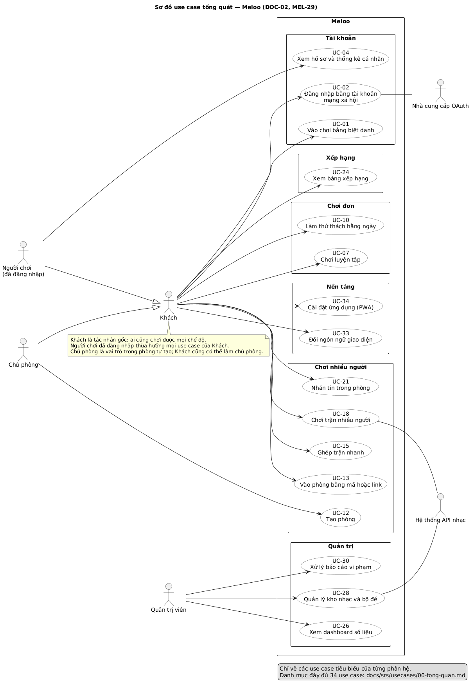
*Hình 3.1: Sơ đồ Use Case tổng quan toàn bộ hệ thống Meloo*

#### Sơ đồ Use Case Phân hệ Tài khoản và Xác thực (UC-01 → UC-05)
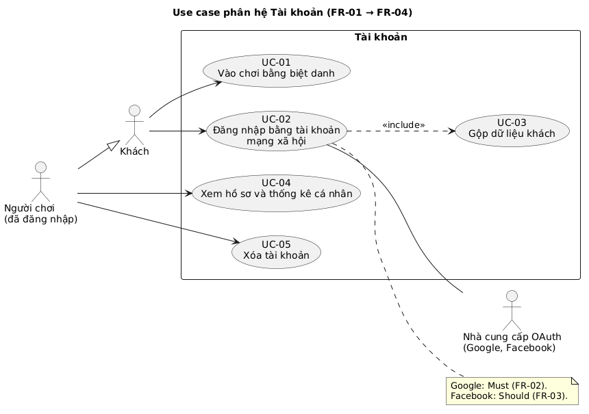
*Hình 3.2: Sơ đồ Use Case phân hệ Quản lý tài khoản và định danh*

#### Sơ đồ Use Case Phân hệ Chơi đơn & Thử thách ngày (UC-06 → UC-11)
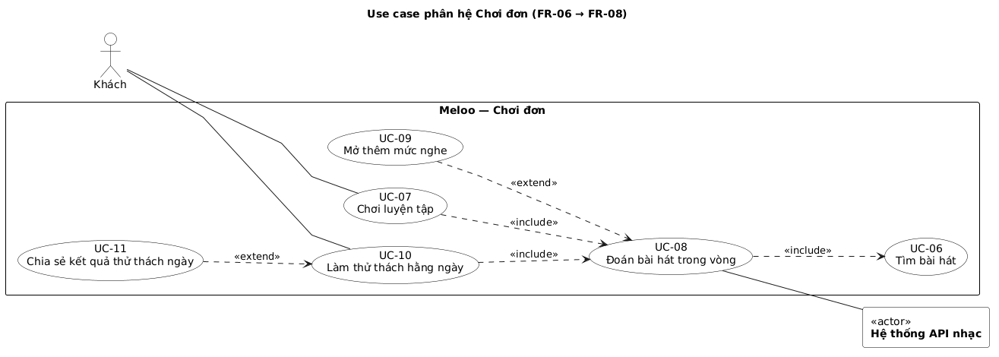
*Hình 3.3: Sơ đồ Use Case phân hệ Chơi đơn và Thử thách hàng ngày*

#### Sơ đồ Use Case Phân hệ Phòng chơi nhiều người & Giao tiếp (UC-12 → UC-23)
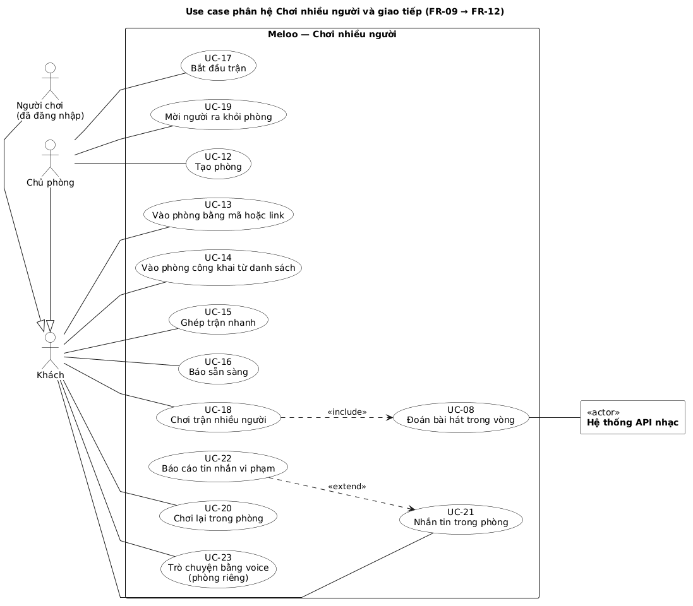
*Hình 3.4: Sơ đồ Use Case phân hệ Phòng chơi nhiều người và tương tác thời gian thực*

#### Sơ đồ Use Case Phân hệ Bảng xếp hạng & Tiến trình (UC-24, UC-25)
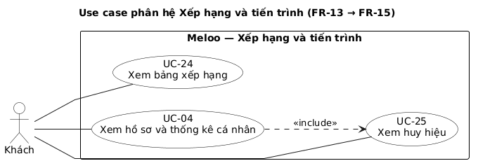
*Hình 3.5: Sơ đồ Use Case phân hệ Bảng xếp hạng và Thành tựu người chơi*

#### Sơ đồ Use Case Phân hệ Quản trị hệ thống (UC-26 → UC-32)
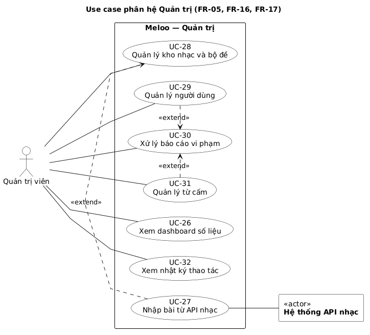
*Hình 3.6: Sơ đồ Use Case phân hệ Quản trị nội dung và giám sát hệ thống*

### 3.3. Ma trận truy vết yêu cầu (Traceability Matrix: FR ↔ UC)
Bảo đảm 100% các yêu cầu chức năng trong tài liệu SRS đều được hiện thực hóa bởi ít nhất một Use Case cụ thể:

| Mã FR | Tên yêu cầu chức năng | Mã Use Case hiện thực | Ghi chú quan hệ |
|---|---|---|---|
| FR-01 | Vào chơi ngay bằng biệt danh | UC-01 | Luồng khách vãng lai chính |
| FR-02 | Đăng nhập Google OAuth2 | UC-02, UC-03 | Bao gồm include Gộp dữ liệu khách (UC-03) |
| FR-03 | Đăng nhập Facebook & Xóa tài khoản | UC-02, UC-05 | Phục vụ quyền riêng tư người dùng |
| FR-04 | Hồ sơ cá nhân & Thống kê | UC-04 | Mở chế độ chỉ xem cho Khách |
| FR-05 | Quản lý kho nhạc & Playlist | UC-27, UC-28 | Bao gồm extend Nhập bài từ Deezer API (UC-27) |
| FR-06 | Tìm kiếm bài hát thông minh | UC-06, UC-08 | Tích hợp trực tiếp trong ô đoán bài |
| FR-07 | Chế độ chơi đơn & Tính điểm | UC-07, UC-08, UC-09 | Bao gồm extend Mở mức nghe (UC-09) |
| FR-08 | Thử thách đoán nhạc hàng ngày | UC-10, UC-11 | Bao gồm extend Chia sẻ kết quả (UC-11) |
| FR-09 | Phòng chơi nhiều người (Tự tạo) | UC-12, UC-13, UC-16, UC-17, UC-18, UC-19, UC-20 | Bộ use case trọn vẹn cho sảnh và trận đấu |
| FR-10 | Phòng công khai & Ghép trận nhanh | UC-14, UC-15, UC-20 | Matchmaking tự động do máy chủ điều phối |
| FR-11 | Trò chuyện văn bản trong phòng | UC-21, UC-22 | Bao gồm extend Báo cáo tin nhắn (UC-22) |
| FR-12 | Đàm thoại thoại WebRTC | UC-23 | Dành riêng cho phòng riêng bạn bè |
| FR-13 | Lưu trữ kết quả trận đấu | UC-07, UC-10, UC-18 | Cơ chế tự động kích hoạt bởi server |
| FR-14 | Bảng xếp hạng mùa & ngày | UC-24 | Vinh danh thành tích người chơi |
| FR-15 | Hệ thống huy hiệu thành tựu | UC-25 | Include trong xem hồ sơ |
| FR-16 | Dashboard số liệu quản trị | UC-26 | Giám sát vận hành |
| FR-17 | Kiểm duyệt báo cáo & Khóa tài khoản | UC-29, UC-30, UC-31, UC-32 | Quản lý an toàn nội dung và từ cấm |
| FR-18 | Đa ngôn ngữ giao diện | UC-33 | Hỗ trợ vi/en |
| FR-19 | Cài đặt ứng dụng PWA | UC-34 | Tối ưu trải nghiệm mobile |

### 3.4. Đặc tả chi tiết 10 Use Case trọng tâm
Dưới đây là đặc tả chi tiết của 10 Use Case cốt lõi nhất đại diện cho toàn bộ luồng nghiệp vụ của hệ thống:

#### Đặc tả chi tiết UC-01 · Vào chơi bằng biệt danh
- **Tác nhân chính:** Khách (Guest)
- **Sự kiện kích hoạt:** Người dùng bấm nút 'Chơi ngay' tại trang chủ hoặc truy cập link phòng.
- **Tiền điều kiện:** Người dùng chưa đăng nhập tài khoản hệ thống.
- **Hậu điều kiện:** Hệ thống cấp phiên khách hợp lệ (JWT Access Token 15 phút, Refresh Cookie 30 ngày), người dùng vào thẳng màn hình chơi hoặc sảnh.
- **Luồng sự kiện chính (Main Success Scenario):**
  1. Người dùng truy cập Meloo, nhập biệt danh mong muốn (hoặc giữ biệt danh ngẫu nhiên do hệ thống gợi ý).
  1. Người dùng nhấn 'Bắt đầu'.
  1. Frontend gửi yêu cầu `POST /api/v1/auth/guest` kèm biệt danh.
  1. Backend kiểm tra giới hạn tần suất (Rate Limiter) và xác thực tính hợp lệ của biệt danh (độ dài 3–20 ký tự, lọc từ cấm theo BR-22).
  1. Backend tạo bản ghi `app_user` loại `GUEST`, sinh Access Token và Refresh Token.
  1. Hệ thống điều hướng người chơi vào màn hình chọn chế độ hoặc sảnh chờ phòng thi đấu.
- **Luồng ngoại lệ / Rẽ nhánh:** 4a. Biệt danh chứa từ cấm hoặc không đúng định dạng: Hệ thống báo lỗi cụ thể, yêu cầu nhập lại mà không tạo phiên mới.

#### Đặc tả chi tiết UC-02 · Đăng nhập bằng Google & Gộp tài khoản khách
- **Tác nhân chính:** Khách / Người chơi
- **Sự kiện kích hoạt:** Người dùng bấm nút 'Đăng nhập với Google' trên thanh điều hướng.
- **Tiền điều kiện:** Thiết bị có kết nối Internet và có tài khoản Google hợp lệ.
- **Hậu điều kiện:** Người dùng được xác thực quyền `REGISTERED`, dữ liệu phiên khách trước đó (nếu có) được gộp toàn vẹn vào tài khoản theo BR-21.
- **Luồng sự kiện chính (Main Success Scenario):**
  1. Người dùng chọn 'Đăng nhập Google'. Trình duyệt chuyển hướng đến màn hình xác thực tài khoản của Google.
  1. Người dùng chấp thuận cấp quyền định danh cơ bản (Email, Profile).
  1. Google chuyển hướng về Meloo kèm Authorization Code.
  1. Frontend chuyển mã code lên Backend qua endpoint xác thực.
  1. Backend xác minh code với Google API, trích xuất email và Google User ID.
  1. Backend kiểm tra: nếu đã có tài khoản, thực hiện đăng nhập; nếu chưa có, tự động tạo mới tài khoản `REGISTERED`.
  1. Nếu trước đó người dùng đang có phiên khách hợp lệ, Backend tự động kích hoạt tiến trình gộp dữ liệu (UC-03): chuyển toàn bộ lịch sử đấu, tổng điểm xếp hạng, thống kê và huy hiệu sang tài khoản mới.
  1. Backend trả về JWT mới và thiết lập Refresh Cookie an toàn; giao diện cập nhật trạng thái đã đăng nhập.
- **Luồng ngoại lệ / Rẽ nhánh:** 5a. Mã xác thực Google không hợp lệ hoặc hết hạn: Backend trả lỗi 401, giao diện hiển thị thông báo đăng nhập thất bại và giữ nguyên phiên khách.

#### Đặc tả chi tiết UC-07 · Chơi luyện tập đơn (Solo Practice)
- **Tác nhân chính:** Khách / Người chơi
- **Sự kiện kích hoạt:** Người dùng chọn tab 'Chơi đơn' và chọn bộ đề/bộ lọc mong muốn.
- **Tiền điều kiện:** Đã có phiên làm việc hợp lệ (Khách hoặc Đã đăng nhập).
- **Hậu điều kiện:** Trận đấu đơn hoàn thành, kết quả được lưu trữ bền vững vào cơ sở dữ liệu.
- **Luồng sự kiện chính (Main Success Scenario):**
  1. Người dùng chọn bộ đề (ví dụ: 'V-pop 2020s') và chọn chế độ: 'Xếp hạng' (bộ chuẩn) hoặc 'Luyện tập' (tự chọn thể loại).
  1. Frontend gửi yêu cầu `POST /api/v1/solo/matches`.
  1. Backend tạo phiên đấu `SoloMatch` trong bộ nhớ, chọn ngẫu nhiên 10 bài hát không trùng lặp (BR-09), khởi tạo Vòng 1.
  1. Lặp lại 10 vòng đấu: Người chơi thực hiện nghe nhạc và đoán bài hát (UC-08).
  1. Sau khi hoàn thành vòng 10, Backend tính toán tổng điểm, chuỗi combo cao nhất, phát sự kiện `MatchFinished`.
  1. Module `progression` lưu lịch sử trận đấu, cộng điểm kinh nghiệm (EXP) và cập nhật thành tựu.
  1. Giao diện hiển thị bảng tổng kết trận đấu và danh sách bài hát đã chơi kèm liên kết nghe trên Deezer (BR-29).
- **Luồng ngoại lệ / Rẽ nhánh:** 4a. Người dùng thoát giữa chừng: Hệ thống lưu trạng thái trận đấu trong bộ nhớ tối đa 30 phút (BR-23). Nếu quay lại trong 30 phút, tiếp tục ván đấu; nếu quá 30 phút, ván đấu tự động hủy.

#### Đặc tả chi tiết UC-08 · Đoán bài hát trong một vòng đấu
- **Tác nhân chính:** Khách / Người chơi
- **Sự kiện kích hoạt:** Vòng chơi bắt đầu hoặc người dùng bấm 'Nghe thêm' / nhập câu trả lời.
- **Tiền điều kiện:** Vòng đấu đang ở trạng thái `IN_PROGRESS`.
- **Hậu điều kiện:** Lượt đoán được chấm điểm chính xác, vòng đấu chuyển trạng thái phù hợp.
- **Luồng sự kiện chính (Main Success Scenario):**
  1. Client nhận thông tin vòng chơi từ Backend (gồm số thứ tự vòng, mức nghe hiện tại và chuỗi Audio Token mờ).
  1. Frontend gọi streaming proxy audio với token để phát đoạn âm thanh tương ứng mức nghe (mặc định bắt đầu từ Mức 1: 2 giây).
  1. Người chơi nhập tên bài hát vào ô tìm kiếm (gõ không dấu, UC-06 gợi ý danh sách bài tương ứng).
  1. Người chơi nhấn Enter hoặc chọn bài hát: Frontend gửi `POST /api/v1/solo/matches/{matchId}/rounds/current/guesses`.
  1. Backend chuẩn hóa tên bài hát đoán và so khớp với đáp án theo chuẩn BR-05 (TitleNormalizer):
     - Nếu ĐÚNG: Tính điểm cơ bản theo mức nghe (BR-02), nhân hệ số combo (BR-08), đánh dấu vòng `CORRECT`, công bố đáp án và dừng vòng.
     - Nếu SAI nhưng ĐÚNG CA SĨ: Hiển thị gợi ý ca sĩ (BR-06), tự động mở mức nghe tiếp theo (2s $\rightarrow$ 5s $\rightarrow$ 10s $\rightarrow$ 20s $\rightarrow$ 30s).
     - Nếu SAI HOÀN TOÀN: Đánh dấu đoán sai, tự động mở mức nghe tiếp theo.
  1. Nếu đã ở mức 30s mà đoán sai hoặc bấm 'Bỏ qua', vòng kết thúc với 0 điểm (`WRONG_OUT` / `GAVE_UP`).
  1. Giao diện hiển thị kết quả vòng, phát hiệu ứng âm thanh và chuyển sang vòng tiếp theo.
- **Luồng ngoại lệ / Rẽ nhánh:** 2a. Lỗi mạng khi phát audio: Người chơi bấm nút 'Nghe lại' (BR-03) để tải lại đoạn preview mà không bị phạt điểm.

#### Đặc tả chi tiết UC-10 · Tham gia Thử thách hàng ngày (Daily Challenge)
- **Tác nhân chính:** Khách / Người chơi
- **Sự kiện kích hoạt:** Người dùng chọn mục 'Thử thách ngày' tại trang chủ.
- **Tiền điều kiện:** Hôm nay người dùng chưa hoàn thành lượt thử thách ngày (mỗi người 1 lượt/ngày theo BR-25).
- **Hậu điều kiện:** Kết quả được ghi nhận vào bảng vinh danh ngày, chuỗi ngày liên tiếp (Streak) được cập nhật.
- **Luồng sự kiện chính (Main Success Scenario):**
  1. Người dùng truy cập màn hình Thử thách ngày.
  1. Frontend gửi yêu cầu `POST /api/v1/daily/attempt`.
  1. Backend kiểm tra: nếu người dùng đã chơi hôm nay, từ chối tạo lượt mới và trả về kết quả cũ; nếu chưa chơi, cấp bài hát của ngày hôm nay (cố định toàn server theo ngày giờ Việt Nam).
  1. Kích hoạt đồng hồ đếm giờ (giới hạn trần tối đa 5 phút theo quy định BR-25).
  1. Người chơi tiến hành nghe các mức 2s $\rightarrow$ 30s và đưa ra dự đoán duy nhất cho bài hát.
  1. Khi đoán đúng hoặc hết 5 phút / bỏ cuộc, hệ thống ghi nhận kết quả `DailyAttempt`.
  1. Giao diện hiển thị bảng kết quả ngày, chuỗi ngày tham gia liên tục và nút 'Chia sẻ thành tích' (UC-11).
- **Luồng ngoại lệ / Rẽ nhánh:** 3a. Người dùng đã hoàn thành thử thách trước đó: Hiển thị màn hình xem lại kết quả đã chơi và đếm ngược thời gian đến 00:00 VN để mở lượt mới.

#### Đặc tả chi tiết UC-12 · Tạo phòng chơi nhiều người (Create Room)
- **Tác nhân chính:** Chủ phòng (Host)
- **Sự kiện kích hoạt:** Người dùng chọn 'Tạo phòng' tại sảnh nhiều người chơi.
- **Tiền điều kiện:** Người dùng có phiên làm việc hợp lệ.
- **Hậu điều kiện:** Phòng chơi mới được khởi tạo trên server, người dùng trở thành Chủ phòng trong sảnh chờ.
- **Luồng sự kiện chính (Main Success Scenario):**
  1. Người dùng bấm 'Tạo phòng'.
  1. Frontend gửi yêu cầu `POST /api/v1/rooms` kèm cấu hình ban đầu (tên phòng, số vòng đấu, chế độ công khai/riêng tư).
  1. Backend sinh ngẫu nhiên mã phòng 6 ký tự dễ đọc (loại bỏ `0, O, 1, I, L` theo BR-11).
  1. Backend khởi tạo một thực thể `RoomActor` độc lập trong bộ nhớ, gán người tạo làm Chủ phòng.
  1. Frontend nhận mã phòng, tự động thiết lập kết nối WebSocket STOMP tới `/ws` và subscribe vào các topic `/topic/rooms/{roomId}/*`.
  1. Giao diện chuyển sang màn hình Sảnh chờ (Lobby), hiển thị mã phòng và nút sao chép liên kết mời bạn bè.
- **Luồng ngoại lệ / Rẽ nhánh:** 3a. Trùng mã phòng đang hoạt động: Bộ sinh mã tự động thử lại mã ngẫu nhiên khác cho đến khi duy nhất.

#### Đặc tả chi tiết UC-13 · Tham gia phòng chơi bằng mã hoặc liên kết
- **Tác nhân chính:** Khách / Người chơi
- **Sự kiện kích hoạt:** Người dùng nhập mã phòng 6 ký tự hoặc mở đường link chia sẻ.
- **Tiền điều kiện:** Phòng chơi tồn tại và chưa vượt quá sĩ số tối đa (tối đa 5 người theo BR-11).
- **Hậu điều kiện:** Người chơi kết nối thành công vào sảnh chờ phòng thi đấu.
- **Luồng sự kiện chính (Main Success Scenario):**
  1. Người dùng mở liên kết phòng hoặc nhập mã phòng tại ô 'Vào phòng'.
  1. Frontend gửi yêu cầu `POST /api/v1/rooms/join` kèm mã phòng và thông tin người chơi.
  1. Backend kiểm tra trạng thái phòng qua `RoomActor`:
     - Nếu phòng đã đủ 5 người: từ chối, báo lỗi phòng đầy.
     - Nếu người chơi từng bị chủ phòng đuổi (Kicked): từ chối theo BR-12.
     - Nếu hợp lệ: thêm người chơi vào danh sách thành viên phòng.
  1. Client kết nối WebSocket STOMP và subscribe topic phòng.
  1. Backend phát sự kiện `PlayerJoinedEvent` tới toàn bộ người trong phòng.
  1. Giao diện sảnh chờ của mọi thành viên tự động cập nhật danh sách người chơi tức thời.
- **Luồng ngoại lệ / Rẽ nhánh:** 3a. Trận đấu trong phòng đang diễn ra: Người chơi được đưa vào trạng thái 'Khán giả chờ' (Waiting lobby), tự động tham gia ở ván đấu tiếp theo (BR-15).

#### Đặc tả chi tiết UC-15 · Ghép trận tự động nhanh (Quick Matchmaking)
- **Tác nhân chính:** Khách / Người chơi
- **Sự kiện kích hoạt:** Người dùng nhấn nút 'Ghép trận nhanh'.
- **Tiền điều kiện:** Có phiên đăng nhập hợp lệ.
- **Hậu điều kiện:** Người chơi được xếp vào phòng ghép trận chuẩn và tự động bắt đầu thi đấu khi đủ điều kiện.
- **Luồng sự kiện chính (Main Success Scenario):**
  1. Người chơi nhấn 'Ghép trận nhanh'.
  1. Frontend gửi yêu cầu tìm phòng ghép tới hệ thống.
  1. Hệ thống Matchmaker tìm kiếm phòng ghép trận đang ở trạng thái chờ có sẵn vị trí trống:
     - Nếu tìm thấy: gán người chơi vào phòng đó.
     - Nếu không có: tự động tạo một phòng ghép trận mới không có chủ phòng (BR-13).
  1. Khi phòng có từ 2 người chơi trở lên: Server kích hoạt đồng hồ đếm ngược 30 giây.
  1. Hết 30 giây (hoặc khi đạt đủ 5 người): Trận đấu tự động kích hoạt bắt đầu mà không cần ai bấm sẵn sàng.
  1. Toàn bộ thành viên tự động chuyển vào màn hình thi đấu Vòng 1.
- **Luồng ngoại lệ / Rẽ nhánh:** 4a. Người chơi thứ 2 rời phòng khi đang đếm ngược: Đồng hồ đếm ngược tự động dừng lại; khi có người chơi mới vào, bộ đếm kích hoạt lại từ đầu đủ 30 giây (BR-13).

#### Đặc tả chi tiết UC-18 · Thi đấu vòng chơi nhiều người thời gian thực
- **Tác nhân chính:** Khách / Người chơi
- **Sự kiện kích hoạt:** Trận đấu nhiều người chuyển sang vòng tiếp theo.
- **Tiền điều kiện:** Phòng chơi đang ở trạng thái `IN_MATCH`.
- **Hậu điều kiện:** Vòng chơi hoàn tất, điểm số và bảng xếp hạng trực tiếp trong phòng được cập nhật đồng bộ.
- **Luồng sự kiện chính (Main Success Scenario):**
  1. `RoomActor` chọn bài hát ngẫu nhiên cho vòng từ kho nhạc (BR-09).
  1. Pha chuẩn bị (Prepare Phase, 3 giây): Server cấp token audio Mức 1 (2s) qua hàng đợi riêng `/user/queue/private` cho từng người chơi để client nạp đệm trước (Audio Preload, NFR-04).
  1. Pha chơi chính thức (Playing Phase, 45 giây): Server phát `RoundStartEvent` ra topic chung `/topic/rooms/{roomId}/round`, đồng hồ 45s server bắt đầu đếm ngược.
  1. Mỗi người chơi tự điều khiển mức nghe của mình (BR-07); phát âm thanh cục bộ.
  1. Người chơi nhập câu trả lời: Lệnh gửi qua kênh WebSocket `/app/rooms/{roomId}/guess`.
  1. Hàng đợi `RoomActor` xử lý tuần tự từng lệnh đoán:
     - Kiểm tra thời gian: nếu nhận trước mốc 45.000 ms, tiến hành so khớp chuẩn hóa (BR-05).
     - Nếu ĐÚNG: Tính điểm cơ bản + thưởng combo (BR-08) + thưởng tốc độ $\lfloor 200 \times \text{ms còn lại} \div 45.000 \rfloor$. Phát thông báo có người đúng nhưng **ẩn tên bài** (BR-07).
     - Nếu SAI: Phát kết quả sai riêng cho người đó, tự động cấp token mức nghe tiếp theo.
  1. Vòng kết thúc khi: Hết 45 giây HOẶC toàn bộ người chơi trong phòng đều đã hoàn thành lượt (đoán đúng, hết lượt hoặc bỏ cuộc).
  1. Server phát `RoundEndEvent` công bố đáp án chính thức, link nghe Deezer (BR-29) và phát `ScoreboardUpdateEvent` cập nhật điểm số toàn phòng.
- **Luồng ngoại lệ / Rẽ nhánh:** 6a. Tin nhắn chat của người chơi cố tình gửi tên bài hát đáp án: Bộ lọc tại `RoomActor` nhận diện chuỗi trùng khớp với đáp án vòng hiện tại, tự động chặn tin nhắn và phát cảnh báo vi phạm riêng cho người gửi theo BR-16.

#### Đặc tả chi tiết UC-21 · Trò chuyện văn bản trong phòng (Room Chat)
- **Tác nhân chính:** Khách / Người chơi
- **Sự kiện kích hoạt:** Người chơi nhập tin nhắn trong hộp thoại chat của phòng.
- **Tiền điều kiện:** Người chơi đang có mặt trong phòng thi đấu.
- **Hậu điều kiện:** Tin nhắn hợp lệ được phát tới tất cả các thành viên trong phòng.
- **Luồng sự kiện chính (Main Success Scenario):**
  1. Người chơi nhập nội dung tin nhắn và nhấn gửi.
  1. Frontend gửi thông điệp STOMP tới `/app/rooms/{roomId}/chat`.
  1. Backend (`RoomActor`) tiếp nhận và thực hiện kiểm duyệt an toàn nội dung:
     - Kiểm tra rò rỉ đáp án (BR-16): Chuẩn hóa nội dung tin nhắn, so khớp với tên bài hát đáp án của vòng đang thi đấu. Nếu trùng, hủy tin nhắn và gửi cảnh báo về người gửi.
     - Kiểm tra từ ngữ thô tục (BR-17): So khớp với bảng danh mục từ cấm `banned_word`. Nếu vi phạm, chặn tin nhắn.
  1. Nếu tin nhắn hợp lệ, server chuyển tiếp tin nhắn ra topic `/topic/rooms/{roomId}/chat`.
  1. Toàn bộ người chơi trong phòng nhận và hiển thị tin nhắn trên khung chat giao diện.
- **Luồng ngoại lệ / Rẽ nhánh:** 3a. Tin nhắn bị chặn do vi phạm: Server gửi thông điệp lỗi riêng vào `/user/queue/errors`, khung chat hiển thị cảnh báo đỏ 'Tin nhắn bị chặn do vi phạm tiêu chuẩn cộng đồng hoặc lộ đáp án'.

---

# PHẦN IV: THIẾT KẾ KIẾN TRÚC HỆ THỐNG C4 MODEL VÀ TRIỂN KHAI

### 4.1. Triết lý thiết kế và ràng buộc hệ thống
Kiến trúc Meloo được định hình dựa trên 4 trụ cột triết lý kỹ thuật:
1. **Máy chủ là trọng tài tối cao (Server-as-Referee):** Đảm bảo tính công bằng tuyệt đối. Mọi phép toán chấm điểm, xử lý đồng hồ đếm ngược, phân định thắng thua và xác thực đáp án đều diễn ra độc quyền tại backend. Trình duyệt client chỉ đóng vai trò hiển thị và gửi tương tác (NFR-07).
2. **Kiến trúc Modular Monolith (Spring Modulith):** Toàn bộ nghiệp vụ được gói gọn trong một đơn vị triển khai duy nhất nhưng phân tách ranh giới module vật lý nghiêm ngặt (ADR-001). Cấu trúc này giúp tối ưu hóa chi phí phần cứng (chạy trọn vẹn trên 1 GB RAM của AWS Free Tier) đồng thời ngăn chặn xung đột mã nguồn khi nhiều AI agent cùng lập trình.
3. **Hợp đồng là trên hết (Contract-First / API-First):** OpenAPI 3.1 quy chuẩn hóa toàn bộ REST API và AsyncAPI 3 quy chuẩn hóa toàn bộ kênh WebSocket STOMP (ADR-002). Code DTO và client hai đầu được sinh tự động, đảm bảo khớp nối 100%.
4. **Bảo mật luồng âm thanh qua Proxy Streaming:** Phân phối preview nhạc bằng cơ chế proxy cắt byte CBR tại máy chủ với token HMAC ngắn hạn ($\le 2$ phút), triệt tiêu nguy cơ tải trước hoặc dịch ngược đáp án (ADR-008).

### 4.2. C4 Level 1: Sơ đồ bối cảnh hệ thống (Context Diagram)
Sơ đồ thể hiện phạm vi hệ thống Meloo trong tương tác với các nhóm người dùng và các hệ thống dịch vụ bên thứ ba:

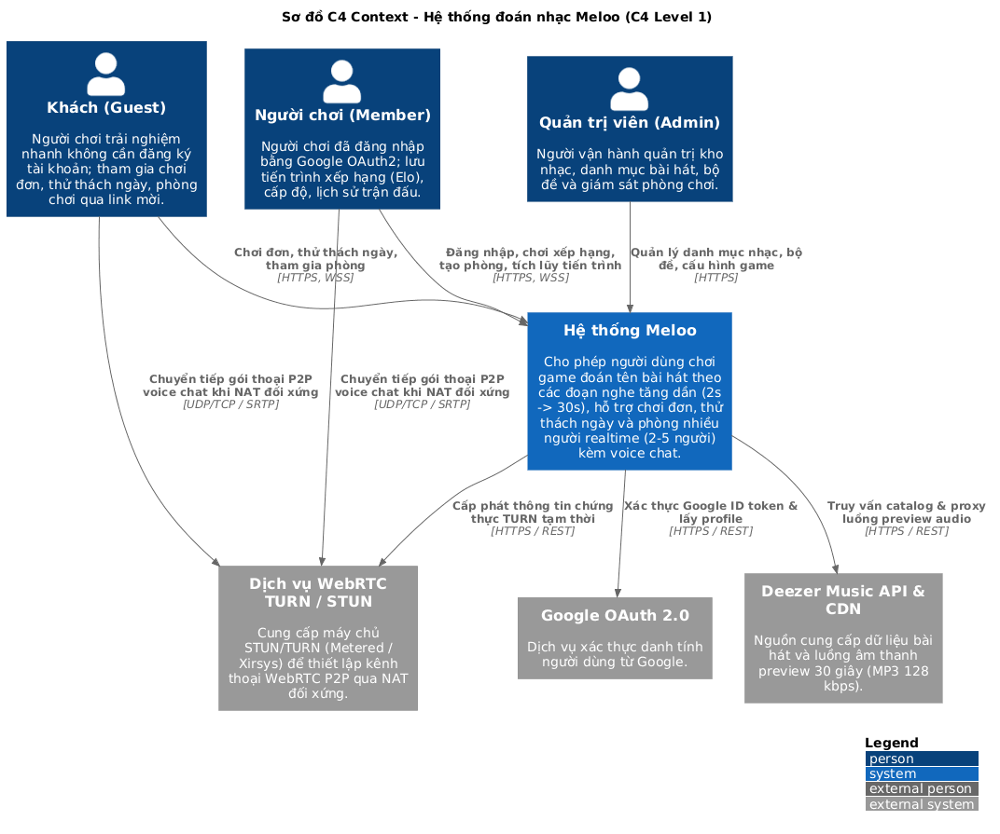
*Hình 4.1: Sơ đồ bối cảnh hệ thống (C4 Level 1 - System Context Diagram)*

**Các tương tác ngoại vi then chốt:**
- **Khách & Thành viên:** Tương tác qua trình duyệt web trên máy tính hoặc điện thoại thông minh.
- **Google OAuth 2.0 / Facebook Login:** Cung cấp dịch vụ định danh tập trung an toàn.
- **Deezer Music API & CDN:** Cung cấp danh mục bài hát phong phú và luồng audio MP3 128 kbps hợp pháp.
- **External STUN/TURN Services:** Hỗ trợ thiết lập kênh thoại WebRTC Mesh P2P xuyên qua các lớp tường lửa/NAT đối xứng.

### 4.3. C4 Level 2: Sơ đồ khối thùng chứa (Container Diagram)
Sơ đồ phân rã các khối phần mềm độc lập cấu thành giải pháp Meloo và công nghệ tương ứng:

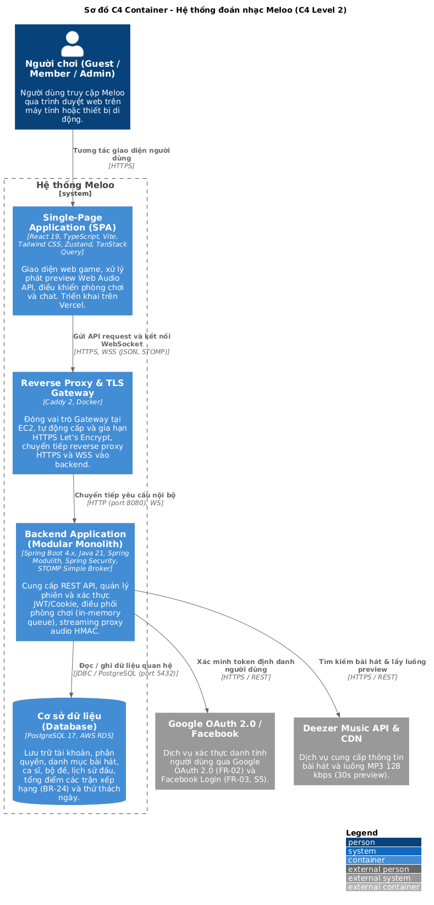
*Hình 4.2: Sơ đồ khối thùng chứa phần mềm (C4 Level 2 - Container Diagram)*

**Chi tiết các Container:**
1. **Frontend Single-Page Application (SPA):** Công nghệ React 19, TypeScript strict, Vite, Tailwind CSS, shadcn/ui, Web Audio API và STOMP client. Lưu trữ và phân phối biên qua mạng toàn cầu Vercel Edge Network.
2. **Reverse Proxy & TLS Gateway (Caddy):** Máy chủ Caddy 2 chạy trong Docker trên EC2, tự động quản lý chứng chỉ SSL/TLS Let's Encrypt, định tuyến REST API `/api/**` và tự động nâng cấp WebSocket `/ws`.
3. **Backend Application (Spring Boot Modular Monolith):** Đóng gói Java 21, Spring Boot 4.x, Spring Modulith, Spring Security 7. Vận hành toàn bộ máy trạng thái phòng chơi và luật tính điểm.
4. **Hệ quản trị CSDL Quan hệ (PostgreSQL 17):** Dịch vụ CSDL được quản lý AWS RDS PostgreSQL 17, lưu trữ dữ liệu người dùng, bài hát và kết quả thi đấu.

### 4.4. C4 Level 3: Sơ đồ thành phần Backend Modular Monolith (Component Diagram)
Sơ đồ thể hiện cấu trúc phân rã các module nghiệp vụ nội bộ bên trong tiến trình Spring Boot Backend:

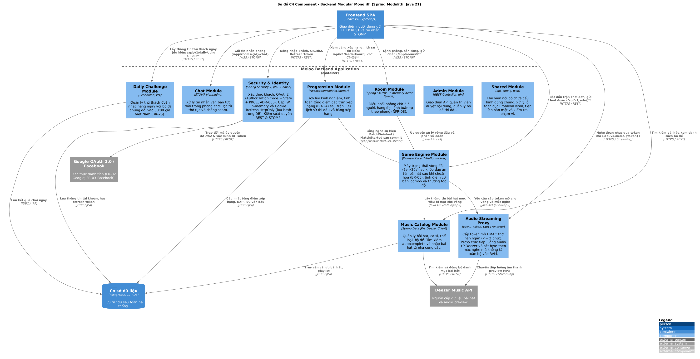
*Hình 4.3: Sơ đồ thành phần các module Backend (C4 Level 3 - Component Diagram)*

**Ranh giới và chức năng của các module Spring Modulith:**
- **`identity`:** Quản lý phiên khách vãng lai, xác thực OAuth2, cấp phát và xoay vòng JWT/Cookie.
- **`catalog`:** Quản lý kho dữ liệu bài hát, thể loại, playlist; kết nối Deezer API client.
- **`audio`:** Dịch vụ proxy luồng âm thanh trực tiếp từ CDN, khống chế độ dài byte theo mức nghe qua token HMAC.
- **`game`:** Lõi luật chơi, điều phối máy trạng thái vòng đấu đơn, bộ so khớp tên bài `TitleNormalizer` và bộ tính điểm `ScoreCalculator`.
- **`room`:** Điều phối phòng thi đấu nhiều người bằng mô hình hàng đợi đơn luồng `RoomActor`, xử lý tin nhắn STOMP.
- **`chat`:** Kênh trao đổi tin nhắn văn bản, tích hợp bộ kiểm duyệt từ cấm và chống lộ đáp án.
- **`voice`:** Quản lý thông tin xác thực STUN/TURN và điều phối tín hiệu WebRTC signaling.
- **`progression`:** Xử lý sự kiện kết thúc trận `MatchFinished` để ghi nhận kết quả bền, tính điểm xếp hạng mùa và thăng cấp.
- **`daily`:** Quản lý chu kỳ thử thách đoán nhạc hàng ngày, đồng bộ làm mới lúc 00:00 VN.
- **`admin`:** Điểm cuối REST API dành riêng cho quản trị viên vận hành hệ thống.
- **`shared`:** Thư viện chung toàn cục chứa chuẩn hóa lỗi ProblemDetail RFC 7807 và tiện ích bảo mật.

### 4.5. Sơ đồ triển khai hạ tầng đám mây AWS (Deployment Diagram)
Sơ đồ mô tả hiện thực hóa kiến trúc vật lý trên hạ tầng đám mây công cộng (AWS Region `ap-southeast-1` Singapore kết hợp Vercel và Cloudflare):

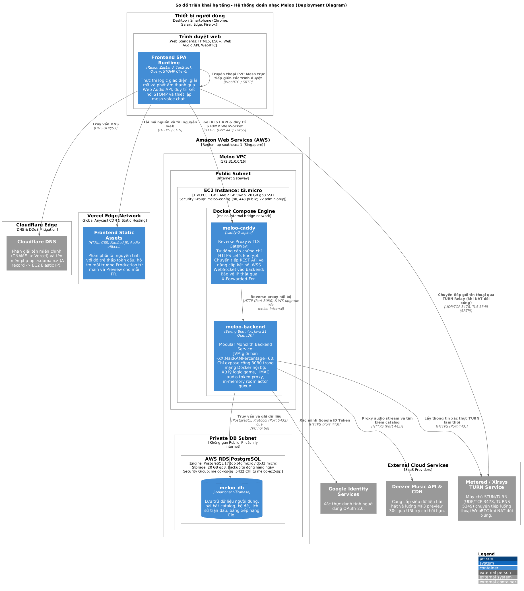
*Hình 4.4: Sơ đồ triển khai hạ tầng vật lý (Physical Deployment Architecture Diagram)*

**Cấu hình hạ tầng chi tiết:**
- **Phân tầng Edge & DNS:** Cloudflare DNS quản lý bản ghi tên miền và chống DDoS; Vercel CDN lưu trữ Frontend tĩnh.
- **Phân tầng Máy chủ ứng dụng (AWS EC2 `t3.micro`):** Cấu hình 1 vCPU, 1 GB RAM vật lý, bổ sung 2 GB swapfile làm vùng đệm bộ nhớ an toàn. Chạy Docker Compose cô lập Caddy và Spring Boot Backend.
- **Phân tầng Cơ sở dữ liệu (AWS RDS PostgreSQL 17):** Cấu hình `Publicly Accessible = No`, đặt trong subnet an toàn, chỉ cho phép kết nối TCP cổng 5432 từ duy nhất Security Group của EC2.

### 4.6. Tổng hợp các quyết định kiến trúc then chốt (ADR-001 → ADR-008)
Toàn bộ các quyết định kỹ thuật quan trọng của dự án được ghi nhận chính thức qua các bản Architecture Decision Record:

| Mã ADR | Quyết định công nghệ | Phương án thay thế | Lý do cốt lõi & Đánh đổi |
|---|---|---|---|
| **ADR-001** | **Modular Monolith với Spring Modulith** | Microservices, Monolith truyền thống | Tối ưu hóa tuyệt đối cho giới hạn 1 GB RAM máy chủ EC2 Free Tier; Spring Modulith kiểm chứng ranh giới module tự động trong CI bằng `verify()`, loại bỏ chi phí vận hành mạng phức tạp. |
| **ADR-002** | **Hợp đồng API-First (OpenAPI 3.1 & AsyncAPI 3)** | Code-First | Đồng bộ hóa hai đầu Backend-Frontend, hỗ trợ kiểm thử tự động và cho phép phát triển song song độc lập. |
| **ADR-003** | **Nguồn nhạc Deezer API làm chủ đạo** | iTunes Search, Spotify API | Deezer cung cấp định dạng MP3 128 kbps (tiết kiệm 50% băng thông so với iTunes AAC 256 kbps), có API danh mục phong phú. PO chấp nhận ngoại lệ bản quyền cho giai đoạn beta học thuật. |
| **ADR-004** | **Giao tiếp Realtime qua STOMP trên WebSocket** | Polling REST, SSE, Raw WebSocket | STOMP hỗ trợ sẵn mô hình Publish/Subscribe (Topic phòng, Queue riêng), dễ tích hợp xác thực tại frame CONNECT của Spring Security. |
| **ADR-005** | **Xác thực JWT in-memory + Cookie Refresh HttpOnly** | LocalStorage token, Stateful Session | JWT Access Token lưu trong RAM chống rò rỉ XSS; Cookie Refresh Token mang cờ `HttpOnly`, `SameSite=Lax` chống CSRF. Lưu hash refresh token trong DB, hỗ trợ xoay vòng theo family. |
| **ADR-006** | **Hạ tầng Vercel (FE) + AWS EC2/RDS (BE) + Cloudflare** | VPS đơn lẻ, PaaS all-in-one | Tận dụng trọn vẹn gói dịch vụ miễn phí (Free Tier), Vercel cung cấp CDN toàn cầu và preview tự động cho mỗi PR; EC2 duy trì kết nối WebSocket bền bỉ. |
| **ADR-007** | **Trạng thái phòng trong bộ nhớ + Hàng đợi tuần tự** | DB pessimistic lock, Redis distributed | Loại bỏ hoàn toàn I/O đĩa trong lúc thi đấu; mỗi phòng vận hành một hàng đợi `RoomActor` xử lý tuần tự, triệt tiêu 100% race condition khi nhiều người cùng đoán bài. |
| **ADR-008** | **Chống gian lận: Streaming Proxy + HMAC Token** | Trả trực tiếp URL nhạc của CDN | Bảo mật tuyệt đối đáp án: URL không chứa tên bài hay trackId; token HMAC hết hạn sau $\le 2$ phút; backend cắt byte CBR tương ứng mức nghe, ngăn chặn nghe trước. |

### 4.7. Chiến thuật kiến trúc đáp ứng yêu cầu phi chức năng (NFR Tactics)
1. **Chiến thuật Bảo mật (NFR-05, NFR-07):** Giấu kín hoàn toàn thông tin bài hát trong đối tượng `Round`; endpoint audio `/api/v1/audio/{token}` sử dụng token băm HMAC-SHA256, kiểm tra chữ ký bằng `MessageDigest.isEqual` chống tấn công định thời (Timing Attack); định dạng Access Log Tomcat loại bỏ vết token (`%m` thay vì `%r`).
2. **Chiến thuật Hiệu năng (NFR-01, NFR-02, NFR-04):** Chuyển tiếp luồng byte âm thanh trực tiếp (Zero-Copy Streaming) từ Deezer CDN sang client mà không ghi đĩa và không giữ trong Heap RAM; duy trì trạng thái thi đấu hoàn toàn trong RAM (Zero-Disk I/O In-Game) giúp độ trễ STOMP đạt $< 200\text{ ms}$; nạp đệm audio trước 3s trong pha `ROUND_PREPARE` giúp âm thanh phát $< 1,0\text{ s}$.
3. **Chiến thuật Khả năng Chịu tải (NFR-03):** Cấu hình JVM tối ưu `-XX:MaxRAMPercentage=60 -XX:+ExitOnOutOfMemoryError` ngăn chặn OOM Killer; phục vụ ổn định 20 phòng $\times$ 5 người (100 CCU) trên máy chủ 1 GB RAM.

---

# PHẦN V: THIẾT KẾ CHI TIẾT PHẦN MỀM (UML CHI TIẾT)

### 5.1. Sơ đồ lớp miền tổng quát (Domain Model Class Diagram)
Mô hình thực thể miền biểu diễn các khái niệm nghiệp vụ cốt lõi của hệ thống:

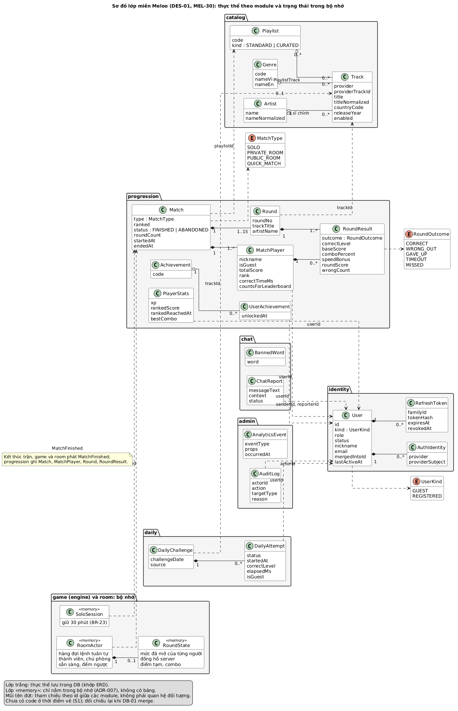
*Hình 5.1: Sơ đồ lớp miền tổng quát toàn hệ thống Meloo*

### 5.2. Thiết kế chi tiết sơ đồ lớp các module nghiệp vụ cốt lõi

#### Module Quản lý Danh tính & Xác thực (`identity`)
Bao gồm các thành phần tiếp nhận yêu cầu REST, dịch vụ tạo phiên khách kèm bộ kiểm tra biệt danh `NicknameValidator`, dịch vụ cấp phát JWT và quản lý vòng đời xoay vòng Refresh Token:

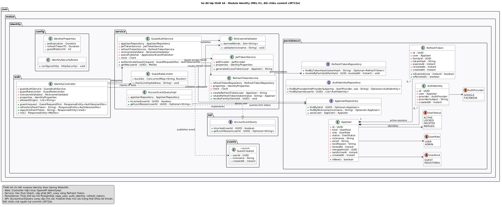
*Hình 5.2: Thiết kế sơ đồ lớp chi tiết module Identity*

#### Module Kho nhạc & Tìm kiếm gợi ý (`catalog`)
Bao gồm thực thể bài hát, nghệ sĩ, playlist, dịch vụ tìm kiếm bài hát sau chuẩn hóa không dấu `TrackSearchService`, và mẫu thiết kế Adapter trừu tượng hóa nhà cung cấp nhạc `MusicProvider`:

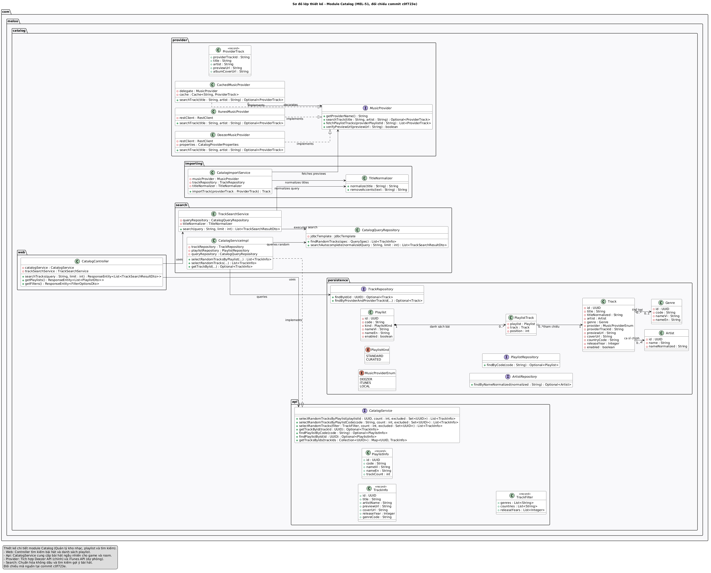
*Hình 5.3: Thiết kế sơ đồ lớp chi tiết module Catalog*

#### Module Luật chơi, Tính điểm & Chơi đơn (`game`)
Đóng gói thực thể aggregate `Round` độc lập hoàn toàn với framework, bộ tính điểm `ScoreCalculator`, bộ theo dõi chuỗi combo `ComboTracker` và quản lý phiên đấu đơn `SoloMatchManager`:

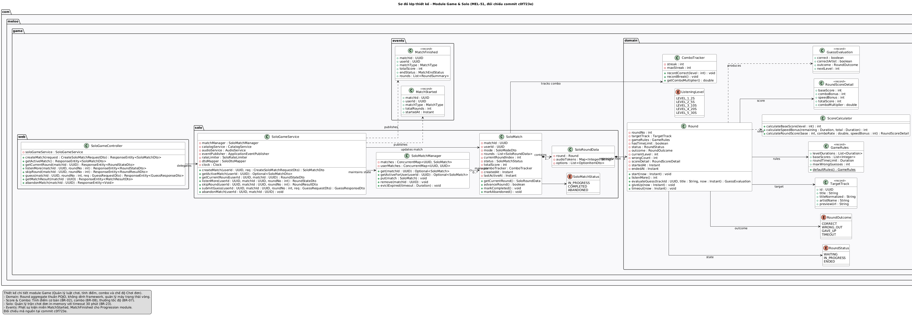
*Hình 5.4: Thiết kế sơ đồ lớp chi tiết module Game*

#### Module Phòng chơi & Realtime STOMP (`room`)
Trung tâm điều phối nhiều người chơi áp dụng mẫu hình Actor Model với `RoomActor` vận hành trên luồng ảo (Virtual Thread), quản lý hàng đợi lệnh tuần tự và phát sự kiện STOMP:

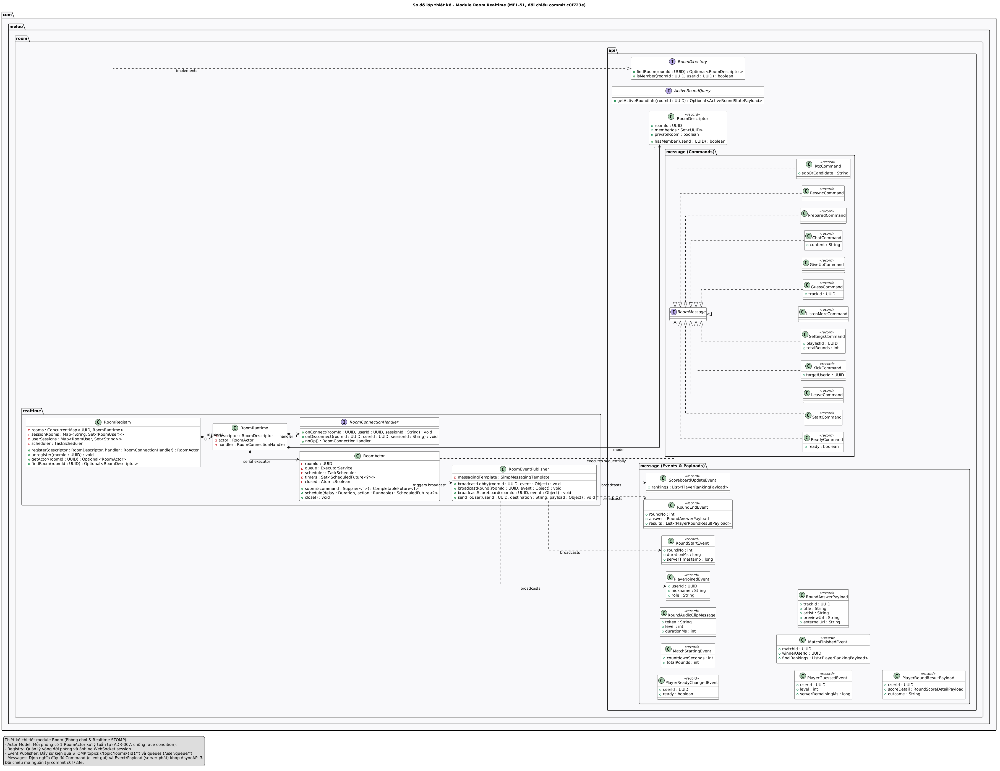
*Hình 5.5: Thiết kế sơ đồ lớp chi tiết module Room*

### 5.3. Thiết kế sơ đồ tuần tự (Sequence Diagrams) cho các kịch bản tương tác chính
Dưới đây là 5 kịch bản tương tác trọng tâm thể hiện sự phối hợp nhịp nhàng giữa Frontend, Caddy Gateway, các Controller, Service và Message Broker:

#### Kịch bản 1: Đăng nhập khách bằng biệt danh (UC-01, BR-20, BR-22)
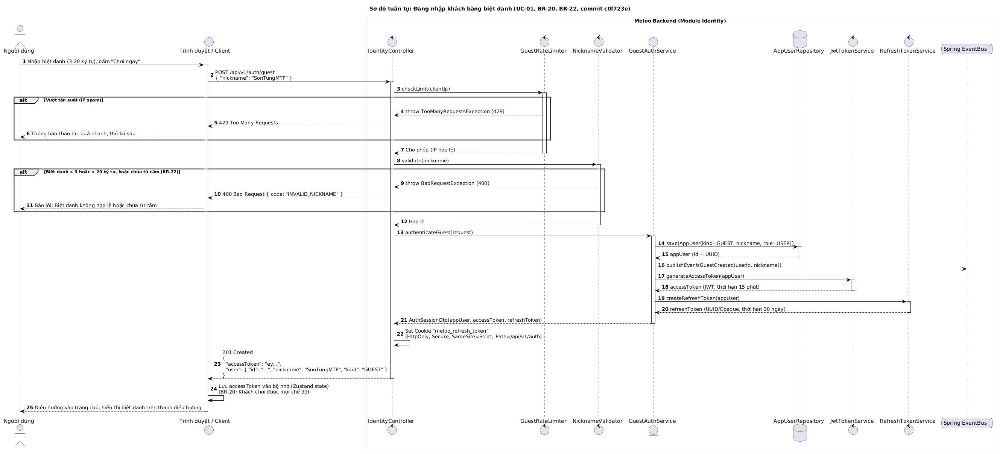
*Hình 5.6: Sơ đồ tuần tự quy trình tạo phiên khách vãng lai bằng biệt danh*

#### Kịch bản 2: Đăng nhập Google & Gộp tài khoản khách (UC-02, BR-21)
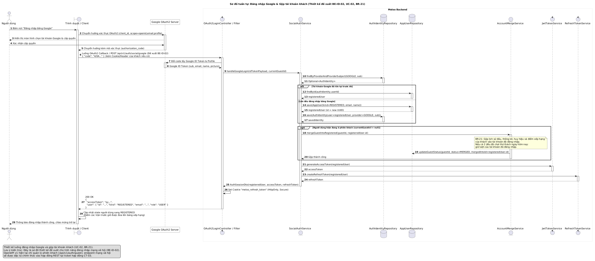
*Hình 5.7: Sơ đồ tuần tự xác thực Google OAuth2 và tự động gộp dữ liệu khách*

#### Kịch bản 3: Một vòng chơi đơn và cấp phát Audio Token mờ (UC-07, UC-08, ADR-008)
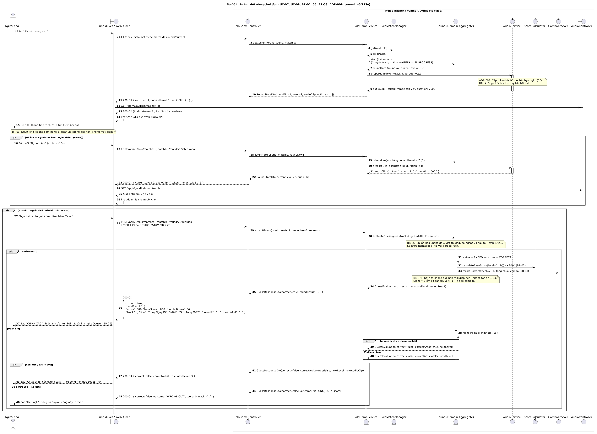
*Hình 5.8: Sơ đồ tuần tự một vòng chơi đơn và quy trình phát audio bảo mật*

#### Kịch bản 4: Tạo phòng và vào phòng chơi nhiều người (UC-12, UC-13, BR-11..15)
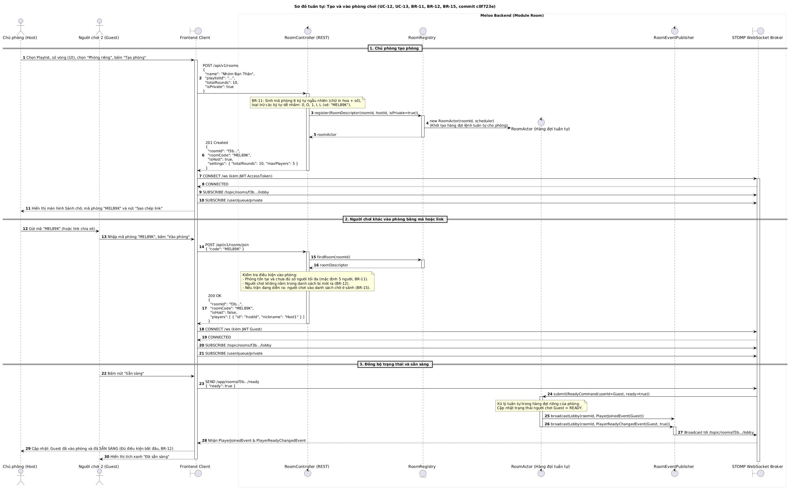
*Hình 5.9: Sơ đồ tuần tự quy trình tạo phòng, kết nối STOMP và vào sảnh chờ*

#### Kịch bản 5: Một vòng thi đấu nhiều người thời gian thực qua STOMP (UC-18, BR-07..10)
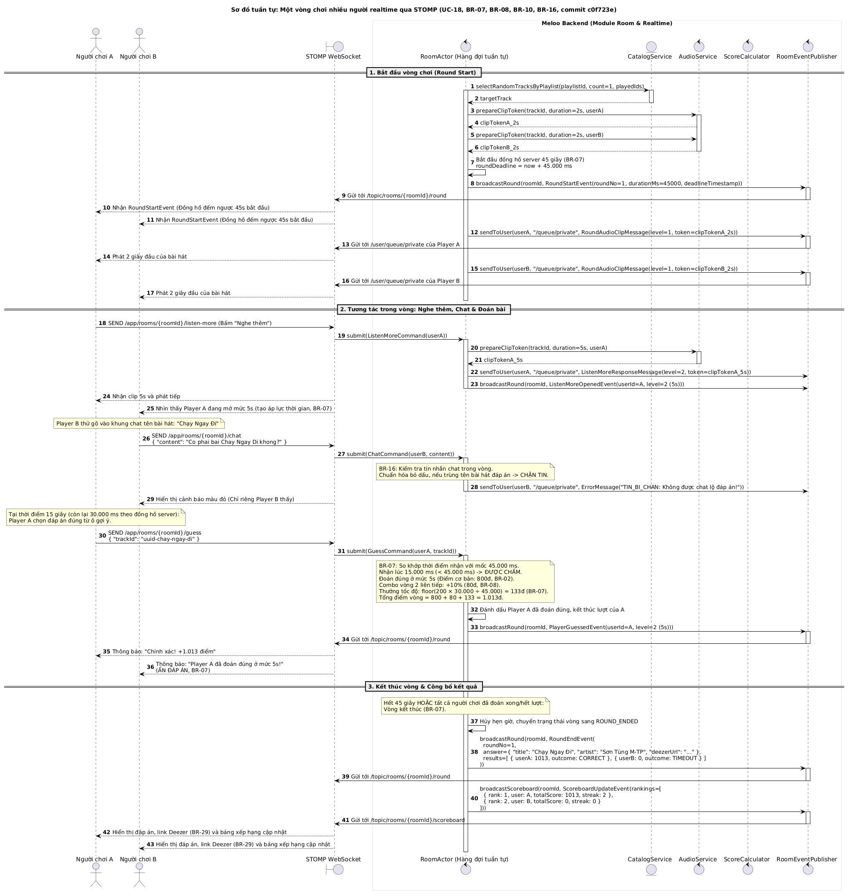
*Hình 5.10: Sơ đồ tuần tự thi đấu vòng nhiều người realtime, đồng bộ điểm số và ẩn đáp án*

### 5.4. Thiết kế sơ đồ máy trạng thái (State Machine Diagrams)

#### Vòng đời Phòng chơi (Room State Machine - BR-11..15)
Biểu diễn các trạng thái `WAITING_LOBBY` $\rightarrow$ `COUNTDOWN` $\rightarrow$ `IN_MATCH` $\rightarrow$ `MATCH_FINISHED` $\rightarrow$ `CLOSED`:

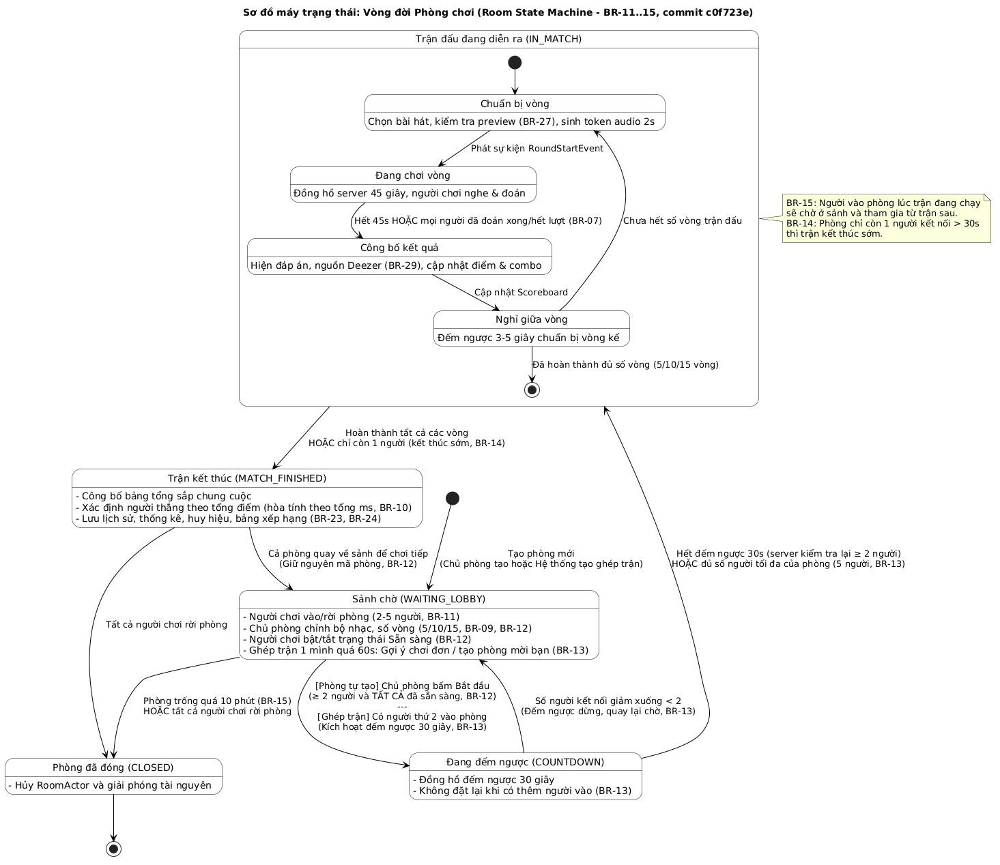
*Hình 5.11: Sơ đồ máy trạng thái vòng đời phòng chơi*

#### Vòng đời Vòng đấu (Round State Machine - BR-01..07)
Biểu diễn các trạng thái `WAITING` $\rightarrow$ `IN_PROGRESS` (5 mức 2s..30s) $\rightarrow$ `CORRECT` / `WRONG_OUT` / `GAVE_UP` / `TIMEOUT` $\rightarrow$ `ENDED`:

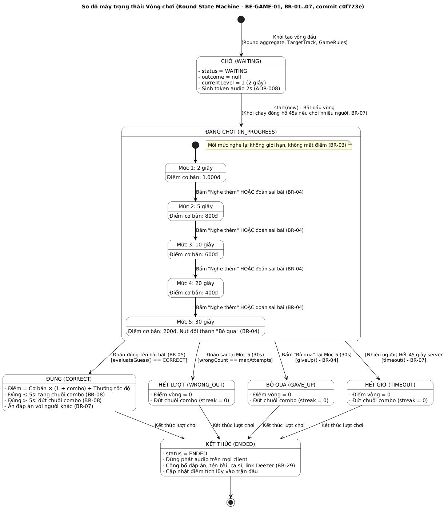
*Hình 5.12: Sơ đồ máy trạng thái vòng đấu*

#### Vòng đời Người chơi trong phòng & Xử lý rớt mạng (BR-12, BR-14, BR-15)
Biểu diễn chuyển dịch `NOT_READY` $\leftrightarrow$ `READY`, trạng thái trong trận và vùng đệm 30 giây rớt mạng (`DISCONNECTED_GRACE`):

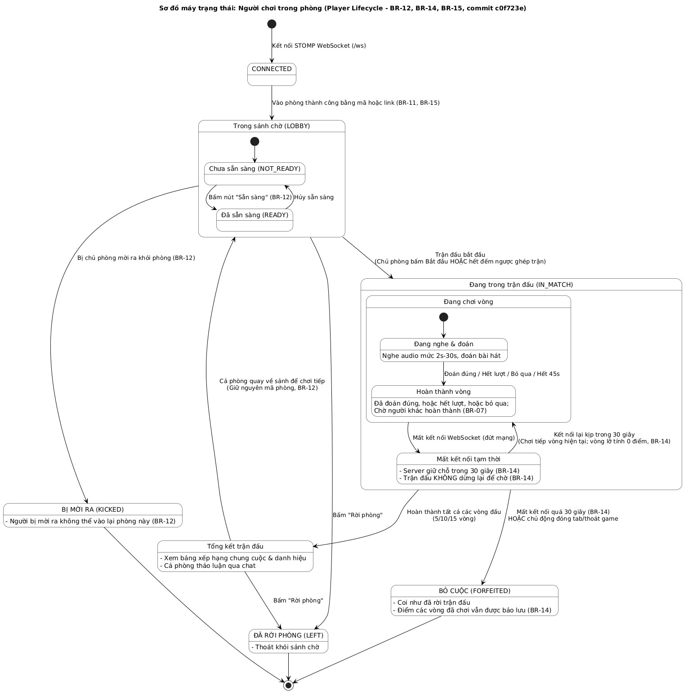
*Hình 5.13: Sơ đồ máy trạng thái người chơi và cơ chế phục hồi rớt mạng 30 giây*

### 5.5. Sơ đồ hoạt động luồng một vòng chơi (Activity Diagram)
Biểu diễn toàn cảnh luồng hoạt động rẽ nhánh từ lúc mở mức nghe, xử lý nghe lại, nhập đáp án, so khớp chuỗi cho đến kết thúc vòng:

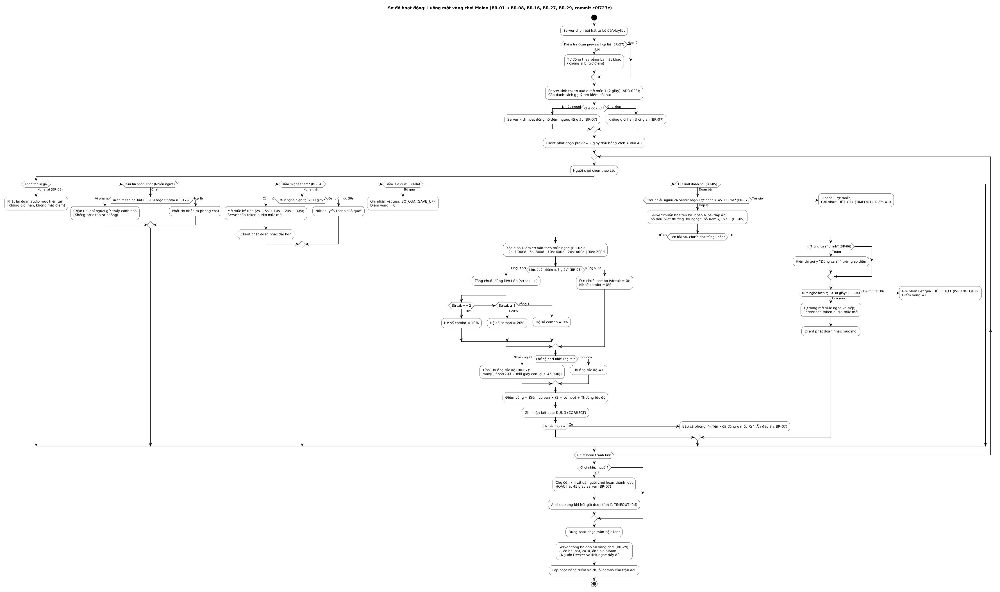
*Hình 5.14: Sơ đồ hoạt động chi tiết luồng xử lý một vòng chơi*

---

# PHẦN VI: THIẾT KẾ CƠ SỞ DỮ LIỆU VÀ TỔ CHỨC LƯU TRỮ

### 6.1. Nguyên tắc thiết kế CSDL và phân quyền module Spring Modulith
1. **Server là trọng tài:** Mọi điểm số lưu trong CSDL đều do server tính toán và thẩm định; không có bất kỳ bảng nào nhận dữ liệu điểm do client tự gửi lên.
2. **Quyền sở hữu độc quyền:** Mỗi bảng trong cơ sở dữ liệu thuộc quyền sở hữu của đúng một module duy nhất. Các module khác không bao giờ được phép `JOIN` hoặc truy vấn trực tiếp bảng của nhau mà phải giao tiếp qua interface Java hoặc sự kiện miền (Spring Modulith).
3. **Tách biệt trạng thái sống ngắn và kết quả bền:** Trạng thái phòng chơi, vòng đấu đang chạy được duy trì hoàn toàn trong RAM (ADR-007). Cơ sở dữ liệu PostgreSQL chỉ lưu trữ kết quả bền vững khi trận đấu hoàn tất.
4. **Quy chuẩn thời gian:** Toàn bộ các trường mốc thời gian sử dụng kiểu `timestamptz` (UTC); riêng ngày của thử thách hàng ngày sử dụng kiểu `date` theo múi giờ Việt Nam (BR-25).

### 6.2. Mô hình quan hệ thực thể ERD tổng thể
Lược đồ quan hệ thực thể gồm **21 bảng dữ liệu** được chuẩn hóa bậc 3 (3NF):

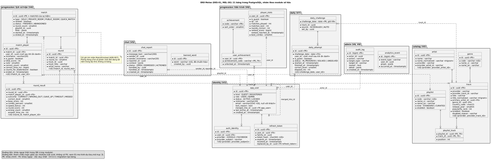
*Hình 6.1: Mô hình thực thể liên kết (Entity-Relationship Diagram - ERD) cơ sở dữ liệu Meloo*

### 6.3. Từ điển dữ liệu chi tiết 21 bảng (Data Dictionary)
Cấu trúc 21 bảng dữ liệu được chuẩn hóa và đồng bộ 100% với tài liệu thiết kế CSDL DES-01 (`docs/architecture/data/02-tu-dien-du-lieu.md`) và quyết định kiến trúc ADR-003:

#### Phân hệ Định danh & Xác thực (`identity` - Migration V2)
1. **`app_user` (Người chơi & Quản trị viên):** `id` (uuid, PK), `kind` (varchar 12, not null, check `GUEST`/`REGISTERED`), `role` (varchar 8, not null default `USER`, check `USER`/`ADMIN`), `status` (varchar 8, not null default `ACTIVE`, check `ACTIVE`/`LOCKED`), `nickname` (varchar 20, not null, char_length 3–20, BR-22), `email` (varchar 254, unique, null với khách), `lock_reason` (text, null, bắt buộc khi `LOCKED`), `locked_at` (timestamptz, null), `merged_into_id` (uuid, FK `app_user(id)`, null, BR-21), `last_active_at` (timestamptz, not null default now(), BR-20).
2. **`auth_identity` (Liên kết nhà cung cấp OAuth):** `id` (uuid, PK), `user_id` (uuid, not null, FK `app_user(id)` on delete cascade), `provider` (varchar 10, not null, check `GOOGLE`/`FACEBOOK`), `provider_subject` (varchar 128, not null). Unique `(provider, provider_subject)`.
3. **`refresh_token` (Phiên làm việc & Token xoay vòng ADR-005):** `id` (uuid, PK), `user_id` (uuid, not null, FK `app_user(id)` on delete cascade), `family_id` (uuid, not null), `token_hash` (char 64, not null, unique - SHA-256), `expires_at` (timestamptz, not null - 30 ngày), `revoked_at` (timestamptz, null), `replaced_by_id` (uuid, FK `refresh_token(id)`, null).

#### Phân hệ Kho nhạc & Danh mục (`catalog` - Migration V3)
4. **`artist` (Nghệ sĩ biểu diễn):** `id` (uuid, PK), `name` (varchar 200, not null), `name_normalized` (varchar 200, not null, GIN `gin_trgm_ops`), `provider` (varchar 16, not null: `DEEZER`, `ITUNES`), `provider_artist_id` (varchar 64, not null). Unique `(provider, provider_artist_id)`.
5. **`genre` (Thể loại âm nhạc):** `id` (uuid, PK), `code` (varchar 40, not null, unique), `name_vi` (varchar 80, not null), `name_en` (varchar 80, not null).
6. **`track` (Bản thu dùng làm đáp án):** `id` (uuid, PK), `provider` (varchar 16, not null), `provider_track_id` (varchar 64, not null - tuyệt đối không lưu URL preview hay audio trên CSDL theo ADR-003:31), `title` (varchar 300, not null), `title_normalized` (varchar 300, not null, GIN `gin_trgm_ops`, BR-05), `primary_artist_id` (uuid, not null, FK `artist(id)`), `genre_id` (uuid, FK `genre(id)`, null), `country_code` (char 2, null), `release_year` (smallint, null), `popularity_rank` (int, null), `enabled` (boolean, not null default true), `disabled_reason` (varchar 200, null). Unique `(provider, provider_track_id)`.
7. **`playlist` (Bộ đề thi đấu):** `id` (uuid, PK), `code` (varchar 60, not null, unique), `name_vi` (varchar 120, not null), `name_en` (varchar 120, not null), `kind` (varchar 10, not null, check `STANDARD`/`CURATED`), `enabled` (boolean, not null default true).
8. **`playlist_track` (Liên kết bài hát vào bộ đề):** `playlist_id` (uuid, PK, FK `playlist(id)` on delete cascade), `track_id` (uuid, PK, FK `track(id)`), `position` (int, not null).

#### Phân hệ Lưu trữ Trận đấu & Tiến trình (`progression` - Migration V4, V6)
9. **`match` (Lịch sử ván đấu):** `id` (uuid, PK - khớp `matchId`), `type` (varchar 16, not null, check `SOLO`/`PRIVATE_ROOM`/`PUBLIC_ROOM`/`QUICK_MATCH`, BR-23), `ranked` (boolean, not null, check `status <> 'ABANDONED' or not ranked`), `status` (varchar 10, not null, check `FINISHED`/`ABANDONED`), `round_count` (smallint, not null, check 5/10/15), `playlist_id` (uuid, null, ref `playlist`), `filter` (jsonb, null), `started_at` (timestamptz, not null), `ended_at` (timestamptz, not null).
10. **`match_player` (Thành viên tham gia trận):** `id` (uuid, PK), `match_id` (uuid, not null, FK `match(id)` on delete cascade), `user_id` (uuid, null, ref `app_user`), `nickname` (varchar 20, not null), `is_guest` (boolean, not null), `total_score` (int, not null), `rank` (smallint, not null, BR-10), `correct_count` (smallint, not null), `correct_time_ms` (bigint, not null), `counts_for_leaderboard` (boolean, not null, BR-20, BR-21), `ended_at` (timestamptz, not null). Unique `(match_id, user_id)`.
11. **`round` (Thông tin từng vòng):** `id` (uuid, PK), `match_id` (uuid, not null, FK `match(id)` on delete cascade), `round_no` (smallint, not null), `track_id` (uuid, not null, ref `track`), `track_title` (varchar, not null), `artist_name` (varchar, not null - chụp lại lúc đấu). Unique `(match_id, round_no)`.
12. **`round_result` (Kết quả vòng của từng người):** `id` (uuid, PK), `round_id` (uuid, not null, FK `round(id)` on delete cascade), `match_player_id` (uuid, not null, FK `match_player(id)` on delete cascade), `outcome` (varchar 10, not null, check `CORRECT`/`WRONG_OUT`/`GAVE_UP`/`TIMEOUT`/`MISSED`), `correct_level` (smallint, null, check 1–5), `base_score` (int, not null, BR-02), `combo_percent` (smallint, not null default 0, check 0/10/20, BR-08), `speed_bonus` (int, not null default 0, BR-07), `round_score` (int, not null, = `base_score` × (1 + `combo_percent`/100) + `speed_bonus`), `wrong_count` (smallint, not null default 0), `answer_time_ms` (int, null). Unique `(round_id, match_player_id)`.
13. **`player_stats` (Chỉ số tích lũy cá nhân):** `user_id` (uuid, PK, ref `app_user`), `is_guest` (boolean, not null), `xp` (int, not null default 0), `matches_played` (int, not null default 0), `matches_won` (int, not null default 0), `rounds_correct` (int, not null default 0), `best_combo` (smallint, not null default 0), `ranked_score` (bigint, not null default 0 - bảng toàn thời gian BR-24), `ranked_reached_at` (timestamptz, null - thời điểm đạt ranked_score hiện tại, bằng điểm thì ai đạt trước xếp trên).
14. **`achievement` (Danh mục huy hiệu):** `code` (varchar 60, PK - điều kiện mở khóa nằm trong code BE-PROG-02, không trong DB), `sort_order` (smallint, not null - tên và mô tả lấy từ file i18n theo code).
15. **`user_achievement` (Huy hiệu người chơi đạt được):** `user_id` (uuid, PK, ref `app_user`), `achievement_code` (varchar 60, PK, FK `achievement(code)`), `unlocked_at` (timestamptz, not null - BR-26: không thu hồi).

#### Phân hệ Thử thách hàng ngày (`daily` - Migration V7)
16. **`daily_challenge` (Bộ đề theo ngày):** `challenge_date` (date, PK - ngày theo giờ Việt Nam, BR-25), `track_id` (uuid, not null, ref `track`), `source` (varchar 10, not null, check `SCHEDULED`/`AUTO` - admin đặt hoặc tự chọn), `set_by` (uuid, null, ref `app_user`).
17. **`daily_attempt` (Lượt chơi thử thách của người dùng):** `id` (uuid, PK), `challenge_date` (date, not null, FK `daily_challenge` - ngày server cấp bài, kể cả khi xong sau 00:00), `user_id` (uuid, null, ref `app_user` - null sau khi ẩn danh), `is_guest` (boolean, not null - khách chơi được nhưng không lên bảng), `status` (varchar 11, not null, check `IN_PROGRESS`/`SOLVED`/`UNSOLVED` - UNSOLVED gồm hết lượt và quá trần 5 phút), `started_at` (timestamptz, not null - server cấp), `finished_at` (timestamptz, null), `correct_level` (smallint, null, check 1–5), `elapsed_ms` (int, null - từ started_at đến lúc đoán đúng). Unique `(challenge_date, user_id)`.

#### Phân hệ Kiểm duyệt & Giao tiếp (`chat`, `admin` - Migration V5, V8, V9)
18. **`banned_word` (Từ điển từ ngữ cấm):** `id` (uuid, PK), `word` (varchar 80, not null, unique, check `word = lower(word)` - chữ thường, Unicode NFC, giữ nguyên dấu tiếng Việt, BR-17, BR-22), `created_by` (uuid, null, ref `app_user`).
19. **`chat_report` (Báo cáo tin nhắn vi phạm):** `id` (uuid, PK), `message_text` (varchar 200, not null, BR-16), `sender_id` (uuid, not null, ref `app_user` - khách bị khóa theo id này, BR-28), `sender_nickname` (varchar 20, not null - chụp lại lúc báo), `reporter_id` (uuid, not null, ref `app_user`), `context` (jsonb, not null default '[]' - 5 tin trước đó), `status` (varchar 10, not null default `OPEN`, check `OPEN`/`DISMISSED`/`ACTIONED`), `handled_by` (uuid, null, ref `app_user`), `handled_at` (timestamptz, null).
20. **`audit_log` (Nhật ký thao tác admin V8, BR-28):** `id` (bigint generated always as identity, PK), `actor_id` (uuid, not null, ref `app_user`), `action` (varchar 40, not null - VD `USER_LOCK`, `USER_UNLOCK`, `BANNED_WORD_ADD`, `TRACK_DISABLE`), `target_type` (varchar 30, not null), `target_id` (varchar 64, null), `reason` (text, null - bắt buộc với USER_LOCK ở ứng dụng), `detail` (jsonb, null), `created_at` (timestamptz, not null default now()). Chỉ thêm, không sửa, không xóa.
21. **`analytics_event` (Số liệu sử dụng cho dashboard V9, FR-16):** `id` (bigint generated always as identity, PK), `event_type` (varchar 40, not null - `GUEST_CREATED`, `USER_REGISTERED`, `MATCH_STARTED`, `MATCH_FINISHED`, `DAILY_ATTEMPT_FINISHED`), `user_id` (uuid, null, ref `app_user` - đặt null khi nhận AccountDeleted), `props` (jsonb, null - VD loại trận), `occurred_at` (timestamptz, not null). **Thời hạn lưu trữ 90 ngày:** Job của module admin chạy hằng ngày xóa dòng có `occurred_at` quá 90 ngày (delete where occurred_at < now() - interval 90 days).
### 6.4. Kế hoạch di trú dữ liệu tự động (Flyway Migration Plan V1 → V9)
Tiến trình di trú schema được phân phiên bản tuần tự rõ ràng qua Flyway:
- **V1:** Thiết lập hạ tầng CSDL ban đầu, kích hoạt extension `uuid-ossp` và hàm tiện ích.
- **V2:** Khởi tạo bảng danh tính `app_user`, `auth_identity`, `refresh_token` và chỉ mục tìm kiếm.
- **V3:** Khởi tạo kho nhạc `artist`, `genre`, `track`, `playlist`, `playlist_track`.
- **V4:** Khởi tạo cấu trúc lưu trữ ván đấu `match`, `match_player`, `round`, `round_result`.
- **V5:** Khởi tạo phân hệ kiểm duyệt `chat_report`, `banned_word`.
- **V6:** Khởi tạo hệ thống tiến trình người chơi `player_stats`, `achievement`, `user_achievement`.
- **V7:** Khởi tạo phân hệ thử thách ngày `daily_challenge`, `daily_attempt`.
- **V8:** Khởi tạo bảng nhật ký kiểm toán quản trị viên `audit_log`.
- **V9:** Khởi tạo phân hệ đo lường số liệu hoạt động `analytics_event`.

---

# PHẦN VII: BỘ CÂU HỎI BẢO VỆ ĐỒ ÁN VÀ HƯỚNG DẪN GIẢI THÍCH

Nhằm phục vụ sinh viên tự tin giải trình và bảo vệ các quyết định thiết kế trước Hội đồng phản biện, dưới đây là bộ câu hỏi trọng tâm kèm gợi ý trả lời chuẩn xác:

### 7.1. Nhóm câu hỏi về Kiến trúc và Lựa chọn công nghệ
**Câu 1: Tại sao lại chọn kiến trúc Modular Monolith thay vì Microservices ngay từ đầu?**
> *Trả lời:* Đề tài có ràng buộc phát triển bởi một lập trình viên duy nhất và triển khai trên máy chủ đám mây miễn phí AWS EC2 `t3.micro` chỉ có 1 GB RAM. Nếu áp dụng Microservices, chi phí bộ nhớ cho nhiều máy ảo Java (JVM), API Gateway và mạng nội bộ sẽ vượt quá giới hạn tài nguyên và dẫn đến treo máy. Kiến trúc Modular Monolith với Spring Modulith cho phép đóng gói toàn bộ miền nghiệp vụ trong một tiến trình duy nhất (tiết kiệm RAM tối đa) nhưng vẫn đảm bảo ranh giới module rõ ràng, tự động kiểm tra vi phạm package bằng công cụ CI (`verify()`) và sẵn sàng tách thành Microservices trong Phase 2 khi quy mô người dùng tăng cao.

**Câu 2: Làm thế nào để đảm bảo tính nhất quán giữa Backend (Java) và Frontend (TypeScript)?**
> *Trả lời:* Dự án áp dụng triệt để phương pháp tiếp cận **Hợp đồng là trên hết (Contract-First)**. Mọi giao tiếp RESTful đều được định nghĩa trước qua OpenAPI 3.1 (`openapi.yaml`) và giao tiếp thời gian thực STOMP qua AsyncAPI 3 (`asyncapi.yaml`). Mã nguồn DTO của Java và client TypeScript được sinh tự động bằng generator tool, kết hợp bộ test tự động kiểm chứng khớp nối (Contract Verification Test). Nhờ đó, backend và frontend luôn hiểu chung một cấu trúc dữ liệu và không xảy ra lỗi lệch trường.

### 7.2. Nhóm câu hỏi về Bảo mật, Phòng chống gian lận và Bản quyền âm thanh
**Câu 3: Làm sao ngăn chặn người chơi gian lận mở Network DevTools để xem trước tên bài hát?**
> *Trả lời:* Theo quyết định kiến trúc ADR-008, server áp dụng nguyên tắc **Zero-Knowledge Client**: metadata bài hát và đáp án không bao giờ gửi về client trước khi vòng đấu kết thúc. URL phát nhạc chỉ là một endpoint trung gian `/api/v1/audio/{token}`. Chuỗi token là mã băm HMAC-SHA256 có thời hạn $\le 2$ phút, không chứa ID bài hay tên bài. Backend đóng vai trò Streaming Proxy, chỉ đọc trực tiếp và cắt đúng dung lượng byte ứng với mức nghe (ví dụ mức 2s chỉ stream khoảng 32 KB dữ liệu MP3) rồi đóng luồng. Trình duyệt không thể tua trước hoặc trích xuất tiêu đề bài hát.

**Câu 4: Vấn đề bản quyền âm thanh được giải quyết thế nào khi phát nhạc trên web?**
> *Trả lời:* Hệ thống chỉ sử dụng các đoạn trích âm thanh ngắn 30 giây (preview) được cấp phát công khai qua API chính thức của nhà cung cấp nhạc hợp pháp (Deezer API). Máy chủ không lưu trữ bất kỳ file MP3 lậu nào trên ổ cứng. Sau mỗi vòng chơi, hệ thống vinh danh bản quyền (BR-29) bằng cách hiển thị tên nghệ sĩ, ảnh album và cung cấp đường dẫn nghe bài hát gốc trên Deezer/Spotify.

### 7.3. Nhóm câu hỏi về Xử lý thời gian thực và Chống tranh chấp dữ liệu (Race Condition)
**Câu 5: Nếu 5 người chơi trong phòng cùng nhấn nút đoán bài trong cùng 1 mili giây thì hệ thống xử lý thế nào?**
> *Trả lời:* Theo quyết định ADR-007, mỗi phòng thi đấu được điều phối bởi một đối tượng `RoomActor` riêng biệt chạy trên luồng ảo (Virtual Thread) với một hàng đợi lệnh tuần tự (`SingleThreadExecutor`). Mọi thao tác đoán bài gửi lên WebSocket STOMP đều được xếp vào hàng đợi này và xử lý lần lượt theo thứ tự thời gian server nhận lệnh. Nhờ đó, hiện tượng tranh chấp điều kiện (Race Condition) bị loại trừ 100%, server phân định người đoán trước/sau một cách hoàn toàn công bằng.

**Câu 6: Nếu người chơi đang trong trận đấu mà bị rớt mạng thì ván chơi có bị gián đoạn không?**
> *Trả lời:* Theo quy tắc BR-14, hệ thống thiết lập cơ chế **Vùng đệm giữ chỗ 30 giây (Disconnection Grace Period)**. Khi một người chơi mất kết nối, trận đấu của các thành viên còn lại vẫn tiếp tục bình thường, không ai phải chờ đợi vô ích (Nguyên tắc 1). Nếu người chơi kết nối lại trong vòng 30 giây, họ sẽ tiếp tục thi đấu ở vòng hiện tại; các vòng bị lỡ được ghi nhận 0 điểm. Nếu quá 30 giây không quay lại, server mới xử lý xử thua (Forfeited) để dọn dẹp tài nguyên.

### 7.4. Nhóm câu hỏi về Thuật toán tính điểm và Luật chơi
**Câu 7: Thuật toán so khớp tên bài hát xử lý thế nào với việc gõ sai chính tả hoặc gõ không dấu?**
> *Trả lời:* Theo quy tắc BR-05, hệ thống áp dụng thuật toán `TitleNormalizer` chuẩn hóa chuỗi hai đầu: chuyển toàn bộ về chữ thường Unicode NFC, loại bỏ toàn bộ dấu thanh tiếng Việt (A-Z không dấu), xóa các ký tự đặc biệt, dấu câu và tự động loại bỏ các phần nội dung phụ trong ngoặc đơn/ngoặc vuông (như 'feat.', 'remix', 'OST', 'official audio'). Người chơi chỉ cần gõ đúng từ ngữ cốt lõi là được công nhận kết quả. Ngoài ra, ô tìm kiếm gợi ý bài hát theo từ khóa giúp giảm thiểu tối đa việc gõ sai chính tả.

**Câu 8: Tại sao phòng chơi riêng tự tạo lại không được tính điểm lên Bảng xếp hạng mùa giải?**
> *Trả lời:* Theo quy tắc BR-23, phòng riêng cho phép chủ phòng tự do chọn bộ đề và mời bạn bè, do đó người chơi rất dễ tạo tài khoản phụ để gian lận hoặc cày điểm trên các bộ đề quen thuộc. Để bảo vệ tính công bằng học thuật và sự trong sạch của bảng xếp hạng, chỉ có các trận đấu ngẫu nhiên do hệ thống điều phối (Ghép trận nhanh) hoặc Chơi đơn bộ chuẩn mới được tính điểm xếp hạng mùa. Tuy nhiên, phòng riêng vẫn lưu lịch sử trận đấu, cộng điểm kinh nghiệm (EXP) và tính huy hiệu bình thường để khuyến khích tinh thần giao lưu nhóm bạn.

---

# PHỤ LỤC: DANH MỤC TÀI LIỆU THAM CHIẾU

1. **[S1] Báo cáo thị trường nghe nhạc số Việt Nam:** Q&Me Vietnam Music Streaming Behavior (2025) & Decision Lab The Connected Consumer Q4/2025.
2. **[S2] Heardle Phenomenon & Spotify Acquisition:** TechCrunch, *'Spotify acquires Heardle, the music trivia game inspired by Wordle'* (12/07/2022).
3. **[S3] Heardle Shutdown Announcement:** Billboard, *'Spotify is Shutting Down Heardle'* (14/04/2023).
4. **[S4] Khảo sát đối thủ cạnh tranh quốc tế:** Nghiên cứu đối thủ trực tiếp SongTrivia.io và SongPop Party (Tài liệu Meloo BIZ-04 / MEL-20).
5. **[S5] Tài liệu Đặc tả Yêu cầu Phần mềm Meloo (SRS v1):** `docs/srs/01-srs.md` & `docs/srs/02-business-rules.md` (DOC-01 / MEL-28).
6. **[S6] Mô hình Use Case & Đặc tả 10 Use Case:** `docs/srs/usecases/` (DOC-02 / MEL-29).
7. **[S7] Tài liệu Thiết kế Kiến trúc Hệ thống Meloo:** `docs/architecture/01-architecture.md` (DOC-04 / MEL-52).
8. **[S8] Thiết kế Cơ sở Dữ liệu & Kế hoạch Migration:** `docs/architecture/data/` (DES-01 / MEL-30).
9. **[S9] Bộ sơ đồ UML Phân tích & Thiết kế Phần mềm:** `docs/uml/` (DOC-03 / MEL-51).
10. **[S10] Tập hợp các Quyết định Kiến trúc (ADR-001..008):** `docs/architecture/adr/`.
