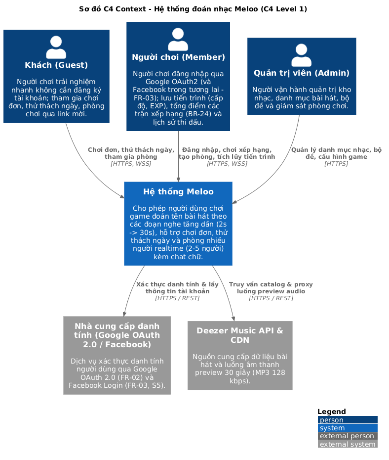
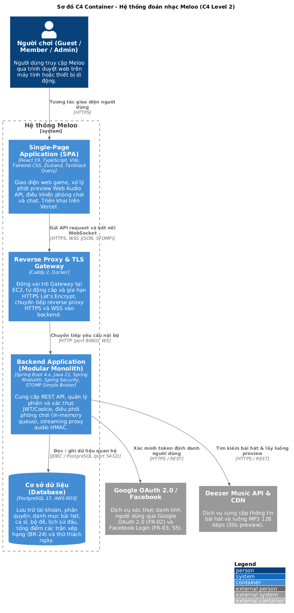
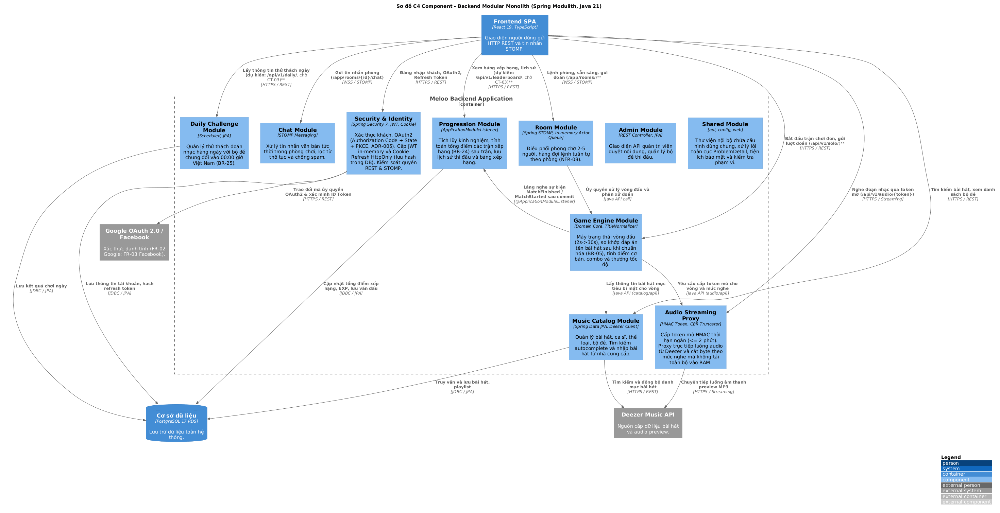

# Sơ đồ C4 - Hệ thống đoán nhạc Meloo

Thư mục này chứa các sơ đồ kiến trúc theo mô hình C4 (Context, Container, Component) của Meloo, phản ánh đúng cấu trúc hiện tại của hệ thống.

## Danh sách sơ đồ

| Cấp độ | Tên sơ đồ | File nguồn | Ảnh xuất | Mô tả |
|---|---|---|---|---|
| **C4 Level 1** | C4 Context | [`c4-context.puml`](c4-context.puml) |  | Bối cảnh hệ thống: Người dùng (Guest, Member, Admin) và các hệ thống bên ngoài (Google OAuth2, Deezer Music). |
| **C4 Level 2** | C4 Container | [`c4-container.puml`](c4-container.puml) |  | Các khối triển khai chính: Frontend SPA (React on Vercel), Reverse Proxy (Caddy on EC2), Backend (Spring Boot 4 on EC2), Cơ sở dữ liệu (PostgreSQL 17 on RDS). |
| **C4 Level 3** | C4 Component | [`c4-component-backend.puml`](c4-component-backend.puml) |  | Cấu trúc bên trong Backend Modular Monolith: các module nghiệp vụ Spring Modulith (`identity`, `catalog`, `audio`, `game`, `room`, `chat`, `progression`, `daily`, `admin`). |

## Cách biên dịch lại sơ đồ
Sử dụng Docker image `plantuml/plantuml`:

```bash
docker run --rm -v "$PWD":/w:z plantuml/plantuml -tpng /w/docs/uml/c4/*.puml
```
