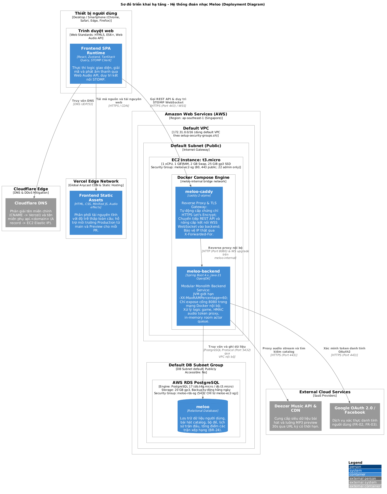

# Sơ đồ triển khai hạ tầng (Deployment Diagram)

Thư mục này chứa sơ đồ triển khai hạ tầng thực tế của Meloo, phản ánh các thành phần điện toán đám mây và kết nối mạng đã thiết lập trong INF-01, ADR-006, các script cấu hình AWS và runbook `docs/runbooks/aws-setup.md`.

## Danh sách sơ đồ

| Tên sơ đồ | File nguồn | Ảnh xuất | Mô tả |
|---|---|---|---|
| **Sơ đồ triển khai hạ tầng** | [`deployment.puml`](deployment.puml) |  | Triển khai phân tán: Vercel (Edge CDN Static Hosting), Cloudflare (DNS), AWS EC2 Singapore (Docker Compose với Caddy Reverse Proxy & Spring Boot Backend), AWS RDS PostgreSQL 17 (Default DB Subnet Group, Public Access = No, SG chỉ nhận 5432 từ EC2) cùng hai dịch vụ ngoài: Deezer và Google OAuth. |

## Các thành phần chính trong hạ tầng

1. **Vercel Edge Network:**
   - Hosting giao diện SPA tĩnh (React, TypeScript, Vite).
   - Tích hợp CI/CD tự động deploy nhánh `main` cho môi trường Production và tạo bản xem trước (Preview) cho mỗi Pull Request.
   - Trỏ tên miền chính qua CNAME DNS Cloudflare.

2. **Cloudflare DNS:**
   - Quản lý DNS và phân giải tên miền chính và tên miền phụ API (`api.<domain>`).
   - Cung cấp lớp bảo vệ DDoS lớp mạng cơ bản.

3. **AWS EC2 (Region `ap-southeast-1` - Singapore):**
   - Loại máy: `t3.micro` (1 vCPU, 1 GB RAM vật lý kèm 2 GB swapfile chống OOM, 25 GiB gp3 SSD theo `aws-setup.md:33,126`).
   - Nằm trong Default VPC (`172.31.0.0/16`) theo `setup-security-groups.sh`.
   - Security Group `meloo-ec2-sg`: Mở cổng công khai 80 (HTTP) và 443 (HTTPS); cổng 22 (SSH) được giới hạn nghiêm ngặt chỉ từ IP quản trị viên.
   - Chạy Docker Compose gồm 2 container trên mạng bridge nội bộ `meloo-internal`:
     - `meloo-caddy`: Gateway proxy, tự động quản lý chứng chỉ SSL Let's Encrypt, chuyển tiếp yêu cầu HTTP REST và nâng cấp kết nối WebSocket STOMP (WSS).
     - `meloo-backend`: Tiến trình Java 21 Spring Boot 4.x đóng kín trong mạng nội bộ, chỉ expose cổng 8080 cho Caddy, cấu hình `-XX:MaxRAMPercentage=60 -XX:+ExitOnOutOfMemoryError` để kiểm soát heap RAM.

4. **AWS RDS (PostgreSQL 17):**
   - Tên cơ sở dữ liệu: `meloo` (theo `aws-setup.md:212` và `env.prod.example`).
   - Đặt trong Default DB Subnet Group (`default`) của Default VPC, không gán Public IP (`Publicly Accessible = No`).
   - Security Group `meloo-rds-sg`: Chỉ chấp nhận kết nối TCP cổng 5432 bắt nguồn từ `meloo-ec2-sg` (cách ly truy cập mạng).
   - Cơ chế sao lưu tự động (Automated Backups) hàng ngày đảm bảo RPO ≤ 24 giờ (NFR-15).
   - *(Ghi chú cải tiến tương lai: khi nâng cấp hệ thống có thể cấu hình Private Subnet chuyên biệt không có Internet Gateway).*

## Cách biên dịch lại sơ đồ
Sử dụng Docker image `plantuml/plantuml`:

```bash
docker run --rm -v "$PWD":/w:z plantuml/plantuml -tpng /w/docs/uml/deployment/*.puml
```
